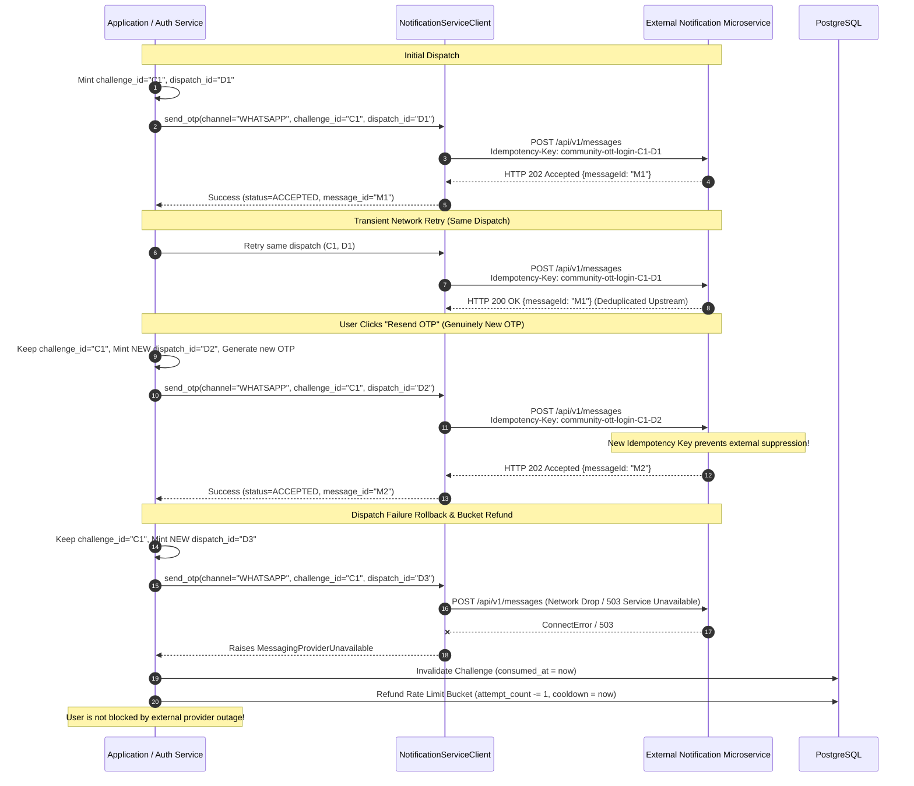
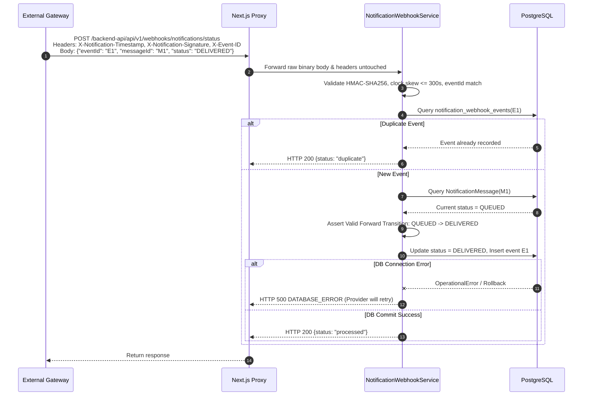
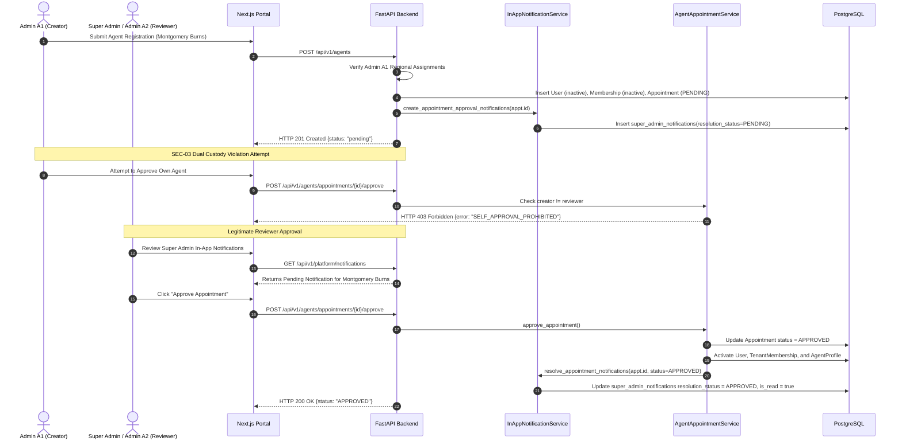

# Authentication and Notification Flow Matrix

**Project Directory:** `D:\AVANFlix\OTT_Agent_App`  
**Last Updated:** October 24, 2026  
**Document Status:** Production Reference  

---

## 1. Complete API Endpoint Matrix

| Method | Public / Proxy Path | Internal Backend Path | Auth Requirement | Role | CSRF Protected | Primary Purpose |
|---|---|---|---|---|---|---|
| `POST` | `/backend-api/api/v1/auth/otp/request` | `/api/v1/auth/otp/request` | Public | None | No | Request new OTP challenge or resend for phone |
| `POST` | `/backend-api/api/v1/auth/otp/verify` | `/api/v1/auth/otp/verify` | Public | None | No | Verify 6-digit OTP code against active challenge |
| `POST` | `/backend-api/api/v1/auth/otp/select-context` | `/api/v1/auth/otp/select-context` | One-Time Token | None | No | Select community context after multi-membership OTP verification |
| `POST` | `/backend-api/api/v1/auth/login` | `/api/v1/auth/login` | Public | None | No | Username/password login; triggers 2FA OTP if required |
| `POST` | `/backend-api/api/v1/auth/logout` | `/api/v1/auth/logout` | Session Cookie | All Roles | Yes | Revokes active session server-side in PostgreSQL |
| `GET` | `/backend-api/api/v1/auth/me` | `/api/v1/auth/me` | Session Cookie | All Roles | No | Inspect current session identity, tenant, and permissions |
| `POST` | `/backend-api/api/v1/webhooks/notifications/status` | `/api/v1/webhooks/notifications/status` | HMAC-SHA256 Signature | Provider | No | Receive provider message delivery status callbacks |
| `GET` | `/backend-api/api/v1/platform/notifications` | `/api/v1/platform/notifications` | Platform Session | `SUPER_ADMIN` | No | List Super Admin pending appointment notifications |
| `POST` | `/backend-api/api/v1/platform/notifications/{id}/read` | `/api/v1/platform/notifications/{id}/read` | Platform Session | `SUPER_ADMIN` | Yes | Mark Super Admin notification as read |
| `POST` | `/backend-api/api/v1/platform/notifications/mark-all-read` | `/api/v1/platform/notifications/mark-all-read` | Platform Session | `SUPER_ADMIN` | Yes | Mark all Super Admin notifications as read |
| `POST` | `/backend-api/api/v1/agents` | `/api/v1/agents` | Session Cookie | `ADMIN` / `SUPER_ADMIN` | Yes | Provision new agent candidate with PENDING appointment |
| `POST` | `/backend-api/api/v1/agents/appointments/{id}/approve` | `/api/v1/agents/appointments/{id}/approve` | Session Cookie | `SUPER_ADMIN` / Independent `ADMIN` | Yes | SEC-03 Dual Custody initial appointment approval |
| `POST` | `/backend-api/api/v1/agents/appointments/{id}/reject` | `/api/v1/agents/appointments/{id}/reject` | Session Cookie | `SUPER_ADMIN` / Independent `ADMIN` | Yes | Reject pending agent appointment |
| `POST` | `/backend-api/api/v1/agents/{id}/lifecycle-requests` | `/api/v1/agents/{id}/lifecycle-requests` | Session Cookie | `ADMIN` / `SUPER_ADMIN` | Yes | Submit lifecycle actions (SUSPEND, TERMINATE, REACTIVATE) for already-approved agents |

---

## 2. Sequence Diagrams

### 2.1 OTP Login & Multi-Community Resolution

```mermaid
sequenceDiagram
    autonumber
    actor User as User
    participant Browser as Browser
    participant Proxy as Next.js Proxy
    participant FastAPI as FastAPI Backend
    participant Repo as Auth Repository
    participant DB as PostgreSQL

    User->>Browser: Enter Mobile Number (+919876543210)
    Browser->>Proxy: POST /backend-api/api/v1/auth/otp/request
    Proxy->>FastAPI: Forward OTP Request
    FastAPI->>DB: Check Abuse Bucket & Store Challenge
    FastAPI-->>Browser: HTTP 200 {challenge_id: "CID-1", cooldown: 60}
    User->>Browser: Enter 6-digit OTP
    Browser->>Proxy: POST /backend-api/api/v1/auth/otp/verify {challenge_id: "CID-1", otp: "123456"}
    Proxy->>FastAPI: Forward Verification
    FastAPI->>Repo: verify_otp() & resolve_contexts_for_mobile()
    Repo->>DB: Query TenantMemberships & Roles for Mobile
    DB-->>Repo: Returns 2 Contexts: [Alpha (ADMIN), Beta (MEMBER)]
    FastAPI-->>Browser: HTTP 200 {verification_token: "VTOK-ABC", requires_context_selection: true, contexts: [...]}
    User->>Browser: Select "Community Alpha (ADMIN)"
    Browser->>Proxy: POST /backend-api/api/v1/auth/otp/select-context {verification_token: "VTOK-ABC", tenant_id: "t1-uuid"}
    Proxy->>FastAPI: Forward Selection
    FastAPI->>Repo: Create AuthSession with token_digest in PostgreSQL
    FastAPI-->>Proxy: Set-Cookie: community_session=...; HttpOnly; SameSite=Lax
    Proxy-->>Browser: Session Established (Redirect to /admin/dashboard)
```

### 2.2 Outbound Dispatch & Idempotency Key Handling



### 2.3 Webhook Delivery Tracking & Monotonic State Progression



### 2.4 Agent Registration, In-App Notification & Dual-Custody Approval



---

## 3. Status Transitions & Invariant Matrices

### 3.1 OTP Challenge Lifecycle States

| State | `consumed_at` | `verified_at` | `expires_at` | Valid Actions |
|---|---|---|---|---|
| **`ACTIVE`** | `None` | `None` | `> now` | `verify_otp` (up to 5 attempts), `request_otp` (resend with new `dispatch_id`) |
| **`EXPIRED`** | `None` | `None` | `<= now` | Ineligible for verification; user must request new OTP |
| **`CONSUMED_LOCKED`** | Set to `now` | `None` | Any | 5 failed attempts reached; challenge atomically consumed |
| **`VERIFIED`** | Set to `now` | Set to `now` | Any | Context selection or immediate session creation |
| **`DISPATCH_FAILED`** | Set to `now` | `None` | Set to `now` | External provider failed; unusable challenge invalidated immediately |

### 3.2 Notification Message Monotonic Progression

| Current Status | Target Status | Permitted? | Invariant Rule |
|---|---|---|---|
| `QUEUED` | `DISPATCHED` | Yes | Outbound HTTP request accepted by provider |
| `DISPATCHED` | `DELIVERED` | Yes | Webhook reports successful provider delivery |
| `DELIVERED` | `READ` | Yes | Webhook reports recipient read receipt |
| `DELIVERED` | `QUEUED` | **No** | Regressive webhook rejected; state remains `DELIVERED` |
| `DELIVERED` | `DISPATCHED` | **No** | Regressive webhook rejected; state remains `DELIVERED` |
| `READ` | `DELIVERED` | **No** | Regressive webhook rejected; state remains `READ` |
| `FAILED` | Any | **No** | Terminal failure cannot be undone |
| `REJECTED` | Any | **No** | Terminal provider rejection cannot be undone |

### 3.3 Security Invariants & Failure Handling

| Fault Scenario | Trigger Condition | System Defense & Response |
|---|---|---|
| **Brute Force OTP Guessing** | $>5$ incorrect attempts | Challenge atomically marked `consumed_at = now`; subsequent attempts rejected with `attempts_remaining: 0`. |
| **OTP SMS Flooding** | Multiple requests within 60s | Blocked by `SQLAlchemyOtpAbuseGuard` with `HTTP 429 Too Many Requests` (`retry_after_seconds`). |
| **Provider Network Outage** | External service times out or returns 503 | Challenge invalidated, rate bucket attempt refunded, cooldown cleared; `HTTP 503` returned. |
| **Webhook Signature Forgery** | Tampered body or invalid signature | HMAC-SHA256 mismatch yields `HTTP 401 Unauthorized` without modifying DB. |
| **Webhook Replay Attack** | Re-sending captured webhook request | Timestamp skew $>300$s fails with `HTTP 400`; duplicate event ID returns idempotent `HTTP 200 {"status": "duplicate"}`. |
| **Self-Approval (SEC-03)** | Agent creator attempts to approve agent | Rejected with `HTTP 403 Forbidden` (`SELF_APPROVAL_PROHIBITED`). |
| **Lifecycle Reactivate Bypass** | Attempting `REACTIVATE` on unapproved agent | Rejected with `HTTP 400 Bad Request` (`APPOINTMENT_NOT_APPROVED`). |
| **Session Cookie Hijacking** | Database leakage of session tokens | Database stores only `sha256(raw_token)`; raw cookie tokens cannot be recovered from database dumps. |

