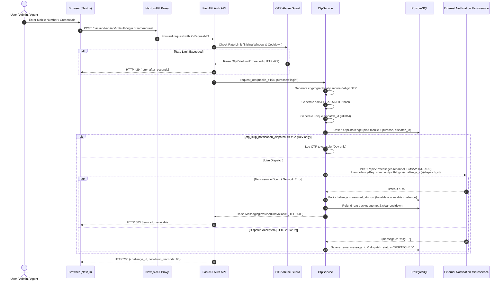
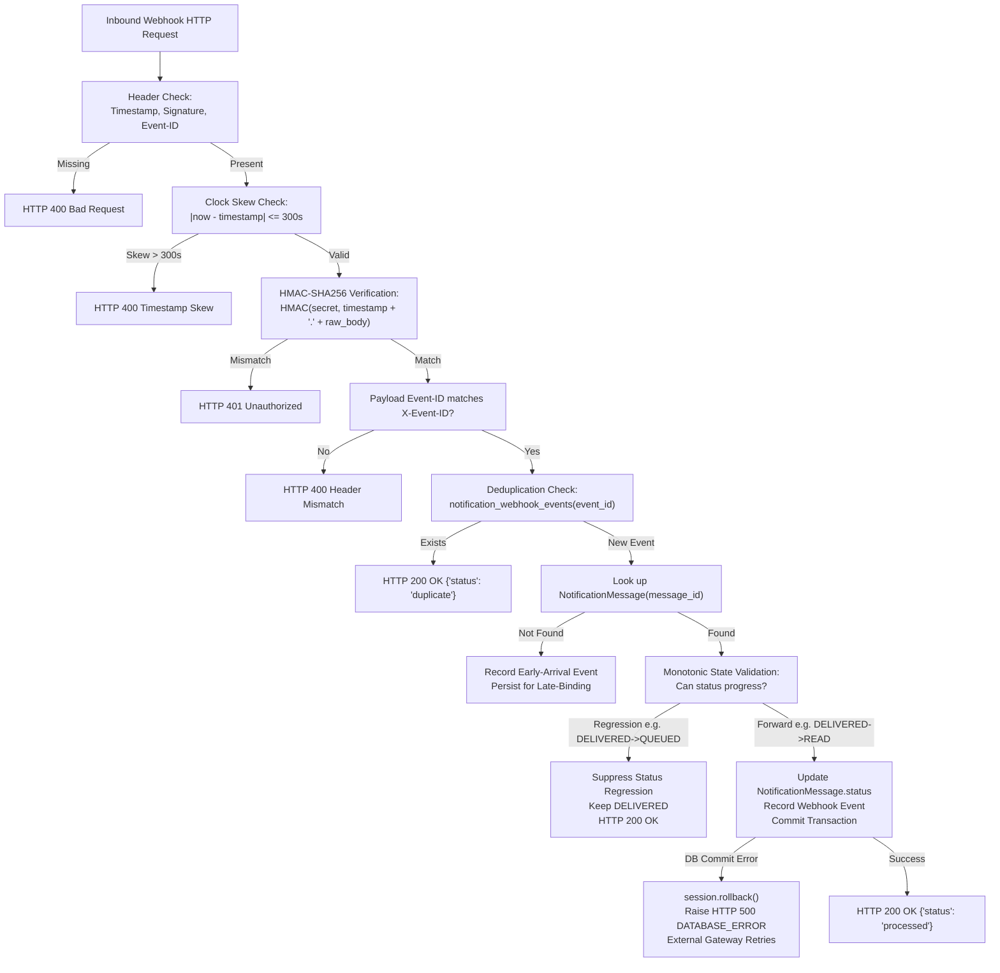

# Current Authentication and Notification Workflow

**Project Directory:** `D:\AVANFlix\OTT_Agent_App`  
**Architecture:** Next.js 14 Frontend + FastAPI (Python 3.12) Backend + PostgreSQL + Cloudflare R2 Storage  
**Last Updated:** October 24, 2026  
**Document Status:** Production Reference  

---

## 1. Overview & Architecture Summary

The Community OTT platform provides a multi-tenant operational environment for community-level video streaming services. It supports three primary administrative and operational roles:
- **`SUPER_ADMIN` (Platform Operator):** Global platform administrator with multi-tenant oversight and approval authority.
- **`ADMIN` (Community Administrator):** Local administrator managing agents, customers, and operations within a specific community tenant.
- **`AGENT` (Community Agent):** Field representative operating in assigned geographic sectors.

Authentication and notifications are decoupled into specialized subsystems:
1. **Pre-Authentication Phone Verification & Login:** Phone-bound OTP verification that resolves cross-community memberships before creating tenant-bound or platform-bound authenticated sessions.
2. **External Notification Microservice Client:** Asynchronous HTTP/HTTPS client dispatching SMS, WhatsApp, and Email alerts via an external notification service.
3. **Inbound Notification Webhook Status Reconciliation:** Authenticated webhook endpoint capturing asynchronous delivery status callbacks from providers.
4. **Internal Super Admin In-App Notifications:** Transactional database-persisted notifications for administrative appointment approvals.
5. **Session Management & Dual-Custody RBAC:** Cryptographically hashed session tokens (`sha256`), CSRF protection, and SEC-03 dual-custody approval workflows.

---

## 2. Login and OTP Workflow

### 2.1 Password-First Two-Factor Login & Direct OTP Login

The platform supports two authentication pathways:
1. **Direct Phone Login:** The user enters their E.164 phone number (`+91...`).
2. **Password + Two-Factor Challenge:** The user submits username and password via `POST /api/v1/auth/login`. If valid and two-factor authentication is required, an OTP challenge is dispatched to the user's verified phone number stored in PostgreSQL.

### 2.2 OTP Resend, Retry, and Idempotency Key Architecture

To prevent duplicate SMS/WhatsApp messages while ensuring new OTPs are never suppressed by external gateways:
- **Same Dispatch Retry:** If an outbound HTTP request fails transiently (network drop), retrying the *same* dispatch reuses the exact same `Idempotency-Key: community-ott-{purpose}-{challenge_id}-{dispatch_id}`. Upstream providers safely deduplicate.
- **Genuinely New OTP Resend:** When the user clicks "Resend OTP", a new 6-digit OTP is generated. `existing_challenge.dispatch_id` is updated to a newly minted UUID, while maintaining the same `challenge_id`. The new idempotency key `community-ott-{purpose}-{challenge_id}-{new_dispatch_id}` guarantees the external provider will **not** suppress the new OTP message.
- **Failure Recovery & Bucket Refund:** If dispatch fails (external service timeout, 401, 500, or network drop), the system:
  1. Immediately invalidates the newly generated OTP challenge (`consumed_at = now`, `expires_at = now`, `dispatch_status = "FAILED"`).
  2. Decrements the rate bucket `attempt_count` and resets `cooldown_until = now`.
  3. The user is never left waiting for an OTP that was never dispatched, and is not locked out by a 60-second cooldown caused by an upstream provider outage.

### 2.3 Attempt Limits and Atomic Lockout

- **Uniform Attempt Limit:** The system enforces a strict limit of **5 failed attempts** across configuration, repository, and service layers.
- **Atomic Decrement:** Every incorrect OTP verification increments `failed_attempts` and returns `attempts_remaining = 5 - failed_attempts`.
- **Atomic Lockout:** On the 5th failed attempt, the challenge is immediately and atomically consumed (`consumed_at = now`, `attempts_remaining = 0`). Any subsequent attempts against this challenge are rejected as invalid.

### 2.4 Multi-Community & Multi-Role Context Selection

In a multi-tenant platform, an individual's phone number may belong to multiple community tenants or serve as both a platform operator and a community administrator.
1. Pre-auth OTP verification is phone-bound (`mobile_e164 + purpose`).
2. Once the OTP is successfully verified via `POST /api/v1/auth/otp/verify`:
   - If the phone belongs to a single active membership, a session is established immediately.
   - If the phone belongs to multiple communities or roles, `resolve_contexts_for_mobile()` returns all eligible contexts (`SUPER_ADMIN`, `ADMIN`, `AGENT`, `MEMBER`).
   - The frontend prompts the user to select the target community context, calling `POST /api/v1/auth/otp/select-context` with the one-time `verification_token`.
   - The backend validates the token, asserts active status across `User`, `TenantMembership`, and `Tenant`, and creates the scoped `AuthSession`.

---

## 3. External Notification Microservice Integration

### 3.1 Client Implementation & Contracts

FastAPI communicates with the external notification service via [`NotificationServiceClient`](file:///d:/AVANFlix/OTT_Agent_App/backend/app/modules/messaging/notification_service.py).
- **Target Endpoint:** `POST ${NOTIFICATION_SERVICE_BASE_URL}/api/v1/messages`
- **Authentication Header:** Configurable header, typically `X-API-Key: ${NOTIFICATION_SERVICE_API_KEY}`.
- **Idempotency Key:** `Idempotency-Key: community-ott-{purpose}-{challenge_id}-{dispatch_id}`.

### 3.2 Supported Channels

| Channel | Method | Message Types | Payload Format |
|---|---|---|---|
| **`WHATSAPP`** | `send_otp` / `send_notification` | `LOGIN_OTP`, `AGENT_APPROVAL` | `TEMPLATE` with `templateName: "otp_verification"` and template parameters `code`, `minutes`. |
| **`SMS`** | `send_otp` / `send_notification` | `LOGIN_OTP`, `SYSTEM_ALERT` | `TEXT` with fallback text content: `"Your Community OTT verification code is {otp}. Valid for 5 minutes."` |
| **`EMAIL`** | `send_email` | `ACCOUNT_UPDATE`, `APPOINTMENT_NOTICE` | `TEXT` or `TEMPLATE` with `recipient`, `subject`, and content body. |

### 3.3 Error Classification & Fail-Closed Behavior

The notification client translates upstream HTTP and network responses into explicit domain exceptions:
- **`200 OK` / `202 Accepted`:** Parsed into `NotificationDispatchResult(success=True, status="ACCEPTED", message_id="...")`.
- **`401 / 403 Forbidden`:** Raises `MessagingProviderRejected("Notification service authorization rejected.")`.
- **`422 / 400 Bad Request`:** Raises `MessagingProviderRejected("Notification service rejected request schema.")`.
- **`5xx / Timeout / ConnectError`:** Raises `MessagingProviderUnavailable("The notification service is temporarily unavailable.")`.
- **Fail-Closed Policy:** During login and critical security operations, provider failures fail closed (returning HTTP 503 to the client) without issuing session cookies.

---

## 4. Inbound Webhook Delivery Reconciliation

### 4.1 Ingress Paths & Next.js Proxy Forwarding

The platform supports two public ingress pathways for notification status callbacks:
1. **Direct Backend Ingress (e.g., Cloudflare Tunnel / Public Reverse Proxy):**
   - Public Endpoint: `POST https://<domain-or-tunnel>/api/v1/webhooks/notifications/status`
   - Configured via: `NOTIFICATION_WEBHOOK_CALLBACK_URL` in `backend/.env`.
   - Used during local development and testing with secure HTTPS tunnels (e.g. `https://generations-conference-during-fold.trycloudflare.com/api/v1/webhooks/notifications/status`).
2. **Next.js Unified Gateway Proxy:**
   - Public Endpoint: `POST https://<domain>/backend-api/api/v1/webhooks/notifications/status`
   - The Next.js route handler (`frontend/src/app/backend-api/[...path]/route.ts`):
     - Reads raw binary body as an `ArrayBuffer` without JSON parsing, ensuring zero whitespace tampering.
     - Forwards the exact raw payload and cryptographic headers (`X-Notification-Timestamp`, `X-Notification-Signature`, `X-Event-ID`) to FastAPI (`POST http://localhost:8000/api/v1/webhooks/notifications/status`).

> [!NOTE]
> Probing the external microservice at `handorg.duckdns.org` revealed that it does not provide self-service REST APIs to dynamically register or modify tenant callback URLs. Webhook subscriber registration must be configured statically on host `201.18.216.70` by the external server administrator.

### 4.2 FastAPI Webhook Verification & Processing

FastAPI's [`NotificationWebhookService`](file:///d:/AVANFlix/OTT_Agent_App/backend/app/modules/messaging/webhook_service.py) processes the incoming event:

### 4.3 Monotonic Status Progression

Message states progress monotonically to prevent out-of-order race conditions:
$$\text{QUEUED} \longrightarrow \text{DISPATCHED} \longrightarrow \text{DELIVERED} \longrightarrow \text{READ}$$
Terminal failure states ($\text{FAILED}, \text{REJECTED}, \text{BOUNCED}$) can never be transitioned back into $\text{QUEUED}$ or $\text{DISPATCHED}$.

### 4.4 Database Rollback on Failure

If an unexpected database error occurs during event recording or message status updating, the transaction is cleanly rolled back and an `HTTP 500 DATABASE_ERROR` is returned. This signals the external notification microservice to retain the event in its queue and retry later.

---

## 5. Registration and SEC-03 Dual-Custody Approval

### 5.1 Community Agent Provisioning Workflow

1. **Admin Initiates Agent Creation:** An administrator in Community A accesses `/admin/employees/add` and submits the agent candidate form.
2. **KYC Document Upload:** Agent KYC documents (Profile Photo, Aadhaar, PAN) are uploaded directly to Cloudflare R2 storage via signed upload URLs. Identity numbers are encrypted with AES-256-GCM.
3. **Regional Assignment Enforcement:** The creating admin's regional assignments (`UserRegionAssignment`) are validated; admins cannot assign agents to regions outside their authorized territory.
4. **Initial Candidate State:**
   - `User.status = "inactive"`
   - `TenantMembership.status = "inactive"`
   - `AccountCredential.status = "inactive"`
   - `AgentAppointment.status = "PENDING"`
5. **Login Gating:** The candidate cannot log in, request OTPs, or access any protected routes while the appointment remains `PENDING`.

### 5.2 SEC-03 Dual Custody Enforcement

Initial agent activation **must** occur through the dedicated appointment approval endpoint:
`POST /api/v1/agents/appointments/{id}/approve` (or `/agent-appointments/{id}/approve`).

The system enforces strict dual-custody invariants:
- **Self-Approval Prohibited:** The administrator who created the agent candidate cannot approve their own candidate (`SELF_APPROVAL_PROHIBITED`, HTTP 403). Approval must be performed by an independent administrator or Super Admin.
- **No Direct Reactivation:** The lifecycle endpoint `POST /api/v1/agents/{id}/lifecycle-requests` cannot be used to bypass initial appointment approval. Submitting a `REACTIVATE` action against an unapproved agent candidate fails with `APPOINTMENT_NOT_APPROVED` (HTTP 400).
- **Post-Approval Activation:** Upon independent approval, `AgentAppointment.status` transitions to `APPROVED`, and `User.status`, `TenantMembership.status`, and `AgentProfile.status` transition to `active`.

---

## 6. Super Admin In-App Notifications

### 6.1 Subsystem Design

Super Admin in-app notifications are strictly internal administrative records stored in PostgreSQL via the `super_admin_notifications` table. They are completely separate from external SMS/WhatsApp notifications.

### 6.2 Lifecycle Hooks & Transactional Updates

- **Creation:** When an agent appointment is submitted, `InAppNotificationService.create_appointment_approval_notifications()` creates a notification record linked to `appointment_id` with `resolution_status = "PENDING"`.
- **Delivery:** The Super Admin dashboard header polls `/backend-api/api/v1/platform/notifications` every 25 seconds, rendering unread counts and high-priority badges.
- **Resolution:** When the Super Admin clicks "Approve" or "Reject", `InAppNotificationService.resolve_appointment_notifications()` marks `resolution_status = "APPROVED"` or `"REJECTED"`, records `resolved_at`, and marks `is_read = true`.

---

## 7. Session Security and CSRF Protection

- **Token Storage:** Raw session tokens are never stored in the database. Only their cryptographic digest `sha256(raw_token)` is persisted in `AuthSession.token_digest`.
- **Cookie Security:**
  - Name: `community_session` (tenants) or `community_platform_session` (Super Admin).
  - Flags: `HttpOnly`, `SameSite=Lax`, `Path=/backend-api/api/v1`.
  - In production and staging, `Secure=True` is strictly required.
- **CSRF Token:** Mutations (`POST`, `PUT`, `DELETE`, `PATCH`) require the matching `x-csrf-token` header.
- **Server-Side Revocation:** Calling `POST /api/v1/auth/logout` revokes the session record in PostgreSQL by deleting or setting `revoked_at = now`. Subsequent requests with the raw token fail closed.

---

## 8. Production Configuration & Fail-Closed Guardrails

All configuration is managed through Pydantic `Settings` in [`backend/app/core/config.py`](file:///d:/AVANFlix/OTT_Agent_App/backend/app/core/config.py). When `ENVIRONMENT` is set to `production` or `staging`, the application enforces fail-closed validation on startup:

| Setting | Required Production Value | Failure Consequence |
|---|---|---|
| `OTP_SKIP_NOTIFICATION_DISPATCH` | `False` | Startup aborted (`ValueError`). Real notifications cannot be bypassed. |
| `OTP_LOG_TO_CONSOLE` | `False` | Startup aborted (`ValueError`). OTPs cannot leak into server logs. |
| `DEVELOPMENT_STATIC_OTP_ENABLED` | `False` | Startup aborted (`ValueError`). Static OTPs are strictly prohibited. |
| `NOTIFICATION_SERVICE_BASE_URL` | `https://...` | Startup aborted (`ValueError`). Cleartext HTTP is forbidden. |
| `MESSAGING_API_BASE_URL` | `https://...` | Startup aborted (`ValueError`). Cleartext HTTP is forbidden. |
| `FRONTEND_ORIGINS` | Explicit HTTPS origins | Startup aborted (`ValueError`). Wildcards or missing origins prohibited. |
| `DATABASE_URL` | PostgreSQL URL (`postgresql+psycopg://...`) | Startup aborted. SQLite is forbidden in production/staging. |
| `NOTIFICATION_WEBHOOK_CALLBACK_URL` | `https://...` (if specified) | Startup aborted (`ValueError`). Cleartext HTTP callback URL is strictly forbidden in production/staging. |
| `AUTH_SESSION_COOKIE_SECURE` | `True` | Insecure cookies rejected. |

