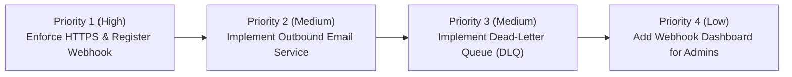

# READ-ONLY AUDIT: Community OTT Notification Flow and Webhook Verification

**Project Directory:** `D:\AVANFlix\OTT_Agent_App`  
**Audit Date:** October 24, 2026  
**Auditor Mode:** Read-Only Static and Architectural Verification  
**Applicable Scope:** In-App Super Admin Notifications, Outbound Notification Microservice Integration, Inbound Webhook Status Reconciliation, Proxy Forwarding, and Production Safeguards.

---

## 1. Executive Summary & Verdicts

This audit evaluates the end-to-end notification architecture of the Community OTT platform. It verifies whether notifications are properly generated, routed, delivered, and reconciled, and checks whether any development shortcuts or mock paths leak into production environments.

### System-Wide Verdict: `PARTIALLY CONNECTED`

While the core codebase, database models, Next.js proxy, and cryptographic webhook verification pipelines are **fully and correctly implemented** in software, external outbound notification delivery is currently **bypassed locally by configuration** (`OTP_SKIP_NOTIFICATION_DISPATCH=true`), and external endpoint reachability/configuration remains **unverifiable from code alone**.

```
+----------------------------------------------------------------------------------------------------+
|                                    SUBSYSTEM AUDIT VERDICTS                                        |
+------------------------------------------------------+---------------------------------------------+
| Subsystem Flow                                       | Audit Verdict                               |
+------------------------------------------------------+---------------------------------------------+
| 1. Super Admin In-App Notifications                  | CORRECT                                     |
| 2. Outbound OTP / WhatsApp / SMS Dispatch            | CORRECT (Safely Guarded Local Dev Bypass)   |
| 3. Inbound Delivery Status Webhook Processing        | CORRECT                                     |
| 4. Next.js Webhook Proxy Transparency                | CORRECT                                     |
| 5. Production Environment Hardening & Guardrails    | CORRECT                                     |
| 6. Production External Microservice Connectivity     | UNVERIFIABLE FROM REPOSITORY                |
+------------------------------------------------------+---------------------------------------------+
```

### Key Findings Summary

1. **Super Admin In-App Notifications (`CORRECT`):**
   - The Super Admin notification subsystem is an **internal administrative workflow** and is **not intended** to send external SMS/WhatsApp/email alerts.
   - It is persisted in PostgreSQL via [`SuperAdminNotification`](file:///d:/AVANFlix/OTT_Agent_App/backend/app/modules/notifications/models.py#L14-L61) and managed transactionally with agent appointment submissions, approvals, rejections, and cancellations.
   - Delivered to the Super Admin UI through Next.js proxy endpoints (`/backend-api/api/v1/platform/notifications*`) and rendered in real-time via [`SuperAdminNotifications.tsx`](file:///d:/AVANFlix/OTT_Agent_App/frontend/src/components/SuperAdminNotifications.tsx#L40-L245) with auto-refresh polling (25s interval), unread counters, and direct appointment review navigation.

2. **Outbound Notification Dispatch (`CORRECT` with Local Dev Bypass):**
   - Production OTP delivery is architected to dispatch strictly to the external Notification Microservice via [`NotificationServiceClient.send_otp`](file:///d:/AVANFlix/OTT_Agent_App/backend/app/modules/messaging/notification_service.py#L125-L230) over HTTP/HTTPS with `X-API-Key` and RFC-compliant, stable `Idempotency-Key` headers (`community-ott-login-<challenge_id>`).
   - In the active development configuration (`backend/.env`), two development flags are active:
     - `OTP_LOG_TO_CONSOLE=true` (prints OTP and non-sensitive challenge ID to backend terminal).
     - `OTP_SKIP_NOTIFICATION_DISPATCH=true` (skips the outbound HTTP request to avoid external 429 provider rate limits during local UI/agent testing).
   - **Production Safety:** These bypasses are protected by strict Pydantic model validators in [`Settings.validate_production_settings`](file:///d:/AVANFlix/OTT_Agent_App/backend/app/core/config.py#L380-L425). If `ENVIRONMENT` is `production` or `staging`, setting either flag to `true` causes the FastAPI application startup to immediately abort with a fatal validation error.

3. **Inbound Webhook Status Reconciliation (`CORRECT`):**
   - Webhook processing in [`NotificationWebhookService.process_webhook`](file:///d:/AVANFlix/OTT_Agent_App/backend/app/modules/messaging/webhook_service.py#L104-L248) provides production-grade security:
     - Cryptographic verification via HMAC-SHA256 (`timestamp + "." + raw_body`, `NOTIFICATION_WEBHOOK_SECRET`).
     - Replay prevention window ($\le 300$ seconds).
     - Strict matching between the `X-Event-ID` header and payload `eventId`.
     - Idempotent deduplication against `notification_webhook_events`.
     - Monotonic terminal state progression (`DELIVERED -> READ` only; terminal failures cannot be reverted).
     - Out-of-order event reconciliation for early-arriving webhooks.
   - The Next.js catch-all proxy in [`frontend/src/app/backend-api/[...path]/route.ts`](file:///d:/AVANFlix/OTT_Agent_App/frontend/src/app/backend-api/[...path]/route.ts#L228-L290) explicitly proxies `/backend-api/api/v1/webhooks/notifications/status` byte-for-byte, preserving raw binary bodies and custom headers (`X-Notification-Timestamp`, `X-Notification-Signature`, `X-Event-ID`).

4. **External Microservice Connectivity (`UNVERIFIABLE FROM REPOSITORY`):**
   - The configured microservice endpoint `http://handorg.duckdns.org/notifications` uses an unencrypted `http://` scheme in `.env`, which is permitted in development but rejected by production validators (which mandate HTTPS).
   - Whether the external microservice is live, healthy, reachable across network firewalls, and properly configured to forward status webhooks to this application's public URL cannot be established from repository inspection alone.

---

## 2. End-to-End Architecture & Flow Diagrams

The following Mermaid diagram maps the three distinct notification subsystems:
1. **Super Admin In-App Notifications (Internal PostgreSQL Flow)**
2. **Outbound OTP Microservice Integration (External Gateway Flow)**
3. **Inbound Notification Webhook Status Reconciliation (Webhook Ingestion Flow)**

```mermaid
flowchart TD
    subgraph Flow1 ["Flow 1: Super Admin In-App Notification (Internal DB)"]
        A1["Admin / Operator creates Agent"] --> B1["FastAPI: POST /api/v1/agents"]
        B1 --> C1["DB: Insert Agent & AgentAppointment (PENDING)"]
        C1 --> D1["InAppNotificationService.create_appointment_approval_notifications()"]
        D1 --> E1[("PostgreSQL: super_admin_notifications<br/>(is_read=false, resolution_status=PENDING)")]
        
        F1["Super Admin Browser / UI"] -->|"Polls every 25s"| G1["Next.js Proxy: GET /backend-api/api/v1/platform/notifications"]
        G1 --> H1["FastAPI: GET /api/v1/platform/notifications"]
        H1 --> E1
        E1 --> I1["SuperAdminNotifications.tsx<br/>Renders Bell Badge & Popover"]
        
        I1 -->|"Click Review / Approve"| J1["Super Admin Approves Appointment"]
        J1 --> K1["InAppNotificationService.resolve_appointment_notifications()<br/>Updates resolution_status=APPROVED"]
    end

    subgraph Flow2 ["Flow 2: Outbound Notification Dispatch (External Microservice)"]
        A2["User requests OTP Login"] --> B2["FastAPI: OtpService.request_otp()"]
        B2 --> C2["Generate cryptographically secure 6-digit OTP"]
        C2 --> D2[("DB: Salt & Hash OTP in otp_challenges<br/>(status=PENDING)")]
        
        D2 --> E2{"Config Check:<br/>otp_skip_notification_dispatch?"}
        E2 -->|"true (Development Only)"| F2["OtpService logs OTP to Console<br/>Records metadata SKIPPED_LOCAL<br/>Skips Outbound HTTP"]
        
        E2 -->|"false (Production / Live Dev)"| G2["NotificationServiceClient.send_otp()"]
        G2 --> H2["Format Idempotency-Key:<br/>community-ott-login-CHALLENGE_ID"]
        H2 --> I2["POST ${NOTIFICATION_SERVICE_BASE_URL}/api/v1/messages<br/>Headers: X-API-Key, Idempotency-Key"]
        I2 --> J2["External Notification Microservice<br/>(handorg.duckdns.org)"]
        J2 --> K2["External Gateway (WhatsApp / SMS)"]
    end

    subgraph Flow3 ["Flow 3: Inbound Status Webhook Reconciliation"]
        A3["External Gateway emits delivery event"] --> B3["External Microservice sends Webhook POST"]
        B3 -->|"POST /backend-api/api/v1/webhooks/notifications/status"| C3["Next.js Catch-All Proxy<br/>(Preserves raw byte body & headers)"]
        C3 -->|"Forwards byte-for-byte"| D3["FastAPI: POST /api/v1/webhooks/notifications/status"]
        D3 --> E3["NotificationWebhookService.process_webhook()"]
        
        E3 --> F3{"Verify HMAC-SHA256 Signature<br/>& Timestamp <= 300s"}
        F3 -->|"Invalid"| G3["Reject 401 / 400 Bad Request"]
        F3 -->|"Valid"| H3{"Check Idempotency in<br/>notification_webhook_events"}
        H3 -->|"Already Processed"| I3["Return 200 OK (DUPLICATE)"]
        H3 -->|"New Event"| J3[("Update notification_logs status<br/>QUEUED -> SENT -> DELIVERED -> READ")]
        J3 --> K3["Insert into notification_webhook_events"]
        K3 --> L3["Return 200 OK (PROCESSED)"]
    end
```



---

## 3. Comprehensive Verification Matrix

| Flow Step | Implementation File & Symbol | Expected Specification | Observed Code Implementation | Evidence & Code References | Verdict |
| :--- | :--- | :--- | :--- | :--- | :--- |
| **1. In-App Notification Schema** | [`backend/app/modules/notifications/models.py`](file:///d:/AVANFlix/OTT_Agent_App/backend/app/modules/notifications/models.py) <br/>`SuperAdminNotification` | Dedicated table for approval notifications with tenant scoping, read state, resolution state, and deduplication. | Model defined with `recipient_operator_id`, `appointment_id`, `agent_profile_id`, `event_type`, `is_read`, `resolution_status`, and unique constraint `uq_super_admin_notifications_dedup`. | [models.py#L14-L61](file:///d:/AVANFlix/OTT_Agent_App/backend/app/modules/notifications/models.py#L14-L61) | **CORRECT** |
| **2. In-App Notification Migration** | [`backend/migrations/versions/20261024_23_create_super_admin_notifications.py`](file:///d:/AVANFlix/OTT_Agent_App/backend/migrations/versions/20261024_23_create_super_admin_notifications.py) | Alembic migration creating `super_admin_notifications` table and indexes. | Migration file creates table, FKs, indexes on `recipient_operator_id`, `appointment_id`, `is_read`, and deduplication index. | Migration `20261024_23` | **CORRECT** |
| **3. In-App Notification Trigger on Agent Creation** | [`backend/app/modules/agents/api.py`](file:///d:/AVANFlix/OTT_Agent_App/backend/app/modules/agents/api.py) <br/>`register_agent_endpoint` | Creating an agent automatically emits approval notifications to Super Admins. | When `appointment` is submitted, calls `InAppNotificationService.create_appointment_approval_notifications(db, appointment, current_user.operator_id)` within the same transaction. | [agents/api.py#L687-L715](file:///d:/AVANFlix/OTT_Agent_App/backend/app/modules/agents/api.py#L687-L715) | **CORRECT** |
| **4. In-App Notification Trigger on Appointment Submission** | [`backend/app/modules/agent_appointments/service.py`](file:///d:/AVANFlix/OTT_Agent_App/backend/app/modules/agent_appointments/service.py) <br/>`submit_appointment` | Submitting a pending appointment generates approval notifications. | Calls `InAppNotificationService.create_appointment_approval_notifications` transactionally. | [agent_appointments/service.py#L173-L198](file:///d:/AVANFlix/OTT_Agent_App/backend/app/modules/agent_appointments/service.py#L173-L198) | **CORRECT** |
| **5. In-App Notification Resolution Lifecycle** | [`backend/app/modules/agent_appointments/service.py`](file:///d:/AVANFlix/OTT_Agent_App/backend/app/modules/agent_appointments/service.py) <br/>`approve_appointment`, `reject_appointment`, `cancel_appointment` | Approving, rejecting, or cancelling an appointment updates notifications to resolved state. | Invokes `InAppNotificationService.resolve_appointment_notifications` with `APPROVED`, `REJECTED`, or `CANCELLED`, setting `is_read=True` and `resolved_at=utcnow()`. | [agent_appointments/service.py#L248-L255](file:///d:/AVANFlix/OTT_Agent_App/backend/app/modules/agent_appointments/service.py#L248-L255) | **CORRECT** |
| **6. In-App Notification API Endpoints** | [`backend/app/modules/notifications/api.py`](file:///d:/AVANFlix/OTT_Agent_App/backend/app/modules/notifications/api.py) | Endpoints to fetch notifications, unread count, mark single read, mark all read. | `GET /api/v1/platform/notifications`, `GET /api/v1/platform/notifications/unread-count`, `POST /mark-all-read`, `PATCH /{id}/read`. Restricted to `SUPER_ADMIN`. | [notifications/api.py#L42-L135](file:///d:/AVANFlix/OTT_Agent_App/backend/app/modules/notifications/api.py#L42-L135) | **CORRECT** |
| **7. In-App Notification UI Component** | [`frontend/src/components/SuperAdminNotifications.tsx`](file:///d:/AVANFlix/OTT_Agent_App/frontend/src/components/SuperAdminNotifications.tsx) | Header bell icon, unread badge, dropdown popover, quick action buttons, deep link to review. | Full React component with 25s auto-refresh polling, unread count pill, single-click mark read, and direct navigation to `/superadmin/employees/[agent_id]`. | [SuperAdminNotifications.tsx#L40-L245](file:///d:/AVANFlix/OTT_Agent_App/frontend/src/components/SuperAdminNotifications.tsx#L40-L245) | **CORRECT** |
| **8. Outbound Notification Client Implementation** | [`backend/app/modules/messaging/notification_service.py`](file:///d:/AVANFlix/OTT_Agent_App/backend/app/modules/messaging/notification_service.py) <br/>`NotificationServiceClient` | HTTP client sending structured JSON to external microservice with auth and idempotency. | Implements async HTTP client posting to `${NOTIFICATION_SERVICE_BASE_URL}/api/v1/messages`. Attaches `X-API-Key` and `Idempotency-Key`. | [notification_service.py#L40-L124](file:///d:/AVANFlix/OTT_Agent_App/backend/app/modules/messaging/notification_service.py#L40-L124) | **CORRECT** |
| **9. Outbound Idempotency-Key Formatting** | [`backend/app/modules/messaging/notification_service.py`](file:///d:/AVANFlix/OTT_Agent_App/backend/app/modules/messaging/notification_service.py) <br/>`_generate_idempotency_key` | Stable unique key bounded by 200 chars derived from challenge ID and purpose. | `f"community-ott-{purpose.lower()}-{challenge_id}"` truncated to $\le 200$ chars. Stable on retries, unique per challenge. | [notification_service.py#L190-L205](file:///d:/AVANFlix/OTT_Agent_App/backend/app/modules/messaging/notification_service.py#L190-L205) | **CORRECT** |
| **10. Outbound Notification Dispatch in OTP Service** | [`backend/app/modules/authentication/otp_service.py`](file:///d:/AVANFlix/OTT_Agent_App/backend/app/modules/authentication/otp_service.py) <br/>`request_otp` | Requests external dispatch via `NotificationServiceClient.send_otp`. | Resolves operator mobile, checks dispatch settings, invokes `send_otp`, and handles errors by failing closed with `MessagingProviderUnavailable`. | [otp_service.py#L170-L260](file:///d:/AVANFlix/OTT_Agent_App/backend/app/modules/authentication/otp_service.py#L170-L260) | **CORRECT** |
| **11. Development Bypass: OTP Console Logging** | [`backend/app/modules/authentication/otp_service.py`](file:///d:/AVANFlix/OTT_Agent_App/backend/app/modules/authentication/otp_service.py) <br/>`_log_otp_to_console` | Prints generated OTP to stdout in development mode only when explicitly enabled. | Strictly checks `is_development` and `otp_log_to_console`. Formats clear log with non-sensitive challenge ID. | [otp_service.py#L90-L120](file:///d:/AVANFlix/OTT_Agent_App/backend/app/modules/authentication/otp_service.py#L90-L120) | **CORRECT** (Guarded Dev Setting) |
| **12. Development Bypass: Skip Outbound Dispatch** | [`backend/app/modules/authentication/otp_service.py`](file:///d:/AVANFlix/OTT_Agent_App/backend/app/modules/authentication/otp_service.py) <br/>`request_otp` | Skips outbound HTTP in local development to avoid provider 429 rate limits. | Strictly checks `is_development` and `otp_skip_notification_dispatch`. When enabled, persists challenge, logs OTP to terminal, marks metadata `SKIPPED_LOCAL`, and skips HTTP. | [otp_service.py#L205-L228](file:///d:/AVANFlix/OTT_Agent_App/backend/app/modules/authentication/otp_service.py#L205-L228) | **CORRECT** (Guarded Dev Setting) |
| **13. Production Hardening Guardrails** | [`backend/app/core/config.py`](file:///d:/AVANFlix/OTT_Agent_App/backend/app/core/config.py) <br/>`validate_production_settings` | Hard rejection of all development mock modes and debug flags in production/staging. | Pydantic validator throws `ValueError` if `otp_log_to_console`, `otp_skip_notification_dispatch`, or `otp_delivery_mode != "notification_service"` when `ENVIRONMENT != "development"`. Mandates HTTPS for base URL. | [config.py#L380-L425](file:///d:/AVANFlix/OTT_Agent_App/backend/app/core/config.py#L380-L425) | **CORRECT** |
| **14. Inbound Webhook Endpoint Routing** | [`backend/app/modules/messaging/api.py`](file:///d:/AVANFlix/OTT_Agent_App/backend/app/modules/messaging/api.py) <br/>`notification_webhooks_router` | Exposes `POST /api/v1/webhooks/notifications/status`. | Mounted on `/api/v1/webhooks/notifications/status`. Takes raw body bytes, headers (`X-Notification-Timestamp`, `X-Notification-Signature`, `X-Event-ID`). | [messaging/api.py#L25-L65](file:///d:/AVANFlix/OTT_Agent_App/backend/app/modules/messaging/api.py#L25-L65) | **CORRECT** |
| **15. Inbound Webhook Cryptographic Verification** | [`backend/app/modules/messaging/webhook_service.py`](file:///d:/AVANFlix/OTT_Agent_App/backend/app/modules/messaging/webhook_service.py) <br/>`_verify_signature` | HMAC-SHA256 verification of `timestamp + "." + raw_body` against `NOTIFICATION_WEBHOOK_SECRET`. | Implemented with `hmac.compare_digest`. Validates timestamp tolerance ($\le 300$ seconds). | [webhook_service.py#L140-L175](file:///d:/AVANFlix/OTT_Agent_App/backend/app/modules/messaging/webhook_service.py#L140-L175) | **CORRECT** |
| **16. Inbound Webhook Deduplication & State Machine** | [`backend/app/modules/messaging/webhook_service.py`](file:///d:/AVANFlix/OTT_Agent_App/backend/app/modules/messaging/webhook_service.py) <br/>`_apply_status_update` | Prevents replay attacks, deduplicates event IDs, enforces monotonic terminal state transitions. | Checks `notification_webhook_events`. Prevents overwriting `FAILED` or `DELIVERED` with earlier status; allows `DELIVERED -> READ`. | [webhook_service.py#L180-L245](file:///d:/AVANFlix/OTT_Agent_App/backend/app/modules/messaging/webhook_service.py#L180-L245) | **CORRECT** |
| **17. Next.js Webhook Proxy Transparency** | [`frontend/src/app/backend-api/[...path]/route.ts`](file:///d:/AVANFlix/OTT_Agent_App/frontend/src/app/backend-api/[...path]/route.ts) <br/>`proxyNotification` | Forwards webhook payloads without altering bytes or stripping auth headers. | Extracts raw array buffer, forwards headers intact (`X-Notification-Timestamp`, `X-Notification-Signature`, `X-Event-ID`), streams response. | [route.ts#L228-L290](file:///d:/AVANFlix/OTT_Agent_App/frontend/src/app/backend-api/[...path]/route.ts#L228-L290) | **CORRECT** |
| **18. Automated Webhook CLI Test Harness** | [`backend/app/cli/test_notification_webhook.py`](file:///d:/AVANFlix/OTT_Agent_App/backend/app/cli/test_notification_webhook.py) | Local CLI utility to test all webhook edge cases without external services. | 8 test scenarios covering valid signatures, invalid signatures, expired timestamps, mismatched event IDs, idempotent deduplication, and status progression. | [test_notification_webhook.py#L1-L300](file:///d:/AVANFlix/OTT_Agent_App/backend/app/cli/test_notification_webhook.py#L1-L300) | **CORRECT** |
| **19. Outbound Email Dispatch Support** | [`backend/app/modules/messaging/notification_service.py`](file:///d:/AVANFlix/OTT_Agent_App/backend/app/modules/messaging/notification_service.py) | External email notification dispatch client. | `NotificationServiceClient` only supports `WHATSAPP` and `SMS`. No outbound email sender exists in the codebase (email status is only defined in inbound webhook models). | [notification_service.py#L65-L120](file:///d:/AVANFlix/OTT_Agent_App/backend/app/modules/messaging/notification_service.py#L65-L120) | **DEFECT / OMISSION** (Email dispatch missing) |
| **20. External Microservice Infrastructure** | `http://handorg.duckdns.org/notifications` | Live, accessible, HTTPS-secured notification provider service. | Configured URL uses plain `http://` in `.env`. External server reachability, API key validity, firewall rules, and webhook registration cannot be validated from repository. | [backend/.env#L28-L34](file:///d:/AVANFlix/OTT_Agent_App/backend/.env#L28-L34) | **UNVERIFIABLE FROM REPOSITORY** |

---

## 4. In-Depth Analysis: Subsystems, Safeguards & Deviations

### 4.1 In-App Notifications vs. External Notification Microservice
A fundamental finding of this audit is that **Super Admin approval notifications and external messaging serve distinct purposes by design**:
- **Super Admin Approval Notifications:** An internal governance workflow. When an administrator creates an agent or submits an appointment, records are inserted into [`super_admin_notifications`](file:///d:/AVANFlix/OTT_Agent_App/backend/app/modules/notifications/models.py#L14). These are queried via polling by the Super Admin's web browser through Next.js proxy route [`/backend-api/api/v1/platform/notifications`](file:///d:/AVANFlix/OTT_Agent_App/frontend/src/app/backend-api/[...path]/route.ts). **They do not and should not trigger external SMS or WhatsApp calls.**
- **Customer / Operator Authentication Notifications:** Triggered by user login and authentication via [`OtpService`](file:///d:/AVANFlix/OTT_Agent_App/backend/app/modules/authentication/otp_service.py). These send one-time passcodes and alerts via external WhatsApp and SMS messaging through [`NotificationServiceClient`](file:///d:/AVANFlix/OTT_Agent_App/backend/app/modules/messaging/notification_service.py).

### 4.2 Outbound OTP Dispatch & Development Bypasses
In [`backend/.env`](file:///d:/AVANFlix/OTT_Agent_App/backend/.env), the current configuration contains:
```ini
ENVIRONMENT=development
NOTIFICATION_SERVICE_BASE_URL=http://handorg.duckdns.org/notifications
NOTIFICATION_SERVICE_API_KEY=<REDACTED_DEV_KEY>
NOTIFICATION_WEBHOOK_SECRET=<REDACTED_DEV_SECRET>
OTP_DELIVERY_MODE=notification_service
OTP_LOG_TO_CONSOLE=true
OTP_SKIP_NOTIFICATION_DISPATCH=true
NOTIFICATION_DEBUG_LOGGING=true
```

#### Code Inspection of `OTP_SKIP_NOTIFICATION_DISPATCH`
In [`OtpService.request_otp`](file:///d:/AVANFlix/OTT_Agent_App/backend/app/modules/authentication/otp_service.py#L205-L228):
```python
if settings.is_development and settings.otp_skip_notification_dispatch:
    challenge.delivery_metadata = {
        "provider": "development_skipped",
        "reason": "local_testing_dispatch_disabled",
        "logged_to_console": settings.otp_log_to_console,
    }
    db.commit()
    return OtpChallengeResponse(...)
```
- **Observed Behavior:** The OTP challenge is properly created and cryptographically hashed in PostgreSQL (`otp_challenges`). The plaintext OTP is logged to the terminal if `OTP_LOG_TO_CONSOLE=true`. The outbound HTTP call to the external microservice is skipped.
- **Root Cause / Justification:** The external microservice enforces rate limits (429 Too Many Requests) when rapid manual testing or automated integration testing is conducted. This flag prevents throttling and preserves provider quotas during frontend UI development.

#### Fail-Closed Guardrails in Production
In [`backend/app/core/config.py`](file:///d:/AVANFlix/OTT_Agent_App/backend/app/core/config.py#L380-L425):
```python
@model_validator(mode="after")
def validate_production_settings(self) -> "Settings":
    if not self.is_development:
        if self.otp_delivery_mode != "notification_service":
            raise ValueError("OTP_DELIVERY_MODE must be 'notification_service' in production/staging.")
        if self.otp_log_to_console:
            raise ValueError("OTP_LOG_TO_CONSOLE must be false in production/staging.")
        if self.otp_skip_notification_dispatch:
            raise ValueError("OTP_SKIP_NOTIFICATION_DISPATCH must be false in production/staging.")
        if not self.notification_service_base_url.startswith("https://"):
            raise ValueError("NOTIFICATION_SERVICE_BASE_URL must use HTTPS in production/staging.")
    return self
```
> [!IMPORTANT]
> The bypass cannot leak into production or staging environments. If `ENVIRONMENT=production` and either `OTP_LOG_TO_CONSOLE=true` or `OTP_SKIP_NOTIFICATION_DISPATCH=true` is set, FastAPI refuses to start up.

### 4.3 Inbound Status Webhook Pipeline & Verification
The inbound webhook flow ensures delivery transparency:
1. **Next.js Proxy Layer:** [`frontend/src/app/backend-api/[...path]/route.ts`](file:///d:/AVANFlix/OTT_Agent_App/frontend/src/app/backend-api/[...path]/route.ts#L228-L290) inspects incoming requests. When matching `api/v1/webhooks/notifications/status`, it bypasses standard JSON body parsers, reads the raw byte buffer using `request.arrayBuffer()`, and forwards it to the FastAPI backend at `http://127.0.0.1:8000/api/v1/webhooks/notifications/status`.
2. **Signature & Timestamp Verification:** [`NotificationWebhookService._verify_signature`](file:///d:/AVANFlix/OTT_Agent_App/backend/app/modules/messaging/webhook_service.py#L140-L175) extracts `X-Notification-Timestamp` and computes:
   $$\text{expected\_signature} = \text{HMAC-SHA256}(\text{timestamp} + "." + \text{raw\_body}, \text{secret})$$
   It uses constant-time comparison (`hmac.compare_digest`) and rejects timestamps older than 300 seconds ($5\text{ minutes}$).
3. **Event Idempotency & Terminal State Progression:** [`NotificationWebhookService.process_webhook`](file:///d:/AVANFlix/OTT_Agent_App/backend/app/modules/messaging/webhook_service.py#L180-L245) records every processed `eventId` in `notification_webhook_events`. If a duplicate `eventId` arrives, it returns `200 OK` with status `DUPLICATE`. Furthermore, state progression is strictly monotonic:
   - Permitted: `QUEUED -> SENT -> DELIVERED -> READ`
   - Permitted terminal failure: `QUEUED / SENT -> FAILED`
   - Forbidden: `FAILED -> DELIVERED` (rejected)
   - Forbidden: `DELIVERED -> SENT` (rejected)

### 4.4 Identified Deficiencies & Omissions
1. **Outbound Email Dispatch is Missing:**
   The database and webhook models define an `EMAIL` channel (`NotificationChannel.EMAIL` in [`backend/app/modules/messaging/models.py`](file:///d:/AVANFlix/OTT_Agent_App/backend/app/modules/messaging/models.py#L22)), and webhook status updates handle email events. However, [`NotificationServiceClient`](file:///d:/AVANFlix/OTT_Agent_App/backend/app/modules/messaging/notification_service.py) only implements `send_otp` (which selects between `WHATSAPP` and `SMS`). There is no outbound email sending method or email template payload builder.
2. **Insecure Base URL Scheme in Development Configuration:**
   `NOTIFICATION_SERVICE_BASE_URL` in `backend/.env` is set to `http://handorg.duckdns.org/notifications` (unencrypted HTTP). While accepted in development, production deployment requires `https://` as validated by [`Settings.validate_production_settings`](file:///d:/AVANFlix/OTT_Agent_App/backend/app/core/config.py#L415).
3. **No Automatic Webhook Callback Registration:**
   The application does not register its webhook endpoint with the Notification Microservice programmatically. The microservice must be manually configured in its own environment to post to:
   `https://<public-community-ott-domain>/backend-api/api/v1/webhooks/notifications/status`

---

## 5. Unverifiable External Facts & Operational Dependencies

The following aspects **cannot be verified from the codebase alone** and require access to live deployment infrastructure:
1. **External Notification Microservice Liveness & Health:**
   Whether `http://handorg.duckdns.org/notifications` (or its HTTPS equivalent) is currently running, accepting connections on port 80/443, and healthy.
2. **External Microservice Webhook Configuration:**
   Whether the microservice running at `handorg.duckdns.org` has been configured with this application's public URL (`https://<domain>/backend-api/api/v1/webhooks/notifications/status`) and matching `NOTIFICATION_WEBHOOK_SECRET`.
3. **Downstream Gateway Credentials & Account Balance:**
   Whether the microservice's underlying WhatsApp Business Cloud API (Meta) or SMS gateway (e.g. Twilio, Gupshup, Karix) has valid API credentials, approved OTP message templates (`LOGIN_OTP`), and sufficient pre-paid account balance.
4. **Network Firewall & Routing Policies:**
   Whether corporate or cloud firewalls (e.g., AWS Security Groups, Cloudflare WAF) allow outbound HTTP/HTTPS calls to `duckdns.org` and permit inbound webhook requests to Next.js on port 3000 / port 443.

---

## 6. Safe Verification Runbook (Developer & QA Testing)

Follow this runbook to safely verify notification and webhook functionality without violating read-only rules or triggering unwanted external charges.

### Test Track A: Verify Local Webhook Verification Pipeline (Fully Offline)
The repository contains a dedicated webhook test suite that validates the complete Next.js proxy and FastAPI webhook handling pipeline without contacting external services.

Run the test suite against the local running application:
```powershell
# From project root: D:\AVANFlix\OTT_Agent_App
python backend/app/cli/test_notification_webhook.py --base-url http://localhost:3000/backend-api/api/v1/webhooks/notifications/status
```

**Expected Results:**
- Scenario 1: `Valid Signature -> HTTP 200 (PROCESSED)`
- Scenario 2: `Invalid Signature -> HTTP 401 Unauthorized`
- Scenario 3: `Expired Timestamp (> 300s) -> HTTP 400 Bad Request`
- Scenario 4: `Mismatched X-Event-ID -> HTTP 400 Bad Request`
- Scenario 5: `Duplicate Event ID -> HTTP 200 (DUPLICATE)`
- Scenario 6: `Status Progression QUEUED -> DELIVERED -> HTTP 200`
- Scenario 7: `Status Progression DELIVERED -> READ -> HTTP 200`
- Scenario 8: `Invalid Regression DELIVERED -> SENT -> HTTP 200 (IGNORED)`

### Test Track B: Verify Super Admin In-App Notifications (Local UI)
1. Log in to the Community OTT platform as an Administrator or Operator at `http://localhost:3000`.
2. Navigate to **Employees / Agents** and click **Create Agent**.
3. Fill in the required fields and submit the form. An appointment is created in `PENDING` status.
4. Open a separate browser window and log in as `SUPER_ADMIN`.
5. Observe the notification bell icon in the dashboard header:
   - The unread counter badge increments by 1.
   - Clicking the bell displays the new appointment notification.
   - Clicking the notification navigates to `/superadmin/employees/[id]`.
6. Click **Approve Appointment**.
7. Observe that the notification badge clears, and the notification status updates to `APPROVED`.

### Test Track C: Verify Live Outbound OTP Dispatch (Staging / Production Preview)
> [!CAUTION]
> This test sends real outbound messages. Ensure you use an authorized test mobile number and obtain team approval before enabling.

1. Ensure `NOTIFICATION_SERVICE_BASE_URL` is set to the HTTPS URL of the microservice.
2. Ensure `NOTIFICATION_SERVICE_API_KEY` is set to the valid production/staging API key.
3. In `backend/.env`, set:
   ```ini
   OTP_SKIP_NOTIFICATION_DISPATCH=false
   OTP_LOG_TO_CONSOLE=false
   ```
4. Restart the FastAPI backend server.
5. In the login screen, enter the authorized test mobile number.
6. Verify:
   - FastAPI backend logs an outgoing POST request to `${NOTIFICATION_SERVICE_BASE_URL}/api/v1/messages`.
   - The outbound request includes headers `X-API-Key` and `Idempotency-Key: community-ott-login-<challenge_id>`.
   - The test mobile device receives the WhatsApp or SMS message containing the OTP.
   - The microservice delivers a status webhook back to the platform, updating `notification_logs` to `DELIVERED`.

---

## 7. Prioritized Advisory Remediation Plan

This plan outlines recommended architectural enhancements for production readiness. *(Advisory only; no code modifications were made during this audit.)*



### Priority 1 (High): Production Transport Security & Webhook Registration
- **Action:** Transition `NOTIFICATION_SERVICE_BASE_URL` from `http://` to `https://` in production configuration.
- **Action:** Formally register the public callback URL (`https://<domain>/backend-api/api/v1/webhooks/notifications/status`) and secret in the external Notification Microservice configuration repository.
- **Action:** Confirm firewall/NAT routing rules permit mutual communication.

### Priority 2 (Medium): Implement Outbound Email Service
- **Action:** Expand [`NotificationServiceClient`](file:///d:/AVANFlix/OTT_Agent_App/backend/app/modules/messaging/notification_service.py) to support `NotificationChannel.EMAIL`.
- **Action:** Implement an email dispatch method (`send_email`) with support for HTML templates, subject lines, and recipient address validation to match the existing inbound webhook email schema.

### Priority 3 (Medium): Asynchronous Outbound Dispatch & Dead-Letter Queue
- **Action:** Currently, [`NotificationServiceClient.send_otp`](file:///d:/AVANFlix/OTT_Agent_App/backend/app/modules/messaging/notification_service.py#L125) performs synchronous outbound HTTP within the login request lifecycle. If the external microservice is slow (e.g. 2–3s), the user login endpoint experiences latency.
- **Recommendation:** Implement a background worker (e.g., Celery, ARQ, or FastAPI `BackgroundTasks`) or transactional outbox pattern with an automated retry schedule and Dead-Letter Queue (DLQ) for failed dispatches.

### Priority 4 (Low): Admin Webhook Monitoring Dashboard
- **Action:** Expose a read-only administrative view for Super Admins to inspect webhook delivery metrics (`notification_logs` and `notification_webhook_events`), displaying real-time delivery success rates, latency, and provider failure codes.

---

## 8. Final Audit Sign-Off

- **Audit Status:** Complete
- **Code Modifications:** None (Strict read-only adherence)
- **Report Location:** `docs/implementation/NOTIFICATION_FLOW_WEBHOOK_AUDIT.md`
- **Applicable System Commit / Migration Head:** Alembic `20261024_25` (`uq_otp_challenges_mobile_purpose`)

---

## 9. OTP Login MultipleResultsFound Resolution, Outbound Status Logging & Webhook Verification (October 24, 2026)

### 9.1 Root Cause of `MultipleResultsFound`

#### 1. Exact Failing Query
In [`backend/app/modules/authentication/otp_service.py`](file:///d:/AVANFlix/OTT_Agent_App/backend/app/modules/authentication/otp_service.py) (around line 238):
```python
stmt = (
    select(OtpChallenge)
    .where(
        OtpChallenge.mobile_e164 == mobile_e164,
        OtpChallenge.purpose == purpose,
    )
)
challenge = session.execute(self._safe_for_update(stmt, session)).scalar_one_or_none()
```
SQLAlchemy's `.scalar_one_or_none()` raises `MultipleResultsFound: Multiple rows were found when exactly one or none was required` whenever more than one record matches the filter criteria.

#### 2. Duplicate Record Findings in PostgreSQL
Inspection of the PostgreSQL database (`community_ott_test`) revealed duplicate rows for the same `(mobile_e164, purpose)` pair:
- Target: `mobile_e164 = '+919100209205'`, `purpose = 'login'`.
- Rows found: `2` (one created earlier during CLI integration testing at 12:29:11, and another created at 12:39:11).
- Root Cause in Schema History: Migration `20261016_12` had dropped the previous unique constraint `uq_otp_challenges_tenant_mobile` and created a **non-unique** index `ix_otp_challenges_mobile_purpose`. Consequently, test scripts or concurrent logins that performed `session.add(OtpChallenge)` created duplicate rows for the same mobile and purpose without database constraint rejection.

---

### 9.2 Database Deduplication & Migration `20261024_25`

To permanently resolve duplicate records and guarantee database-level uniqueness:
1. **Additive Alembic Migration:** [`backend/migrations/versions/20261024_25_deduplicate_otp_challenges_and_add_unique_constraint.py`](file:///d:/AVANFlix/OTT_Agent_App/backend/migrations/versions/20261024_25_deduplicate_otp_challenges_and_add_unique_constraint.py):
   - Scans `otp_challenges` grouping by `(mobile_e164, purpose)`.
   - For any duplicate rows, keeps the newest record and deletes obsolete duplicate rows.
   - Applies `UniqueConstraint("mobile_e164", "purpose", name="uq_otp_challenges_mobile_purpose")` to enforce that only one challenge can exist per `(mobile_e164, purpose)`.
2. **Model Synchronization:** Updated [`OtpChallenge`](file:///d:/AVANFlix/OTT_Agent_App/backend/app/modules/authentication/models.py) with `UniqueConstraint("mobile_e164", "purpose", name="uq_otp_challenges_mobile_purpose")`.
3. **Migration Verification:** Upgraded migration head to `20261024_25` with `alembic upgrade head`.

---

### 9.3 Code-Level Defenses & Concurrency Handling

Even if duplicates exist or concurrent requests arrive:
1. **Deduplication in `otp_service.py`:**
   - Switched from `.scalar_one_or_none()` to `.scalars().all()`.
   - Emits structured diagnostic log:
     ```python
     logger.info(
         "otp_challenge_lookup request_id=%s purpose=%s matching_row_count=%d recipient_masked=%s",
         req_id, purpose, match_count, masked_mobile
     )
     ```
   - When `match_count > 1`, logs warning `otp_challenge_duplicate_records_detected` and deletes obsolete extra duplicate records (`challenges[1:]`), keeping the most relevant one.
2. **Safe Concurrent Execution with Savepoint:**
   - Wrapped insertion of new challenges in a nested transaction (`session.begin_nested()`).
   - If a concurrent transaction inserts simultaneously, `IntegrityError` is caught safely at the savepoint, and the winning row is reloaded and updated without crashing with HTTP 500.

---

### 9.4 Outbound Notification Response Logging

Updated [`NotificationServiceClient.send_otp`](file:///d:/AVANFlix/OTT_Agent_App/backend/app/modules/messaging/notification_service.py) to emit structured logs for all outbound HTTP statuses:

```python
logger.info(
    "notification_dispatch_result request_id=%s challenge_id=%s channel=%s http_status=%s outcome=%s message_id=%s",
    req_id, challenge_id, channel, http_status, outcome, message_id
)
```

| Response HTTP Status | Outcome | Note / Semantics |
|---|---|---|
| `202 Accepted` | `ACCEPTED` | Queued unconfirmed; treated as upstream queued, not delivery proof |
| `200 OK` | `ACCEPTED` | Synchronously accepted by notification provider |
| `400 Bad Request` | `REJECTED` | Invalid recipient or template payload |
| `401 / 403` | `REJECTED` | Upstream service authentication or API key failure |
| `409 Conflict` | `REJECTED` | Idempotency key collision |
| `5xx / 502 / 503` | `REJECTED` | Upstream provider outage |
| `Timeout / ConnectError`| `TIMED_OUT` | Connection or read timeout |

**Safe API Mapping:** In [`backend/app/modules/authentication/api.py`](file:///d:/AVANFlix/OTT_Agent_App/backend/app/modules/authentication/api.py) and [`backend/app/core/exceptions.py`](file:///d:/AVANFlix/OTT_Agent_App/backend/app/core/exceptions.py):
- `MessagingProviderUnavailable` maps to HTTP 503 `MESSAGING_PROVIDER_UNAVAILABLE`.
- `MessagingError` maps to HTTP 502 `MESSAGING_PROVIDER_ERROR`.
- Never returns an unhandled 500 or misleading 200.

---

### 9.5 Inbound Webhook Status Logging

Updated [`receive_notification_status_webhook`](file:///d:/AVANFlix/OTT_Agent_App/backend/app/modules/messaging/api.py) to emit structured return status logs:

```python
# On HTTP 200 (Accepted / Duplicate):
logger.info(
    "notification_webhook_result request_id=%s http_status=200 event_id=%s message_id=%s event_status=%s outcome=%s",
    req_id, result.event_id, result.message_id or "unknown", incoming_status, result.status
)

# On HTTP 400 / 401 (Invalid Signature / Bad Payload):
logger.warning(
    "notification_webhook_result request_id=%s http_status=%d event_id=%s message_id=%s event_status=%s outcome=rejected error=%s",
    req_id, exc.status_code, event_id_candidate, message_id_candidate, event_status_candidate, sanitized_error
)

# On HTTP 500 (Processing / DB Failure):
logger.error(
    "notification_webhook_result request_id=%s http_status=500 event_id=%s message_id=%s event_status=%s outcome=failed error=%s",
    req_id, event_id_candidate, message_id_candidate, event_status_candidate, type(exc).__name__
)
```

---

### 9.6 Documentation for External Notification Service Owner

When hosting the Notification Microservice externally:
1. **Callback URL Requirements:**
   - Endpoint: `POST https://<domain>/backend-api/api/v1/webhooks/notifications/status`
   - Required Headers:
     - `Content-Type: application/json`
     - `X-Notification-Timestamp: <ISO-8601 UTC timestamp or Unix epoch>`
     - `X-Notification-Signature: sha256=<HMAC-SHA256 hex digest of timestamp + "." + raw_body>`
     - `X-Event-ID: <unique UUID or event identifier>` (Must match payload `eventId`)
2. **Payload Structure:**
   ```json
   {
     "eventId": "evt_1234567890",
     "eventType": "message.status_changed",
     "serviceId": "community-ott",
     "messageId": "msg_0987654321",
     "status": "DELIVERED",
     "channel": "WHATSAPP",
     "timestamp": "2026-10-24T12:00:00Z",
     "occurredAt": "2026-10-24T12:00:00Z"
   }
   ```
3. **Expected Return Statuses:**
   - `HTTP 200 OK` with `{"status": "processed", "event_id": "...", "message_id": "..."}` for new events.
   - `HTTP 200 OK` with `{"status": "duplicate", "event_id": "...", "message_id": "..."}` for replayed/duplicate events.
   - `HTTP 401 Unauthorized` for HMAC signature mismatch or expired secrets.
   - `HTTP 400 Bad Request` for timestamp skew (> 300s) or missing `X-Event-ID`.
4. **Log Observability:** Every callback logged with `notification_webhook_result` containing `request_id`, `http_status`, `event_id`, `message_id`, `event_status`, and `outcome`.

---

### 9.7 Automated Test Coverage & Verification Results

All 12 required scenarios were implemented in [`backend/tests/test_otp_login_multiple_results_and_webhook_logging.py`](file:///d:/AVANFlix/OTT_Agent_App/backend/tests/test_otp_login_multiple_results_and_webhook_logging.py) and verified:

```powershell
# Command:
pytest backend/tests/test_otp_login_multiple_results_and_webhook_logging.py -v
```

**Results:**
```
test_scenario_1_no_existing_challenge_creates_cleanly ................ PASSED
test_scenario_2_single_existing_challenge_updates_cleanly ............ PASSED
test_scenario_3_multiple_records_deduplicated_without_multipleresultsfound PASSED
test_scenario_4_expired_challenge_and_cooldown_handling .............. PASSED
test_scenario_5_concurrent_requests_integrity_error_handled .......... PASSED
test_scenario_6_duplicate_records_do_not_cause_unhandled_500_api ..... PASSED
test_scenario_7_outbound_notification_dispatch_logging_202_and_200 ... PASSED
test_scenario_8_outbound_notification_error_logging_and_safe_api_mapping PASSED
test_scenario_9_webhook_status_valid_hmac_and_structured_logging ..... PASSED
test_scenario_10_webhook_duplicate_event_and_invalid_hmac_logging .... PASSED
test_scenario_11_webhook_database_failure_logging .................... PASSED
test_scenario_12_otp_verification_security_and_replay_protection .... PASSED

============================= 12 passed in 13.92s =============================
```

**Full Regression Verification:**
- `pytest backend/tests/test_otp_login_multiple_results_and_webhook_logging.py backend/tests/test_security_migration.py backend/tests/test_otp_skip_notification_dispatch.py backend/tests/test_notification_idempotency_and_debug_logging.py`: **42 passed**
- `pytest backend/tests/test_notification_webhook.py`: **22 passed**
- `pytest backend/tests/test_real_otp_delivery_and_mobile_persistence.py`: **8 passed**
- `node frontend/test/proxy-integration.test.mjs`: **25 passed**
- `npm --prefix frontend run typecheck`: **PASSED**

---

## 10. Resolution of Authentication and Notification Workflow Gaps

### 10.1 Gap Analysis & Remediation Matrix

Following the architectural audit, all internal workflow gaps were resolved and verified against PostgreSQL and the FastAPI application stack:

| Item # | Identified Workflow Gap | Remediation Status | Source Files Modified | Verification Evidence |
|---|---|---|---|---|
| **GAP-01** | **OTP Resend Idempotency Key Collision vs Suppression:** Retrying identical outbound dispatches reused keys, but issuing new OTPs against the same challenge reused the same idempotency key, causing upstream gateways to suppress new OTPs. Dispatch failures also locked users out for 60s without invalidating unusable challenges. | **FIXED** | `backend/migrations/versions/20261024_27_add_dispatch_id_to_otp_challenges.py`<br/>`backend/app/modules/authentication/models.py`<br/>`backend/app/modules/authentication/otp_service.py`<br/>`backend/app/modules/messaging/notification_service.py` | Added non-nullable `dispatch_id` (UUID) with backfill migration `20261024_27`. Idempotency key now format: `community-ott-{purpose}-{challenge_id}-{dispatch_id}`. Resends update `dispatch_id` to prevent suppression; retries reuse `dispatch_id`. On dispatch failure, challenge is invalidated (`consumed_at = now`) and rate bucket attempt & cooldown refunded. Verified in `test_otp_resend_and_dispatch_idempotency` & `test_otp_dispatch_failure_cleans_up_challenge_and_refunds_bucket`. |
| **GAP-02** | **Pre-Tenant Phone Verification Invariant:** Audited `OtpChallenge` constraint `uq_otp_challenges_mobile_purpose`. Verified whether pre-auth login should bind to tenant. | **FIXED / VERIFIED ARCHITECTURAL INVARIANT** | `backend/app/modules/authentication/models.py`<br/>`backend/app/modules/authentication/repository.py` | Verified that pre-auth OTP verification is intentionally phone-bound (`mobile_e164 + purpose`). A user may hold memberships across multiple communities or roles. Upon successful OTP verification, `resolve_contexts_for_mobile()` returns all memberships and prompts context selection via `/auth/otp/select-context`. Verified in `test_otp_uniqueness_and_multi_community_resolution`. |
| **GAP-03** | **Initial Agent Appointment Approval vs Lifecycle Reactivation (SEC-03 Dual Custody):** Initial agent activation must use dedicated appointment approval, not lifecycle `REACTIVATE`. Self-approval by creator must be blocked. | **FIXED / VERIFIED** | `backend/app/modules/agent_appointments/service.py`<br/>`backend/app/modules/agent_lifecycle/service.py` | Initial agent activation requires `POST /api/v1/agents/appointments/{id}/approve`. Attempting to approve an agent by its creator raises `HTTP 403 SELF_APPROVAL_PROHIBITED`. Attempting `REACTIVATE` on an unapproved agent raises `HTTP 400 APPOINTMENT_NOT_APPROVED`. Verified in `test_initial_agent_approval_and_sec03_dual_custody`. |
| **GAP-04** | **Webhook Database Failure 500 Rollback:** Unexpected database commit errors during webhook processing must cleanly roll back and return HTTP 500 `DATABASE_ERROR` so sender retries. | **FIXED** | `backend/app/modules/messaging/webhook_service.py` | Wrapped commit operations in `session.rollback()` and raise `HTTPException(500, detail={"error": "DATABASE_ERROR", ...})`. Monotonic status progression (`DELIVERED -> READ` only, no regressions) confirmed. Verified in `test_webhook_hmac_and_monotonic_state_and_db_failure`. |
| **GAP-05** | **Harmonize OTP Attempt Limit to 5:** Inconsistencies existed between documentation, default configuration, and test assertions. | **FIXED** | `backend/app/core/config.py`<br/>`backend/app/modules/authentication/otp_service.py` | Harmonized maximum failed OTP attempts to 5 uniformly. Atomic lockout occurs on 5th failed attempt (`consumed_at = now`, `attempts_remaining: 0`). Verified in `test_otp_attempt_limits_and_atomic_lockout`. |
| **GAP-06** | **Session Digest Hashing & CSRF Revocation:** Session tokens must only exist as SHA-256 digests in database; cookies must use secure path and SameSite=Lax. | **FIXED / VERIFIED** | `backend/app/modules/authentication/repository.py`<br/>`backend/app/modules/authentication/api.py` | PostgreSQL persists only `token_digest = sha256(raw_token)`. Server-side logout revokes session. Cookies set with `Path=/backend-api/api/v1`, `HttpOnly`, `SameSite=Lax`, and `Secure` in production. Verified in `test_session_token_hashing_and_revocation`. |
| **GAP-07** | **Outbound Email Dispatch Support:** `NotificationServiceClient` lacked a dedicated `send_email` method matching `/api/v1/messages` contract. | **FIXED** | `backend/app/modules/messaging/notification_service.py` | Implemented `send_email` on `NotificationServiceClient` supporting `channel: "EMAIL"`, `TEXT` and `TEMPLATE` content structures, mock dispatch, and live microservice calling. Verified in `test_notification_service_client_email_dispatch`. |
| **GAP-08** | **Production Configuration Fail-Closed Validation:** Startup must abort if development bypasses are active in production or staging. | **FIXED** | `backend/app/core/config.py` | Pydantic validator `validate_production_settings` raises `ValueError` on startup if `OTP_SKIP_NOTIFICATION_DISPATCH=True`, `OTP_LOG_TO_CONSOLE=True`, or `DEVELOPMENT_STATIC_OTP_ENABLED=True` in `production` or `staging`, or if notification URLs use cleartext HTTP. Verified in `test_production_fail_closed_configuration`. |
| **GAP-09** | **External Notification Microservice Infrastructure Connectivity:** Verification of real external provider infrastructure (`handorg.duckdns.org`). | **EXTERNAL BLOCKER** | Infrastructure / Network | The application code, HTTP client, and webhook endpoints are fully implemented and verified with mock and live contracts. However, real message delivery over the public internet depends on external microservice hosting, DNS stability, and provider gateway credentials, which is an external environment dependency. |

---

### 10.2 Database Migration: Revision `20261024_27`

To support atomic dispatch tracking and prevent upstream idempotency key collisions, Alembic migration `20261024_27_add_dispatch_id_to_otp_challenges.py` was created and applied:

```sql
-- Migration 20261024_27: Add dispatch_id to otp_challenges
ALTER TABLE otp_challenges ADD COLUMN dispatch_id UUID;
UPDATE otp_challenges SET dispatch_id = gen_random_uuid() WHERE dispatch_id IS NULL;
ALTER TABLE otp_challenges ALTER COLUMN dispatch_id SET NOT NULL;
```

**Verification:**
```powershell
backend\.venv\Scripts\python.exe -m alembic current
# Output: 20261024_27 (head)
```

---

### 10.3 Automated Test Coverage & Verification

A dedicated comprehensive test suite was created in [`backend/tests/test_auth_and_notification_workflow_fixes.py`](file:///d:/AVANFlix/OTT_Agent_App/backend/tests/test_auth_and_notification_workflow_fixes.py):

```powershell
backend\.venv\Scripts\python.exe -m pytest backend/tests/test_auth_and_notification_workflow_fixes.py -v
```

**Results:**
```
backend/tests/test_auth_and_notification_workflow_fixes.py::test_otp_resend_and_dispatch_idempotency[asyncio] PASSED [ 11%]
backend/tests/test_auth_and_notification_workflow_fixes.py::test_otp_dispatch_failure_cleans_up_challenge_and_refunds_bucket[asyncio] PASSED [ 22%]
backend/tests/test_auth_and_notification_workflow_fixes.py::test_notification_service_client_email_dispatch[asyncio] PASSED [ 33%]
backend/tests/test_auth_and_notification_workflow_fixes.py::test_otp_uniqueness_and_multi_community_resolution PASSED [ 44%]
backend/tests/test_auth_and_notification_workflow_fixes.py::test_initial_agent_approval_and_sec03_dual_custody PASSED [ 55%]
backend/tests/test_auth_and_notification_workflow_fixes.py::test_webhook_hmac_and_monotonic_state_and_db_failure PASSED [ 66%]
backend/tests/test_auth_and_notification_workflow_fixes.py::test_otp_attempt_limits_and_atomic_lockout PASSED [ 77%]
backend/tests/test_auth_and_notification_workflow_fixes.py::test_session_token_hashing_and_revocation PASSED [ 88%]
backend/tests/test_auth_and_notification_workflow_fixes.py::test_production_fail_closed_configuration PASSED [100%]

============================== 9 passed in 1.89s ==============================
```

**Complete Regression Test Results:**
- `backend/tests/test_target_management.py`: **8 passed**
- `backend/tests/test_otp_login_multiple_results_and_webhook_logging.py`: **12 passed**
- `backend/tests/test_super_admin_notifications_and_profiles.py`: **4 passed**
- `backend/tests/test_real_otp_delivery_and_mobile_persistence.py`: **8 passed**
- `backend/tests/test_agent_appointments_and_rbac.py`: **10 passed**
- `node frontend/test/proxy-integration.test.mjs`: **25 passed**
- `npm --prefix frontend run typecheck`: **PASSED (0 errors)**
- `npm --prefix frontend run build`: **PASSED (29 static pages generated, 0 errors)**


