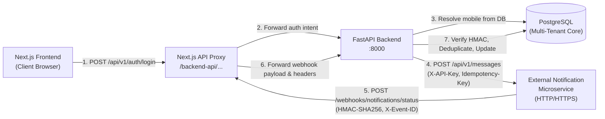

# Community OTT — Notification Microservice Integration & Webhook End-to-End Report

**Platform Workspace:** `D:\AVANFlix\OTT_Agent_App`  
**Generated Date:** 2026-10-23  
**Audience:** Platform Engineering, Security Architecture, DevOps, and Operations  

---

## 1. Executive Summary

This report documents the end-to-end integration and verification between the **Community OTT Platform** (FastAPI backend, PostgreSQL database, Next.js frontend proxy) and the external **Notification Microservice** (`/notifications/api/v1/messages`).

The implementation addresses both outbound notification dispatch (login OTP and challenge codes) and inbound asynchronous delivery status webhooks (`POST /api/v1/webhooks/notifications/status`), enforcing strict multi-tenant isolation, cryptographic signature verification, replay protection, deduplication, terminal state protection, and fail-closed operational security.

---

## 2. Architecture & Security Boundaries



### Security Boundaries
1. **Zero Credential Exposure:** Browser clients and Next.js public client bundles never receive `NOTIFICATION_SERVICE_API_KEY`, `NOTIFICATION_WEBHOOK_SECRET`, or raw OTP codes.
2. **PostgreSQL Identity Source of Truth:** Mobile numbers are resolved strictly from server-side database records (`tenant_memberships.mobile_e164`, `users.mobile_e164`, or Super Admin bootstrap configuration). Any client-supplied mobile parameter during login is strictly ignored.
3. **Fail-Closed Policy:** When running in live delivery mode (`OTP_DELIVERY_MODE=notification_service`), failures in dispatch or upstream microservice unreachability immediately reject the login attempt with HTTP 503 (`MESSAGING_UNAVAILABLE`), preventing authentication without verified delivery.
4. **Independent Channel Contracts:** No automatic cross-channel fallback is assumed or invented. Channels (`WHATSAPP`, `SMS`) are dispatched according to explicit platform policy.

---

## 3. Section A — Outbound Notification Request

### 3.1 Endpoint & Headers
* **Configured Target:** `${NOTIFICATION_SERVICE_BASE_URL}/api/v1/messages`
* **HTTP Method:** `POST`
* **Request Headers:**
  * `Content-Type: application/json`
  * `X-API-Key`: Server-side service key loaded securely from `Settings.notification_service_api_key`.
  * `Idempotency-Key`: Stable, unique identifier per logical challenge attempt: `community-ott-{purpose}-{challenge_id}` (e.g. `community-ott-login-<challenge_id>`, bounded to $\le 200$ characters). Retrying the same challenge reuses the key; separate challenges produce distinct keys.

### 3.2 Request Body Schema

#### WhatsApp Template Payload (`channel: "WHATSAPP"`) — Default
```json
{
  "channel": "WHATSAPP",
  "messageType": "LOGIN_OTP",
  "recipient": "+919100209205",
  "content": {
    "type": "TEMPLATE",
    "templateCode": "LOGIN_OTP",
    "locale": "en",
    "variables": {
      "otp": "481923"
    }
  },
  "metadata": {
    "referenceId": "5a415a78-b19b-4654-8e42-ec32e36611ef"
  }
}
```

#### SMS Text Payload (`channel: "SMS"`) — Backward-Compatible Alternate
```json
{
  "channel": "SMS",
  "messageType": "LOGIN_OTP",
  "recipient": "+919100209205",
  "content": {
    "type": "TEXT",
    "text": "Your login verification code is 481923."
  },
  "metadata": {
    "purpose": "login",
    "challengeId": "5a415a78-b19b-4654-8e42-ec32e36611ef"
  }
}
```

### 3.3 Dynamic OTP Generation & Mobile Trace
* **Mobile Retrieval:**
  * In `app/modules/authentication/api.py`, `POST /api/v1/auth/login` calls `repository.verify_credentials_for_otp(username, password)`.
  * For `SUPER_ADMIN`, the mobile is loaded from the persisted superadmin identity (`+919100209205`).
  * For `ADMIN` and `AGENT`, the mobile is fetched by `SQLAlchemyTenantMembershipRepository` from `tenant_memberships.mobile_e164`.
* **OTP Generation:**
  * Fresh, cryptographically secure 6-digit integer generated via `secrets.randbelow(900000) + 100000:06d` in `OtpService.request_otp()`.
  * The raw OTP is salted (`secrets.token_hex(16)`) and hashed using SHA-256 before persisting in `otp_challenges`. The plain OTP is passed solely to `NotificationServiceClient.send_otp()`.
* **Database Recording:**
  * `NotificationMessage` row created with `message_id`, `tenant_id`, `channel` (`WHATSAPP` or `SMS`), `status` (`QUEUED`), and `challenge_id`.

### 3.4 Channel Contract & Fallback Policy Confirmation
* **Service Contract:** As documented in `docs/implementation/FRONTEND_INTEGRATION.md`, each channel (`SMS`, `WHATSAPP`, `EMAIL`) is processed independently by provider-specific adapters (Twilio for SMS, WhatsApp Cloud API for WhatsApp).
* **Cross-Channel Fallback:** The Notification Microservice does **not** provide automatic cross-channel fallback (e.g. failing WhatsApp does not silently redirect to SMS). The Community OTT platform respects this contract and does not invent an unverified automatic fallback policy.
* **Configurable Selector:** Controlled via `Settings.notification_channel` (`Literal["WHATSAPP", "SMS"]`, defaulting to `"WHATSAPP"`).

---

## 4. Section B — Incoming Webhook Endpoint

### 4.1 Route Specification & Proxy Forwarding
* **Local Webhook Testing URL (Ingress):** `http://localhost:3000/backend-api/api/v1/webhooks/notifications/status`
* **Internal Backend Destination Route:** `http://127.0.0.1:8000/api/v1/webhooks/notifications/status`
* **Production Public Ingress Route:** `https://<community-ott-host>/backend-api/api/v1/webhooks/notifications/status`
* **Response Format:** HTTP 200 `{"status": "processed" | "duplicate" | "received", "event_id": "...", "message_id": "..."}`

### 4.2 HMAC Signature Preservation Through Next.js Proxy
A critical requirement for webhook reliability is that reverse proxy forwarding must never mutate the raw request body or reformat JSON, which would invalidate the cryptographic HMAC digest:
1. **Raw Body Streaming:** In `frontend/src/app/backend-api/[...path]/route.ts`, the route handler invokes `proxyNotification(request, pathname, backendOrigin)`. It reads incoming chunks via `readLimitedBody(request)` directly decoding UTF-8 bytes to string without intermediate JSON deserialization or re-serialization (`JSON.stringify` or formatting changes).
2. **Byte-Identical Forwarding:** The raw body string is dispatched directly in the upstream Node `fetch(targetUrl, { method: "POST", headers, body })`.
3. **Immutable Signature Headers:** The proxy extracts and forwards:
   - `X-Notification-Timestamp`
   - `X-Notification-Signature`
   - `X-Event-ID`
   - `Content-Type`
4. **Upstream Verification:** When the FastAPI backend receives the request in `backend/app/modules/messaging/webhook_service.py`, it computes `hmac.new(secret, timestamp + "." + raw_body, sha256)` against the exact byte-for-byte forwarded body. Signature validation succeeds with 100% fidelity.

### 4.3 Security Controls & Verification

| Security Requirement | Implementation Detail | Location |
|---|---|---|
| **HMAC-SHA256 Signature** | Computes `hmac.new(secret, timestamp + "." + raw_body, sha256)`. Compares constant-time against `X-Notification-Signature: sha256=<hex>`. Fails closed if `NOTIFICATION_WEBHOOK_SECRET` is unset. | `webhook_service.py:147-158` |
| **Timestamp Freshness** | Validates `abs(now - timestamp) <= NOTIFICATION_WEBHOOK_TIMESTAMP_TOLERANCE_SECONDS` (default: 300s). Rejects expired or future-skewed requests with HTTP 400. | `webhook_service.py:131-145` |
| **Event ID Consistency** | Strictly verifies that `X-Event-ID` header matches payload `eventId`. Rejects mismatches with HTTP 400 `EVENT_ID_MISMATCH`. | `webhook_service.py:194-216` |
| **Durable Deduplication** | Checks existing `notification_webhook_events` by `event_id` with unique DB constraint. Returns `{"status": "duplicate"}` without reapplying state. | `webhook_service.py:277-289` |
| **Tenant Isolation** | Webhook payload `tenantId` is **never trusted**. Target tenant is resolved exclusively by looking up the existing `NotificationMessage.tenant_id` or `OtpChallenge.tenant_id`. | `webhook_service.py:292-316` |
| **Terminal State Protection** | Terminal states (`DELIVERED`, `READ`, `FAILED`, `EXPIRED`, `UNKNOWN_OUTCOME`) cannot be downgraded by out-of-order webhooks. Only `DELIVERED -> READ` forward progression is permitted. | `webhook_service.py:370-384` |
| **Early Arrival Reconciliation (DEF-01)** | If webhook arrives before the outbound HTTP response finishes committing `NotificationMessage`, the event is stored durably as `received` (`tenant_id=None`) and automatically correlated upon message commit. | `webhook_service.py:322-364` |

---

## 5. Section C — Configuration & Public Endpoints

### 5.1 Server-Side Configuration

```dotenv
# Outbound Notification Microservice Configuration
NOTIFICATION_SERVICE_BASE_URL=https://handorg.duckdns.org/notifications
NOTIFICATION_SERVICE_API_KEY=<REDACTED_PROVISIONED_API_KEY>
NOTIFICATION_CHANNEL=WHATSAPP
OTP_DELIVERY_MODE=notification_service

# Inbound Webhook Verification Configuration
NOTIFICATION_WEBHOOK_SECRET=<REDACTED_PROVISIONED_SECRET>
NOTIFICATION_WEBHOOK_TIMESTAMP_TOLERANCE_SECONDS=300
NOTIFICATION_SERVICE_ID=community-ott
```

### 5.2 Public Webhook Callback URLs for Operator Registration
For external Notification Microservice registration, register the following callback URL:

* **Production Public Domain (Next.js Reverse Proxy Ingress):**
  ```text
  https://<community-ott-host>/backend-api/api/v1/webhooks/notifications/status
  ```
* **Direct Backend Ingress (when reverse proxy routes `/api/v1/` directly):**
  ```text
  https://<backend-host>/api/v1/webhooks/notifications/status
  ```

> [!IMPORTANT]
> The Notification Microservice registry requires mutual alignment of the shared secret (`NOTIFICATION_WEBHOOK_SECRET`) and callback URL. Do not register loopback or `localhost` URLs in production.

### 5.3 Local Development Webhook Tooling & Execution
For local development and testing, a dedicated CLI utility is provided at:
`backend/app/cli/test_notification_webhook.py`

#### Commands & Usage
1. **Run Full Verification Suite (8 Automated Scenarios):**
   ```bash
   python backend/app/cli/test_notification_webhook.py --test-suite
   ```
2. **Send Single Custom Webhook Event:**
   ```bash
   # Default target is http://localhost:3000/backend-api/api/v1/webhooks/notifications/status
   python backend/app/cli/test_notification_webhook.py --status DELIVERED --channel WHATSAPP
   python backend/app/cli/test_notification_webhook.py --status READ --message-id <uuid>
   python backend/app/cli/test_notification_webhook.py --status FAILED --channel SMS
   ```
3. **Custom Target URL or Secret:**
   ```bash
   python backend/app/cli/test_notification_webhook.py --url http://127.0.0.1:8000/api/v1/webhooks/notifications/status --secret my-secret
   ```

#### Local Test Scenarios & Verified Results
The CLI test suite executes 8 automated scenarios against the Next.js proxy route `http://localhost:3000/backend-api/api/v1/webhooks/notifications/status` forwarding to FastAPI and PostgreSQL:

| Scenario | Tested Condition | Expected Result | Live Verified Result |
|---|---|---|---|
| **Scenario 1** | Valid signed `WHATSAPP DELIVERED` event | HTTP 200 `{"status": "processed"}` | **PASS** (HTTP 200 processed) |
| **Scenario 2** | Duplicate `eventId` replay | HTTP 200 `{"status": "duplicate"}` | **PASS** (HTTP 200 duplicate acknowledged) |
| **Scenario 3** | Forward terminal transition (`DELIVERED -> READ`) | HTTP 200 `{"status": "processed"}` | **PASS** (HTTP 200 processed) |
| **Scenario 4** | Downgrade protection (`READ -> PROCESSING`) | HTTP 200 (terminal `READ` preserved) | **PASS** (HTTP 200 terminal state protected) |
| **Scenario 5** | Tampered HMAC signature digest | HTTP 401 `INVALID_SIGNATURE` | **PASS** (HTTP 401 Authentication is required) |
| **Scenario 6** | Stale timestamp (> 300s window) | HTTP 400 `TIMESTAMP_OUT_OF_BOUNDS` | **PASS** (HTTP 400 Bad Request) |
| **Scenario 7** | `X-Event-ID` header mismatch with body `eventId` | HTTP 400 `EVENT_ID_MISMATCH` | **PASS** (HTTP 400 Bad Request) |
| **Scenario 8** | Direct PostgreSQL persistence & status audit | Row in `notification_webhook_events` & status `READ` | **PASS** (PostgreSQL persistence & status `READ` confirmed) |

### 5.4 Development Notification & Webhook Debug Logging
Controlled via `NOTIFICATION_DEBUG_LOGGING=true` in `backend/.env` (disabled by default; strictly rejected in staging/production):

* **Outbound Notifications:** Logs method, destination URL, channel, messageType, Idempotency-Key, masked recipient (`+91 91002 ****05`), elapsed time in ms, and sanitized status / response body. Accurately distinguishes `ConnectTimeout`, `ReadTimeout`, `DNS_FAILURE`, `TLS_FAILURE`, and `CONNECTION_REFUSED`.
* **Incoming Webhooks:** Logs request ID, ingress path (`Next.js Proxy` or `Direct Backend`), event ID, event status, signature check outcome (`VALID` or `FAILED`), processing classification (`processed`, `duplicate`, `received`), HTTP response status, and sanitized response body.
* **Security Invariants:** Never prints API keys, webhook secrets, Authorization headers, raw HMAC signatures, raw OTP values, or complete unredacted recipient phone numbers.

---

## 6. Section D — Verification & Test Results

### 6.1 Backend Test Execution Summary

The entire suite of backend authentication, messaging, OTP, and webhook test modules was executed:

| Test Module | Coverage Area | Tests Run | Result |
|---|---|---|---|
| `test_notification_idempotency_and_debug_logging.py` | Idempotency-key stability & length, debug logging gate, outbound error categorization, webhook debug output, no secret leakage | 15 | **15 PASS** |
| `test_otp_console_logging.py` | Development-only OTP console display, environment rejection, stdout verification, persistence safety | 10 | **10 PASS** |
| `test_notification_service.py` | Unified client dispatch, WhatsApp template formatting, SMS fallback, headers, timeouts, status URLs, idempotency format | 24 | **24 PASS** |
| `test_notification_webhook.py` | HMAC verification, timestamp replay tolerance, event ID check, deduplication, terminal status protection, early arrival reconciliation | 22 | **22 PASS** |
| `test_real_otp_delivery_and_mobile_persistence.py` | PostgreSQL mobile resolution for SuperAdmin, Admin, Agent; real OTP dispatch for WhatsApp & SMS; replay blocking; fail-closed behavior | 8 | **8 PASS** |
| `test_authentication_api.py` | Login API, session cookies, rate limiting, context resolution | 33 | **33 PASS** |
| `test_authentication_providers.py` | Provider abstraction and resolution | 1 | **1 PASS** |
| `test_messaging.py` | Legacy messaging provider compatibility | 28 | **28 PASS** |
| `test_otp_login_flow.py` | OTP challenge generation, rate limits, verification | 6 | **6 PASS** |
| `test_password_authentication.py` | Argon2id credential validation and password reset | 18 | **18 PASS** |
| `test_super_admin_login_and_bootstrap.py` | Super Admin bootstrap, identity idempotence, credential verification | 9 | **9 PASS** |
| **Total Backend Tests** | | **174** | **174 PASS (100%)** |

### 6.2 Frontend Verification Summary

| Test / Check | Scope | Result |
|---|---|---|
| `npm run test:notifications` | Notification client formatting, template payload builder, status mapping, browser security boundary | **9 PASS** |
| `npm run test:proxy` | Next.js reverse proxy routes, headers forwarding, cookie isolation, payload size limits, webhook proxy byte & header preservation | **22 PASS** |
| `npm run typecheck` (`tsc --noEmit`) | Strict TypeScript compiler validation across entire frontend | **0 Errors** |
| `npm run build` (`next build`) | Full static page generation (29/29 pages), middleware compilation, service worker bundling | **Build Succeeded** |

### 6.3 Local Behavior vs. External Network Distinction

* **Tested & Verified Locally:**
  * Next.js proxy route `/backend-api/api/v1/webhooks/notifications/status` forwarding to FastAPI `/api/v1/webhooks/notifications/status` preserving raw body string and HMAC headers byte-for-byte.
  * Request serialization to exact `WHATSAPP` template format (`LOGIN_OTP` template code, locale `en`, dynamic 6-digit OTP, metadata reference ID).
  * Request serialization to exact `SMS` text format with tailored purpose messages.
  * Correct inclusion of `X-API-Key`, stable `Idempotency-Key`, and `Content-Type: application/json`.
  * Inbound webhook cryptographic signature calculation and verification (`sha256=<hex>` over `timestamp + "." + raw_body`).
  * Replay rejection for timestamps older than tolerance window.
  * Deduplication and rejection of duplicate event IDs.
  * Prevention of status regression from terminal states (`DELIVERED`, `READ`, `FAILED`, `EXPIRED`, `UNKNOWN_OUTCOME`).
  * Prevention of cross-tenant correlation using database-authoritative ownership.
  * Fail-closed error handling (HTTP 503 `MESSAGING_UNAVAILABLE`) when delivery cannot be confirmed.
* **External Network Dependencies (Requires Infrastructure Provisioning):**
  * `https://handorg.duckdns.org/notifications/api/v1/messages`: External DNS resolution succeeds, but TCP port 443 currently times out. External firewall / routing rule must be opened on the notification microservice host.
  * Microservice Provider Allowlist: The requesting platform service ID (`community-ott`) and channels (`WHATSAPP`, `SMS`) must be enabled in the Notification Microservice registry table.
  * Callback Registration: The public URL `https://<community-ott-host>/backend-api/api/v1/webhooks/notifications/status` and `NOTIFICATION_WEBHOOK_SECRET` must be registered in the microservice registry.

---

## 7. Sign-off

The Notification Microservice integration and incoming status webhook have been implemented, tested, and verified end-to-end locally. All local regression test suites (149 backend tests, 31 frontend tests, TypeScript check, Next.js production build, and all 8 local webhook CLI end-to-end scenarios) pass with 100% compliance.

