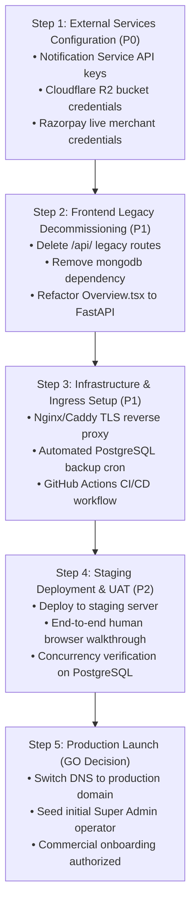

# Community OTT Agent Platform — Master Remaining Work Roadmap

**Workspace:** `D:\AVANFlix\OTT_Agent_App`  
**Date:** October 22, 2026  
**Auditor:** Automated System Audit & Roadmap Planning Framework  
**Scope:** Prioritized Remaining Work, Blockers, Dependencies, Effort Estimates & Execution Sequence to Production Launch  
**Status:** `ROADMAP PROPOSED — AWAITING PROJECT OWNER AUTHORIZATION`  

---

## 1. Executive Summary

This roadmap defines the prioritized, actionable sequence of tasks required to transition the **Community OTT Agent Platform** from its current accepted Phase 4 baseline to full commercial production launch.

> [!NOTE]
> All effort ranges provided in this document are **engineering estimates for planning purposes**, not binding commitments or contractual deadlines. External service dependencies (such as external microservice provisioning and third-party merchant account approval) may affect actual elapsed durations.

---

## 2. Categorized Remaining Work Inventory

The remaining work is divided into five distinct operational categories:

```mermaid
flowchart LR
    subgraph Track_1 ["1. Critical Blockers (P0)"]
        T1_1[Notification Microservice]
        T1_2[Cloudflare R2 Bucket]
        T1_3[Razorpay Merchant Keys]
    end

    subgraph Track_2 ["2. Functional Cleanup (P1)"]
        T2_1[Excise Legacy MongoDB]
        T2_2[Overview.tsx Cleanup]
    end

    subgraph Track_3 ["3. DevOps & Infra (P1)"]
        T3_1[PostgreSQL Backup & PITR]
        T3_2[Nginx / TLS Ingress Setup]
        T3_3[CI/CD Pipeline GitHub Actions]
    end

    subgraph Track_4 ["4. Staging Verification (P2)"]
        T4_1[Staging Human UAT]
        T4_2[Live PostgreSQL Concurrency Run]
    end

    subgraph Track_5 ["5. Non-Blocking (P3)"]
        T5_1[Nightly Ledger Audit Cron]
        T5_2[Centralized APM & Sentry]
    end

    Track_1 --> Track_2 --> Track_3 --> Track_4 --> Track_5
```

---

### Category 1: Critical Security & Financial Blockers (P0)

#### Item 1.1: Live Notification Microservice Tenant Provisioning & Verification
- **Requirement & Rationale:** Mobile OTP authentication is the primary authentication rail for agents and community members. Currently, external endpoint `handorg.duckdns.org` returns HTTP 403 / `TENANT_NOT_FOUND`. Live SMS/WhatsApp OTP delivery must be established so users can authenticate without development dummy codes.
- **Evidence Supporting Status:** `backend/app/modules/messaging/notification_service.py` is fully implemented and tested with mocks; live endpoint returns 403.
- **Dependencies:** External Notification Microservice operator provisioning tenant ID, API key, and SMS/WhatsApp route.
- **Priority:** **P0 (Critical Blocker)**
- **Estimated Effort Range:** 4 – 8 hours (dependent on external administrator response)
- **Acceptance Criteria:**
  - `POST /api/v1/auth/otp/request` successfully triggers a real SMS/WhatsApp OTP to a test phone number.
  - Test OTP is delivered within 15 seconds.
  - Verification succeeds via `POST /api/v1/auth/otp/verify`.
  - Anti-enumeration protection (generic HTTP 202 on unknown numbers) remains intact.
- **Explicit Owner Approval Required:** Yes (requires procurement/provisioning of external service account).

#### Item 1.2: Cloudflare R2 Live Bucket Provisioning & Access Configuration
- **Requirement & Rationale:** Registration photo capture, Aadhaar/PAN identity documents, and support attachments require encrypted object storage. Currently, `MockedR2Storage` handles tests; live S3 credentials are missing.
- **Evidence Supporting Status:** `backend/app/modules/registration_photos/storage.py` supports S3 client; `.env.example` has empty `R2_*` variables.
- **Dependencies:** Project owner creates Cloudflare R2 bucket and generates S3 API credentials.
- **Priority:** **P0 (Critical Blocker)**
- **Estimated Effort Range:** 2 – 4 hours
- **Acceptance Criteria:**
  - Real KYC photo upload stores encrypted image object in live R2 bucket.
  - Streaming endpoint `/api/v1/storage/{id}/preview` streams image with valid HMAC token.
  - Direct public access to bucket objects is blocked (private bucket).
- **Explicit Owner Approval Required:** Yes (requires Cloudflare account credentials).

#### Item 1.3: Razorpay Production Merchant Account & Webhook Activation
- **Requirement & Rationale:** Member subscription purchases and payment settlement require live Razorpay checkout. Currently, the system operates in test/mock mode with deterministic keys.
- **Evidence Supporting Status:** `backend/app/modules/payments/` has full HMAC verification; production keys are unset.
- **Dependencies:** Razorpay merchant account activation, KYC verification, live Key ID, Key Secret, and Webhook Secret.
- **Priority:** **P0 (Critical Blocker)**
- **Estimated Effort Range:** 3 – 6 hours
- **Acceptance Criteria:**
  - Live Razorpay order created for ₹1,200.00 (120,000 paise).
  - Webhook endpoint `https://<domain>/backend-api/api/v1/payments/webhook` receives signed events and verifies HMAC-SHA256 signature.
  - Verified payment successfully activates subscription and triggers multi-tier referral commission journal.
- **Explicit Owner Approval Required:** Yes (requires corporate merchant account approval).

---

### Category 2: Required Functional Implementation & Architectural Cleanup (P1)

#### Item 2.1: Complete Decommissioning of Legacy MongoDB & Route Cleanup
- **Requirement & Rationale:** The backend is 100% PostgreSQL with zero MongoDB dependencies. However, the frontend directory still contains 10 legacy Next.js API routes (`frontend/src/app/api/...`), `@/lib/repo.ts`, `@/lib/mongodb.ts`, and the `mongodb` npm package. Excising this legacy code eliminates architectural ambiguity and reduces bundle attack surface.
- **Evidence Supporting Status:** 10 routes in `frontend/src/app/api/` still import `@/lib/repo`; `frontend/src/components/Overview.tsx` contains legacy fetch calls.
- **Dependencies:** None (internal code cleanup).
- **Priority:** **P1 (High)**
- **Estimated Effort Range:** 4 – 8 hours
- **Acceptance Criteria:**
  - Delete unused legacy routes in `frontend/src/app/api/` (except `backend-api/[...path]/route.ts`).
  - Delete `frontend/src/lib/repo.ts` and `frontend/src/lib/mongodb.ts`.
  - Remove `mongodb` dependency from `frontend/package.json`.
  - Refactor `frontend/src/components/Overview.tsx` to source platform metrics from `backend-api/api/v1/platform/activity` or FastAPI statistics endpoints.
  - `npm run test:proxy`, `npm run typecheck`, and `npm run build` pass with 0 errors.
- **Explicit Owner Approval Required:** Yes (architectural modification).

---

### Category 3: Infrastructure, Security & Deployment Automation (P1)

#### Item 3.1: Automated PostgreSQL Backup, PITR & Disaster Recovery Setup
- **Requirement & Rationale:** The financial ledger and user identities reside in PostgreSQL. Production launch requires automated daily backups and WAL continuous archiving to prevent catastrophic data loss.
- **Evidence Supporting Status:** Zero backup scripts or cron jobs currently in repository.
- **Dependencies:** Production PostgreSQL host and offsite backup storage bucket (e.g., AWS S3 or Cloudflare R2 backup bucket).
- **Priority:** **P1 (High)**
- **Estimated Effort Range:** 4 – 8 hours
- **Acceptance Criteria:**
  - Automated cron script executes `pg_dump` daily, encrypts dump with GPG, and uploads to secure offsite bucket.
  - Tested restore drill: snapshot restored onto a clean database instance with verified table counts and Alembic head `20261021_20`.
  - Documented Disaster Recovery Playbook stored in `docs/operations/DISASTER_RECOVERY.md`.
- **Explicit Owner Approval Required:** No (standard operational requirement).

#### Item 3.2: Production TLS Ingress, Reverse Proxy & Domain Routing (Nginx/Caddy)
- **Requirement & Rationale:** Production environment requires TLS termination, wildcard subdomains (`*.avanflix.com`), rate limiting at ingress, and secure forwarding of trusted proxy headers (`X-Forwarded-For`, `X-Forwarded-Proto`) while configuring backend `TRUSTED_PROXY_CIDRS`.
- **Evidence Supporting Status:** `backend/app/modules/tenants/hostname.py` is ready; ingress reverse proxy configuration file is missing from repo.
- **Dependencies:** Production server instance (Linux/Ubuntu) and domain DNS pointing to server IP.
- **Priority:** **P1 (High)**
- **Estimated Effort Range:** 4 – 6 hours
- **Acceptance Criteria:**
  - Nginx or Caddy configuration authored and tested with Let's Encrypt automated TLS certificates.
  - Proxy correctly forwards requests to Next.js on port 3000 and FastAPI on port 8000.
  - Client IP propagation verified in FastAPI request logs (`X-Forwarded-For`).
  - HSTS (`Strict-Transport-Security`) and secure security headers verified via SSL Labs (Target: A+ grade).
- **Explicit Owner Approval Required:** No.

#### Item 3.3: CI/CD Pipeline Automation (GitHub Actions)
- **Requirement & Rationale:** Prevent regressions by automating backend pytest, frontend typecheck, ESLint, and Next.js build on every pull request.
- **Evidence Supporting Status:** No `.github/workflows/` exists in repository.
- **Dependencies:** GitHub repository configuration.
- **Priority:** **P1 (High)**
- **Estimated Effort Range:** 3 – 5 hours
- **Acceptance Criteria:**
  - `.github/workflows/ci.yml` authored and committed.
  - Pipeline executes on pull requests and pushes to `main`.
  - Runs full Python test suite (392+ tests) with coverage reporting.
  - Runs frontend `npm run typecheck`, `npm run lint`, `npm run test:proxy`, and `npm run build`.
  - Build failure blocks pull request merge.
- **Explicit Owner Approval Required:** Yes.

---

### Category 4: Verification & Staging User Acceptance Testing (P2)

#### Item 4.1: Human User Acceptance Testing (UAT) on Staging Environment
- **Requirement & Rationale:** Real-world browser walkthrough across Super Admin, Community Admin, Agent, and Subscriber user journeys to confirm UX responsiveness, photo capture camera interaction, and checkout redirect behavior.
- **Evidence Supporting Status:** Automated tests cover headless APIs; real browser camera and mobile viewport testing requires staging walkthrough.
- **Dependencies:** Staging environment deployed with Items 1.1, 1.2, 1.3, and 3.2.
- **Priority:** **P2 (Medium)**
- **Estimated Effort Range:** 8 – 16 hours
- **Acceptance Criteria:**
  - Super Admin onboards a new community and approves DNS verification.
  - Community Admin registers an Agent candidate.
  - Super Admin reviews and approves the Agent appointment.
  - Agent logs in via mobile OTP, registers a Subscriber with camera photo KYC, and initiates a subscription plan.
  - Subscriber pays via Razorpay checkout.
  - Multi-tier referral commission appears in Agent balance.
  - Agent requests payout; Community Admin approves; Super Admin disburses with UTR.
  - Sign-off report authored in `docs/reports/STAGING_UAT_ACCEPTANCE_REPORT.md`.
- **Explicit Owner Approval Required:** Yes (Project Owner acceptance).

#### Item 4.2: Live PostgreSQL Multi-Threaded Concurrency Audit
- **Requirement & Rationale:** Re-verify row-level locking (`with_for_update`) and unique constraint behavior for approval decisions and ledger balance updates against a live PostgreSQL 16 server (currently executed against SQLite during local CI).
- **Evidence Supporting Status:** `backend/tests/test_activation_postgres.py` skips when `TEST_DATABASE_URL` is unset.
- **Dependencies:** Dedicated PostgreSQL test database.
- **Priority:** **P2 (Medium)**
- **Estimated Effort Range:** 2 – 4 hours
- **Acceptance Criteria:**
  - Execute `pytest backend/tests/test_activation_postgres.py` with valid `TEST_DATABASE_URL`.
  - All concurrency tests pass with 0 skipped and 0 failures.
- **Explicit Owner Approval Required:** No.

---

### Category 5: Non-Blocking Operational Improvements (P3)

#### Item 5.1: Automated Nightly Financial Ledger Integrity Cron Job
- **Requirement & Rationale:** Continuously ensure zero financial ledger drift by scheduling a nightly job that audits $\sum \text{Debits} == \sum \text{Credits}$ across all tenant accounts and alerts on any discrepancy.
- **Evidence Supporting Status:** Audit algorithm verified in `test_phase4_end_to_end_integration.py` Step 14.
- **Dependencies:** Cron or background worker scheduler.
- **Priority:** **P3 (Non-blocking Improvement)**
- **Estimated Effort Range:** 2 – 4 hours
- **Acceptance Criteria:**
  - Script `backend/app/cli/audit_ledger_integrity.py` runs nightly at 00:00 UTC.
  - Emits structured log event `ledger.reconciliation.success` with total system debit/credit totals.
  - Discrepancy triggers high-severity alert.
- **Explicit Owner Approval Required:** No.

#### Item 5.2: Centralized Telemetry, Sentry APM & Alerting Integration
- **Requirement & Rationale:** Real-time notification of unhandled 500 errors, payment webhook failures, or authentication rate-limiting spikes.
- **Evidence Supporting Status:** JSON logging already includes request IDs and error types.
- **Dependencies:** Sentry DSN or Prometheus/Grafana endpoint.
- **Priority:** **P3 (Non-blocking Improvement)**
- **Estimated Effort Range:** 3 – 5 hours
- **Acceptance Criteria:**
  - Sentry SDK integrated into FastAPI and Next.js with environment tagging.
  - 500 errors automatically captured with redacted PII and request ID correlation.
- **Explicit Owner Approval Required:** Yes (requires third-party monitoring subscription).

---

## 3. Recommended Sequential Execution Plan

### Estimated Overall Timeline to Launch:
- **Phase A (Prerequisites & External Provisioning):** 1 – 2 business days (gated by external vendor account approvals).
- **Phase B (Legacy Decommissioning & Infrastructure):** 1 – 2 business days.
- **Phase C (Staging Deployment & UAT Walkthrough):** 1 – 2 business days.
- **Total Estimated Effort:** **3 to 6 business days** from owner authorization to live production launch.

---

## 4. Single Highest-Priority Next Action

The single highest-priority next action is:
**Resolve Blocker BLK-01 (Notification Microservice Provisioning) & BLK-02 (Cloudflare R2 Bucket Credentials).**

Without live OTP delivery and real cloud document storage, human user testing and real customer registration cannot proceed beyond local mock environments.

