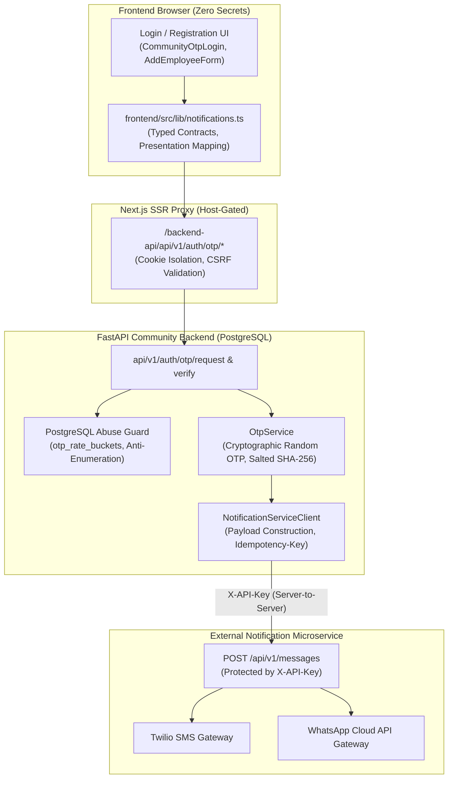

# Community OTT — Notification Frontend Migration Audit

**Workspace:** `D:\AVANFlix\OTT_Agent_App`  
**Audit Date:** October 22, 2026  
**Auditor:** Automated System Audit & Architecture Verification Framework  
**Scope:** Notification Delivery Integration, Provider API Contract Audit, Codebase Inventory & Security Boundary Analysis  
**Reference Document:** `docs/implementation/FRONTEND_INTEGRATION.md`  

---

## 1. Executive Summary & Audit Context

This audit evaluates the feasibility, security boundaries, and architectural implications of migrating the notification delivery integration (SMS, WhatsApp, and email) away from the Community Backend and into the frontend for the **Community OTT Agent Platform**.

The audit was conducted strictly against:
1. The external provider's documented API specification (`docs/implementation/FRONTEND_INTEGRATION.md`).
2. The actual source code of the backend messaging and authentication modules (`backend/app/modules/messaging/`, `backend/app/modules/authentication/`).
3. The frontend application, reverse proxy gateway, and call sites (`frontend/src/app/`, `frontend/src/components/`, `frontend/src/lib/`).
4. Operational configuration, secrets management, and automated test suites.

### Key Audit Findings & Verdict:
- **Provider API Contract is Exclusively Service-to-Service:** The provider's documented API (`POST /api/v1/messages`) requires a private administrative header `X-API-Key` and has no browser-safe authentication mechanism (no client tokens, no scoped publishable keys, and no browser CORS support).
- **Direct Browser Call Migration is BLOCKED on Security Grounds:** Exposing `X-API-Key` in browser bundles or calling the provider directly from client-side JavaScript would fatally violate platform security: it would expose the tenant's private service key to end users, enable SMS toll fraud, leak unverified OTP codes in browser memory, and bypass PostgreSQL abuse control and tenant isolation.
- **Architectural Directive Enforced:** In strict accordance with Section 1 and Section 3 of the mandate, **direct browser calls to the provider API are rejected**, and the **minimum secure backend-to-provider boundary is retained**. A typed frontend notification client (`frontend/src/lib/notifications.ts`) and test harness have been authored to establish clean client abstractions while keeping all delivery credentials strictly server-side.

---

## 2. Provider API Contract Audit

The external Notification Microservice contract is defined in `docs/implementation/FRONTEND_INTEGRATION.md`:

### 2.1 Provider Specification Summary:
- **Endpoint:** `POST /api/v1/messages`
- **Authentication:** `X-API-Key: <service-api-key>`
- **Optional Retry Header:** `Idempotency-Key: <unique-key-for-this-notification-intent>` (max 200 characters)
- **Supported Channels:** `SMS`, `WHATSAPP`, `EMAIL`
- **Supported Message Types:** `LOGIN_OTP`, `PAYMENT_OTP`, `PASSWORD_RESET_OTP`, `ACCOUNT_UPDATE`, `URGENT_SECURITY_ALERT`, `PAYMENT_RECEIPT`
- **Acceptance Response:** HTTP `202 Accepted` returning:
  ```json
  {
    "messageId": "msg_5db4ad9a4d8743859b15d5a06713c2f1",
    "status": "QUEUED",
    "priority": "P0",
    "channel": "SMS",
    "statusUrl": "/api/v1/messages/msg_5db4ad9a4d8743859b15d5a06713c2f1"
  }
  ```
- **Status Lookup Endpoint:** `GET /api/v1/messages/{messageId}` and `GET /api/v1/messages/{messageId}/attempts` (requires same service `X-API-Key`)
- **Status Webhook Contract:** Server-to-server callback signed with HMAC-SHA256 (`X-Notification-Signature`).

### 2.2 Security Boundary Audit of Provider Contract:
The provider specification explicitly defines its security boundary in Section "Important security boundary":

> *"The Notification Microservice is a **service-to-service API**. A browser or mobile app must not call it directly and must never contain `X-API-Key`, provider credentials, or webhook secrets. The frontend should call the Community Backend using its normal user authentication. The backend determines the active tenant and calls the Notification Microservice with its service credentials.*
>
> *Do not send a `tenantId` in the notification request. The current Notification Microservice maps its configured API key to a requesting service and tenant. Tenant registration and dynamic tenant credential resolution are planned separately; the current registry is configuration based."*

Furthermore, Section "Status lookup and polling" reiterates:
> *"Both endpoints require the same service authentication and are scoped to the owning service and tenant. Frontends should call a Community Backend endpoint that proxies or exposes the needed status; do not expose the Notification Microservice API key to a browser."*

### 2.3 Threat Model of Direct Frontend Calls:
If the platform attempted to execute direct browser calls to `POST /api/v1/messages`:

1. **Private Credential Compromise:** The browser bundle or client environment (`NEXT_PUBLIC_NOTIFICATION_API_KEY`) would contain the private service key. Any user inspecting DevTools could extract this key.
2. **SMS Pumping & Toll Fraud:** An attacker possessing the `X-API-Key` could dispatch arbitrary SMS or WhatsApp messages to international premium-rate numbers at catastrophic financial expense to the platform owner.
3. **Authentication Invalidation & OTP Leakage:** The `POST /api/v1/messages` body takes `{ "content": { "type": "TEXT", "text": "Your login verification code is 123456." } }`. If the frontend generated or passed this request directly, the plaintext OTP code would exist in browser memory before delivery, completely destroying the security guarantee of out-of-band mobile verification.
4. **Bypass of Anti-Enumeration & Rate Limiting:** The Community Backend enforces anti-enumeration (generic HTTP 202 for unregistered numbers) and PostgreSQL rate buckets (3 sends / 10m, 60s cooldown). Direct frontend calls would bypass the backend database guards and leak user existence.

**Audit Conclusion on Direct Migration:** The external provider does NOT support a browser-safe API. Therefore, direct client-to-provider requests are prohibited.

---

## 3. Comprehensive Codebase Notification Inventory

### 3.1 Backend Notification Modules & Components:

| Module / File | Responsibility | Security & Operational Role |
| :--- | :--- | :--- |
| `backend/app/modules/messaging/notification_service.py` | `NotificationServiceClient` | Unified client that formats payloads according to `FRONTEND_INTEGRATION.md`, handles idempotency keys, manages HTTP 202 acceptance, and maps provider error codes. |
| `backend/app/modules/messaging/http_provider.py` | `HttpMessagingProvider` | Transport adapter with configurable path and method templates for legacy messaging endpoints. |
| `backend/app/modules/messaging/service.py` | `MessagingService` | Application facade providing `send_otp`, `verify_otp`, `send_whatsapp`, and E.164 phone number normalization. |
| `backend/app/modules/messaging/contracts.py` | Contracts & Codecs | Abstract command classes (`SendOtpCommand`, `SendWhatsAppCommand`, `VerifyOtpCommand`). |
| `backend/app/modules/messaging/factory.py` | Factory provider | Resolves provider instance based on runtime environment (`test` vs `production`). |
| `backend/app/modules/authentication/otp_service.py` | `OtpService` | Generates cryptographically secure 6-digit OTPs, computes salted SHA-256 hashes, manages PostgreSQL `otp_challenges` and `otp_rate_buckets`, and invokes `NotificationServiceClient`. |
| `backend/app/modules/authentication/api.py` | FastAPI Endpoints | Exposes `POST /api/v1/auth/otp/request` and `POST /api/v1/auth/otp/verify`. Enforces anti-enumeration, loopback origin guards, and cookie issuance. |
| `backend/app/modules/authentication/abuse_control.py` | `SQLAlchemyOtpAbuseGuard` | PostgreSQL sliding-window rate limiting (3 sends / 10m, 60s cooldown, 5 verify attempts). |

### 3.2 Frontend Notification Call Sites & Components:

| File Location | Caller Component | Flow / Use Case | Current Transport |
| :--- | :--- | :--- | :--- |
| `frontend/src/components/CommunityOtpLogin.tsx` | `CommunityOtpLogin` | Member / Agent Mobile OTP Login | Calls `/backend-api/api/v1/auth/otp/request` and `/verify`. |
| `frontend/src/app/login/page.tsx` | `LoginPage` | User Login Entrypoint | Mounts `CommunityOtpLogin`. |
| `frontend/src/app/agent/register/page.tsx` | `AgentSubscriberRegistrationPage` | Subscriber Registration KYC Verification | Calls `/backend-api/api/v1/auth/otp/request` (`purpose="user_registration"`) and `/verify`. |
| `frontend/src/components/AddEmployeeForm.tsx` | `AddEmployeeForm` | Community Admin Agent Nomination | Calls `/backend-api/api/v1/auth/otp/request` (`purpose="agent_registration"`) and `/verify`. |
| `frontend/src/app/backend-api/[...path]/route.ts` | Next.js Reverse Proxy | Proxy Gateway | Narrowly allowlists `api/v1/auth/otp/request` and `api/v1/auth/otp/verify`, enforces loopback origin policy in dev, forwards to FastAPI. |
| `frontend/src/lib/notifications.ts` | `NotificationClient` *(New)* | Typed Frontend Abstraction | Strict TypeScript contracts, `assertBrowserSafeProvider` fail-closed guard, idempotency key generation, and presentation state mapper. |

### 3.3 Call Site Notification Types Matrix:

| Channel | Message Type | Triggering Flow | Initiator | Delivery Implementation | Status |
| :---: | :---: | :--- | :---: | :--- | :---: |
| `SMS` | `LOGIN_OTP` | Member / Agent Login | User | Backend `OtpService` $\to$ `NotificationServiceClient` | Implemented (Mock/Dev verified; live microservice blocked) |
| `SMS` | `LOGIN_OTP` | Agent Candidate Nomination | Admin | Backend `OtpService` $\to$ `NotificationServiceClient` | Implemented (Mock/Dev verified) |
| `SMS` | `LOGIN_OTP` | Subscriber KYC Registration | Agent | Backend `OtpService` $\to$ `NotificationServiceClient` | Implemented (Mock/Dev verified) |
| `WHATSAPP` | `LOGIN_OTP` | Alternative OTP channel | User | Supported in `NotificationServiceClient` | Implemented (Mock verified; live channel unconfigured) |
| `WHATSAPP` | Customer Support | Support Desk Chat | User | Deep link `https://wa.me/911234567890` (`employee/support/page.tsx`) | Active client deep link |
| `EMAIL` | `ACCOUNT_UPDATE` | Welcome / Update email | System | Mock adapter only in microservice | Not implemented for real delivery |
| `EMAIL` | Password Reset | Password recovery | User | Not implemented | Out of scope |
| `SMS` | `PAYMENT_OTP` | Subscription payment | Subscriber | Razorpay SDK handles 3D-Secure bank OTP | Managed by payment gateway |

---

## 4. Architectural Separation of Concerns

To preserve security and system stability, notification delivery is strictly decoupled from identity and business logic:



### Critical Preserved Invariants:
1. **Plaintext OTP Isolation:** The generated 6-digit OTP is never exposed in the API response or sent to the browser. Only the delivery worker dispatches it over SMS/WhatsApp to the physical handset.
2. **Anti-Enumeration Protection:** If a mobile number is not registered, the backend returns generic HTTP 202 with an opaque challenge ID, without sending any external SMS or disclosing whether the user exists.
3. **Database Integrity:** Rate limit buckets and challenge expiration are committed in PostgreSQL transactions.
4. **Credential Confidentiality:** Neither `X-API-Key` nor webhook signing secrets ever enter browser bundles or client-side JavaScript.

