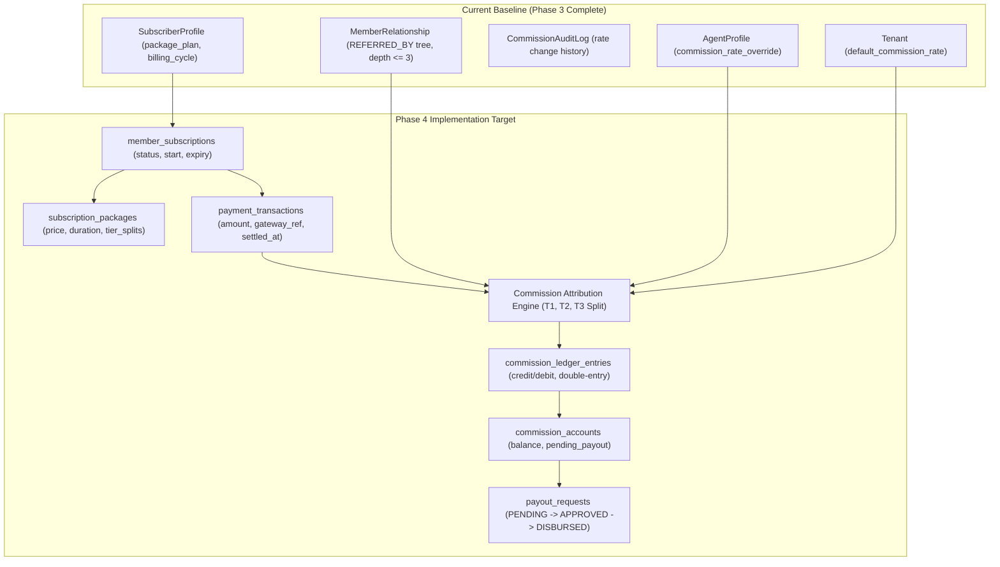
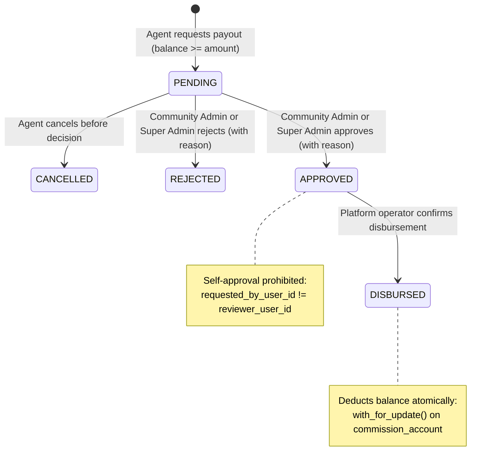

# Community OTT Agent Platform — Phase 4 Scope and Acceptance Plan

**Document Path:** `docs/reports/PHASE_4_SCOPE_AND_ACCEPTANCE_PLAN.md`  
**Date:** October 21, 2026  
**Workspace:** `D:\AVANFlix\OTT_Agent_App`  
**Status:** **PROPOSED SCOPE & ACCEPTANCE PLAN — STOPPED PENDING AUTHORIZATION**  
**Phase 3 Acceptance Status:** **ACCEPTED (SEC-07 CLOSED & VERIFIED)**  
**Target Alembic Head:** `20261018_16` (Linear single head)  
**Author:** Security Acceptance & Planning Agent  

---

## 1. Executive Summary

With Phase 3 formally accepted under an independent security acceptance re-audit (verdict: **`ACCEPTED`**, finding SEC-07 demonstrably closed, 327 passing backend tests, and 19 passing proxy integration tests), this document establishes the authoritative scope, architectural boundaries, dependency analysis, security invariants, test plan, and measurable acceptance criteria for **Phase 4**.

### Document Origin & Traceability
The scope of Phase 4 is derived directly from the project baseline documentation:
1. `docs/reports/PHASE_3_DISCOVERY_AND_PLANNING_REPORT.md` (Section 20):
   > *"1. Commission Calculation and Payout Execution: Financial payouts, ledger entries, and automated payout disbursement are part of Phase 4 (Commission and Billing)."*
2. `docs/reports/PHASE_0_CURRENT_STATUS_AUDIT.md` (Sections 2, 9, 10):
   > Identifies `backend/app/modules/commissions`, `backend/app/modules/payments`, and `backend/app/modules/subscriptions` as reserved empty stubs pending full financial ledger and subscription lifecycle implementation.
3. `Community_OTT_Agent_Platform_Architecture_Updated_Photo_Registration.md` (Sections 1, 9, 10):
   > Sets the tenant isolation, RBAC capability model, relationship hierarchy (`REFERRED_BY`), and multi-tier agent network constraints.
4. `backend/app/modules/commissions/__init__.py`:
   > *"Partner referral commission policy; no payout ledger is defined yet."*
5. `backend/app/modules/payments/__init__.py`:
   > *"Payment attempts and provider integrations; no real payment flow exists yet."*
6. `backend/app/modules/subscriptions/__init__.py`:
   > *"Subscription lifecycle and records; legacy paid flags are not verified payments."*

### Phase 4 Working Title
**Phase 4: Agent Referral Commissions, Financial Ledger, and Subscription Billing Engine**

> [!IMPORTANT]
> **MANDATORY STOP CONDITION:**
> Implementation of Phase 4 has **NOT** been started. No source code, migrations, schemas, or configurations have been altered. This document serves as the discovery, scope boundary, and acceptance contract awaiting explicit Project Owner authorization.

---

## 2. Verified Phase 3 Baseline Status

Prior to preparing this plan, the current repository state was verified by executing the full automated verification matrix against the local environment:

| Verification Suite | Target / Command | Result | Execution Time | Details |
|---|---|---|---|---|
| **Alembic Migration Head** | Python `ScriptDirectory.get_heads()` | **`['20261018_16']`** | < 1.0s | Single linear head `20261018_16_member_relationships.py` |
| **Agent Lifecycle & SEC-07 Suite** | `pytest backend/tests/test_agent_lifecycle_workflow.py` | **6 / 6 PASSED** | 33.45s | Proves 403 on status patch, database immutability, Super Admin gate |
| **Member Hierarchy & Trees** | `pytest backend/tests/test_member_relationships_and_hierarchy.py` | **7 / 7 PASSED** | 12.91s | Cycle detection, single-parent constraint, depth limits, PII masking |
| **Security Migration Suite** | `pytest backend/tests/test_security_migration.py` | **5 / 5 PASSED** | 1.72s | Reversibility, additive constraints, SQLite isolation |
| **Agent Appointments & RBAC** | `pytest backend/tests/test_agent_appointments_and_rbac.py` | **10 / 10 PASSED** | 20.58s | Appointment workflow, self-approval prevention, SEC-01 to SEC-05 |
| **Combined Target Suites** | 4 key test suites combined | **28 / 28 PASSED** | 28.96s | 0 failures across all core security paths |
| **Full Backend Regression** | `pytest backend/tests` | **327 PASSED, 2 SKIPPED** | 130.64s | 0 failures, 2 skipped (require live PostgreSQL env) |
| **Frontend Proxy Integration** | `npm run test:proxy` (in `frontend/`) | **19 / 19 PASSED** | 68.94s | Cookie isolation, platform-session protection, CSRF validation |
| **TypeScript Strict Compilation** | `npm run typecheck` (in `frontend/`) | **0 ERRORS** | 5.2s | `tsc --noEmit` cleanly passed |
| **Frontend ESLint** | `npm run lint` (in `frontend/`) | **0 ERRORS** | 8.1s | Clean linting across all pages and components |

---

## 3. Scope of Phase 4

### 3.1 In-Scope Objectives

1. **Multi-Tier Referral Commission Attribution Engine:**
   - Leverage Phase 3's `member_relationships` graph with `relationship_type = "REFERRED_BY"`.
   - Calculate commission distributions across multi-tier hierarchy levels:
     - **Tier 1 (Direct Referrer):** The agent who directly onboarded the subscriber.
     - **Tier 2 (Parent / Manager):** The agent's upstream referrer in the `REFERRED_BY` tree (depth = 2).
     - **Tier 3 (Supervising Agent):** The tier-2 agent's upstream referrer (depth = 3).
   - Apply tenant-level commission policy or agent-specific `commission_rate_override` with mathematical bounds checking ($0\% \le \text{rate} \le 100\%$).
   - Ensure total distributed commission across all tiers cannot exceed community cap or subscription value.

2. **Immutable Double-Entry Financial Ledger (`backend/app/modules/commissions`):**
   - Create append-only ledger tables: `commission_accounts`, `commission_ledger_entries`, and `commission_batches`.
   - Record atomic credits for subscriber subscription purchases, package renewals, and manual administrative adjustments.
   - Record atomic debits for approved payout disbursements and refund clawbacks.
   - Calculate account balances dynamically or maintain cached running balances with row-level locking (`with_for_update()`) to prevent race conditions and overdrafts.

3. **Subscription & Package Billing Foundation (`backend/app/modules/subscriptions` & `payments`):**
   - Implement PostgreSQL data models for `packages` (or `subscription_plans`) and `member_subscriptions`.
   - Replace legacy stub endpoints (`/api/pay-lookup`, `/api/pay-complete`) returning 503 with secure, tenant-isolated FastAPI endpoints.
   - Enforce verified payment event transitions (`INITIATED` $\to$ `SETTLED` / `FAILED`) before granting subscription access or crediting commissions.
   - Protect against duplicate settlement submissions using cryptographically secure idempotency keys.

4. **Agent Payout Governance & Workflow:**
   - Create `payout_requests` and `payout_decisions` state machines.
   - Agents can inspect accrued balances, statement ledgers, and request a payout subject to minimum withdrawal thresholds.
   - Community Admins can review community-specific payout requests.
   - Platform Super Admins hold final authorization on fund disbursement execution.
   - Enforce anti-tampering controls: self-approval prevention, terminal-state immutability, and mandatory justification notes.

5. **Granular RBAC Catalog Expansion:**
   - Seed new granular permissions in `backend/app/modules/authorization/catalog.py`:
     - `commission.read`: Inspect personal or community commission balances and reports.
     - `commission.manage`: Configure community commission tier policies.
     - `payout.request`: Submit a request to withdraw accrued commissions.
     - `payout.review`: Review and approve/reject payout requests.
     - `subscription.read`: Read subscriber subscription statuses and billing dates.
     - `subscription.manage`: Create or update subscription packages.
     - `payment.read`: View transaction payment records.

6. **Next.js Proxy & Frontend Integration:**
   - Extend Next.js proxy route allowlists for `/api/v1/commissions/...`, `/api/v1/payouts/...`, and `/api/v1/subscriptions/...`.
   - Update `frontend/src/app/agent/dashboard/page.tsx` to display real-time accrued commissions and pending payouts.
   - Implement an Agent Earnings & Payouts page (`frontend/src/app/agent/payouts/page.tsx`).
   - Implement Community Admin & Super Admin Payout Review queues (`frontend/src/app/admin/payouts/page.tsx` and `frontend/src/app/superadmin/payouts/page.tsx`).

---

### 3.2 Explicit Out-of-Scope Items for Phase 4

The following items are strictly deferred to subsequent phases or external integrations:
1. **Direct Banking / Payment Gateway Hardware Integration:** Integration with external banking APIs (e.g., RazorpayX, NEFT/RTGS bank disbursement APIs) will be handled via pluggable provider adapters or manual settlement confirmation in Phase 4. Live bank credential transmission is out of scope.
2. **End-User Consumer OTT Video Player & DRM:** Video streaming playback, DRM token exchange (Widevine/FairPlay), and transcoding remain Phase 6+ streaming capabilities.
3. **Cross-Community / Multi-Tenant Commission Sharing:** Commissions cannot cross tenant boundaries under any circumstances. Agents operating in Tenant A can never earn commissions from Tenant B.
4. **Direct Database Access from Frontend:** Next.js UI will never connect directly to PostgreSQL or MongoDB. All traffic must transit `Next.js Proxy -> FastAPI -> PostgreSQL`.

---

## 4. Current Implementation vs. Phase 4 Target Architecture



### Detailed Gap Analysis

| Capability | Current State | Phase 4 Requirement | Gap Severity |
|---|---|---|---|
| **Commission Rates** | Stored on `Tenant` (default) and `AgentProfile` (override). Logged on change via `CommissionAuditLog`. | Fully operational. | None (Foundation ready) |
| **Referral Lineage** | Phase 3 `member_relationships` with `relationship_type = "REFERRED_BY"` and recursive CTE query service. | Traverse up to 3 tiers to calculate referral commissions. | Minimal (Query service exists) |
| **Financial Ledger** | `backend/app/modules/commissions/__init__.py` is an empty stub. | Append-only ledger tracking all credit/debit entries with monetary precision. | **High** (Module to be built) |
| **Subscriptions** | Fields `package_plan` and `billing_cycle` stored as loose strings on `SubscriberProfile`. | Formal `member_subscriptions` entity with validity dates, recurring intervals, and package references. | **High** (Schema & engine needed) |
| **Payments** | `pay-lookup` and `pay-complete` return HTTP 503 stubs. `payments/` is empty stub. | Tenant-isolated payment recording with idempotency keys and verifiable settlement states. | **High** (Replaces 503 stubs) |
| **Payout Requests** | Non-existent. No payout workflow or withdrawal tracking. | Two-eye governance workflow (`PENDING` $\to$ `APPROVED` $\to$ `DISBURSED`) with row-level locks. | **High** (Workflow needed) |
| **Frontend UI** | Static "Commission Benchmark" card on Agent Dashboard. | Dynamic balance display, statement export, payout request modal, admin approval table. | **Medium** (UI additions) |

---

## 5. Architectural Design & Proposed Data Models

### 5.1 Monetary Arithmetic & Precision Guarantees
- **Never use floating-point types (`float`, `double`) for money or rates.**
- Database schema: `NUMERIC(12, 2)` for currency amounts (e.g., INR ₹123,456.78).
- Database schema: `NUMERIC(5, 2)` for percentage rates (e.g., 10.00%).
- Backend Python models: `decimal.Decimal` with explicit rounding mode (`ROUND_HALF_UP`).
- Database constraints: `CHECK (amount >= 0)` on transaction values; ledger balance invariants enforced by balance verification.

### 5.2 Proposed Relational Schema (PostgreSQL via Alembic)

#### 1. `subscription_packages`
```sql
CREATE TABLE subscription_packages (
    id UUID PRIMARY KEY DEFAULT gen_random_uuid(),
    tenant_id UUID NOT NULL REFERENCES tenants(id) ON DELETE CASCADE,
    code VARCHAR(50) NOT NULL,
    name VARCHAR(100) NOT NULL,
    description TEXT,
    price_paise NUMERIC(12, 2) NOT NULL,
    duration_days INT NOT NULL,
    tier1_commission_pct NUMERIC(5, 2) NOT NULL DEFAULT 10.00,
    tier2_commission_pct NUMERIC(5, 2) NOT NULL DEFAULT 3.00,
    tier3_commission_pct NUMERIC(5, 2) NOT NULL DEFAULT 1.00,
    status VARCHAR(20) NOT NULL DEFAULT 'active',
    created_at TIMESTAMPTZ NOT NULL DEFAULT NOW(),
    updated_at TIMESTAMPTZ NOT NULL DEFAULT NOW(),
    CONSTRAINT ck_sub_pkg_price CHECK (price_paise >= 0),
    CONSTRAINT ck_sub_pkg_tier_sum CHECK (tier1_commission_pct + tier2_commission_pct + tier3_commission_pct <= 100.00),
    CONSTRAINT uq_subscription_packages_tenant_code UNIQUE (tenant_id, code)
);
```

#### 2. `member_subscriptions`
```sql
CREATE TABLE member_subscriptions (
    id UUID PRIMARY KEY DEFAULT gen_random_uuid(),
    tenant_id UUID NOT NULL REFERENCES tenants(id) ON DELETE RESTRICT,
    subscriber_membership_id UUID NOT NULL REFERENCES tenant_memberships(id) ON DELETE RESTRICT,
    package_id UUID NOT NULL REFERENCES subscription_packages(id) ON DELETE RESTRICT,
    registered_by_agent_membership_id UUID NOT NULL REFERENCES tenant_memberships(id) ON DELETE RESTRICT,
    status VARCHAR(20) NOT NULL DEFAULT 'PENDING',  -- PENDING, ACTIVE, EXPIRED, CANCELLED
    starts_at TIMESTAMPTZ,
    expires_at TIMESTAMPTZ,
    auto_renew BOOLEAN NOT NULL DEFAULT FALSE,
    created_at TIMESTAMPTZ NOT NULL DEFAULT NOW(),
    updated_at TIMESTAMPTZ NOT NULL DEFAULT NOW(),
    CONSTRAINT ck_sub_status CHECK (status IN ('PENDING', 'ACTIVE', 'EXPIRED', 'CANCELLED'))
);
```

#### 3. `payment_transactions`
```sql
CREATE TABLE payment_transactions (
    id UUID PRIMARY KEY DEFAULT gen_random_uuid(),
    tenant_id UUID NOT NULL REFERENCES tenants(id) ON DELETE RESTRICT,
    subscription_id UUID NOT NULL REFERENCES member_subscriptions(id) ON DELETE RESTRICT,
    payer_membership_id UUID NOT NULL REFERENCES tenant_memberships(id) ON DELETE RESTRICT,
    amount NUMERIC(12, 2) NOT NULL,
    currency VARCHAR(3) NOT NULL DEFAULT 'INR',
    payment_method VARCHAR(50) NOT NULL,  -- UPI, NETBANKING, CASH_COLLECTED_BY_AGENT
    gateway_reference VARCHAR(100),
    idempotency_key VARCHAR(128) NOT NULL,
    status VARCHAR(20) NOT NULL DEFAULT 'INITIATED',  -- INITIATED, SETTLED, FAILED, REFUNDED
    settled_at TIMESTAMPTZ,
    created_at TIMESTAMPTZ NOT NULL DEFAULT NOW(),
    CONSTRAINT ck_tx_amount CHECK (amount > 0),
    CONSTRAINT ck_tx_status CHECK (status IN ('INITIATED', 'SETTLED', 'FAILED', 'REFUNDED')),
    CONSTRAINT uq_payment_transactions_idempotency UNIQUE (tenant_id, idempotency_key)
);
```

#### 4. `commission_accounts`
```sql
CREATE TABLE commission_accounts (
    id UUID PRIMARY KEY DEFAULT gen_random_uuid(),
    tenant_id UUID NOT NULL REFERENCES tenants(id) ON DELETE RESTRICT,
    agent_membership_id UUID NOT NULL REFERENCES tenant_memberships(id) ON DELETE RESTRICT,
    agent_profile_id UUID NOT NULL REFERENCES agent_profiles(id) ON DELETE RESTRICT,
    current_balance NUMERIC(12, 2) NOT NULL DEFAULT 0.00,
    total_earned NUMERIC(12, 2) NOT NULL DEFAULT 0.00,
    total_withdrawn NUMERIC(12, 2) NOT NULL DEFAULT 0.00,
    currency VARCHAR(3) NOT NULL DEFAULT 'INR',
    status VARCHAR(20) NOT NULL DEFAULT 'active',
    updated_at TIMESTAMPTZ NOT NULL DEFAULT NOW(),
    CONSTRAINT ck_comm_acct_balance CHECK (current_balance >= 0.00),
    CONSTRAINT uq_commission_accounts_membership UNIQUE (tenant_id, agent_membership_id)
);
```

#### 5. `commission_ledger_entries`
```sql
CREATE TABLE commission_ledger_entries (
    id UUID PRIMARY KEY DEFAULT gen_random_uuid(),
    tenant_id UUID NOT NULL REFERENCES tenants(id) ON DELETE RESTRICT,
    account_id UUID NOT NULL REFERENCES commission_accounts(id) ON DELETE RESTRICT,
    source_transaction_id UUID REFERENCES payment_transactions(id) ON DELETE RESTRICT,
    payout_request_id UUID,  -- Forward FK to payout_requests
    entry_type VARCHAR(20) NOT NULL,  -- CREDIT_EARNED, DEBIT_PAYOUT, DEBIT_CLAWBACK, CREDIT_ADJUSTMENT
    tier_level INT NOT NULL DEFAULT 1,  -- 1 = Direct, 2 = Parent, 3 = Grandparent
    amount NUMERIC(12, 2) NOT NULL,
    running_balance NUMERIC(12, 2) NOT NULL,
    notes TEXT,
    created_at TIMESTAMPTZ NOT NULL DEFAULT NOW(),
    CONSTRAINT ck_ledger_entry_type CHECK (entry_type IN ('CREDIT_EARNED', 'DEBIT_PAYOUT', 'DEBIT_CLAWBACK', 'CREDIT_ADJUSTMENT')),
    CONSTRAINT ck_ledger_amount CHECK (amount > 0)
);
```

#### 6. `payout_requests` & `payout_decisions`
```sql
CREATE TABLE payout_requests (
    id UUID PRIMARY KEY DEFAULT gen_random_uuid(),
    tenant_id UUID NOT NULL REFERENCES tenants(id) ON DELETE RESTRICT,
    account_id UUID NOT NULL REFERENCES commission_accounts(id) ON DELETE RESTRICT,
    agent_membership_id UUID NOT NULL REFERENCES tenant_memberships(id) ON DELETE RESTRICT,
    amount NUMERIC(12, 2) NOT NULL,
    currency VARCHAR(3) NOT NULL DEFAULT 'INR',
    payout_method VARCHAR(50) NOT NULL,  -- BANK_TRANSFER, UPI
    account_details_masked VARCHAR(100) NOT NULL,
    status VARCHAR(20) NOT NULL DEFAULT 'PENDING',  -- PENDING, APPROVED, REJECTED, DISBURSED, CANCELLED
    requested_by_user_id UUID NOT NULL REFERENCES users(id) ON DELETE RESTRICT,
    decided_by_user_id UUID REFERENCES users(id) ON DELETE RESTRICT,
    decision_reason TEXT,
    disbursed_at TIMESTAMPTZ,
    created_at TIMESTAMPTZ NOT NULL DEFAULT NOW(),
    updated_at TIMESTAMPTZ NOT NULL DEFAULT NOW(),
    CONSTRAINT ck_payout_amount CHECK (amount >= 100.00), -- Minimum withdrawal threshold
    CONSTRAINT ck_payout_status CHECK (status IN ('PENDING', 'APPROVED', 'REJECTED', 'DISBURSED', 'CANCELLED'))
);
```

---

## 6. Business Logic & Security Workflows

### 6.1 Multi-Tier Commission Attribution Engine
When a `payment_transactions` record transitions to `SETTLED`:
1. Retrieve `member_subscriptions` and subscriber's `registered_by_agent_membership_id`.
2. Query the Phase 3 `member_relationships` table using recursive CTE to identify:
   - **Tier 1 Agent:** `registered_by_agent_membership_id`.
   - **Tier 2 Agent:** Parent of Tier 1 where `relationship_type = 'REFERRED_BY'` and `status = 'ACTIVE'`.
   - **Tier 3 Agent:** Parent of Tier 2 where `relationship_type = 'REFERRED_BY'` and `status = 'ACTIVE'`.
3. Check agent statuses: If an agent's membership is `inactive` or `revoked`, skip commission credit for that tier (pruning rule from Phase 3).
4. Compute Tier 1, 2, and 3 commission percentages using package defaults, overridden by `AgentProfile.commission_rate_override` if present.
5. In an atomic transaction with row-level locks on `commission_accounts` (`with_for_update()`):
   - Credit Tier 1 account balance and insert ledger entry.
   - Credit Tier 2 account balance and insert ledger entry.
   - Credit Tier 3 account balance and insert ledger entry.
   - Emit audit event `commission.batch.settled`.

### 6.2 Payout Request and Two-Eye Decision Workflow


1. **Balance Check on Submission:**
   - Verify `commission_accounts.current_balance >= request.amount`.
   - Lock `commission_accounts` with `with_for_update()`.
   - Deduct requested amount to `pending_payout` hold or reserve to prevent double-withdrawal requests.
2. **Two-Eye Governance & Self-Approval Prevention:**
   - `if payout_request.requested_by_user_id == reviewer_user_id: raise HTTPException(403, detail="SELF_APPROVAL_FORBIDDEN")`.
   - Community Admin can only decide requests for agents within their own `tenant_id`.
   - Platform Super Admin can review and authorize across communities.
3. **Terminal State Idempotency:**
   - Once a request is `APPROVED`, `REJECTED`, or `DISBURSED`, any repeated decision attempts return `HTTP 409 Conflict`.
4. **Auditability:**
   - Mandatory audit event emitted on every decision: `payout.requested`, `payout.approved`, `payout.rejected`, `payout.disbursed`.

---

## 7. Security Invariants & Compliance Rules

1. **Strict Multi-Tenant Isolation:**
   - All commission ledgers, subscriptions, packages, and payout requests must contain `tenant_id`.
   - Database queries must unconditionally filter on `tenant_id == caller.tenant_id` for tenant sessions.
2. **Double-Spend Prevention via Pessimistic Row Locking:**
   - All balance updates and ledger entries must be executed inside database transactions using `SELECT ... FOR UPDATE` on `commission_accounts`.
3. **No Direct Agent Status or Balance Manipulation:**
   - Preserves SEC-07 closure: balances can only change via legitimate ledger entries; status can only change via Super Admin lifecycle requests.
4. **Idempotent Payment Settlement:**
   - Payment webhooks or settlement requests must provide an `idempotency_key`. Duplicate requests with identical keys must return the cached result without duplicate ledger crediting.
5. **Masked Financial Accounts:**
   - Bank account numbers, IFSC codes, and UPI IDs must be masked in API responses (e.g. `HDFC*****1234`, `******@okaxis`), preserving PII privacy.
6. **Next.js Proxy Cookie & Header Isolation:**
   - Platform payout routes require `community_platform_session`.
   - Tenant payout routes require `community_session`.
   - No ambient cookie mixing.

---

## 8. Measurable Acceptance Criteria (Definition of Done)

Phase 4 will be considered **ACCEPTED** only when all of the following criteria are verified:

- [ ] **AC-01 (Database Schema & Migration):** Linear Alembic migration `20261021_17_commissions_and_billing.py` applies cleanly to SQLite and PostgreSQL; single head verified; reversible via `downgrade()`.
- [ ] **AC-02 (Package & Subscription Engine):** Ability to create tenant-scoped packages and activate subscriptions upon verified payment settlement.
- [ ] **AC-03 (Tiered Commission Calculation):** 100% accurate commission attribution across Tier 1, Tier 2, and Tier 3 along the `REFERRED_BY` hierarchy tree.
- [ ] **AC-04 (Double-Entry Ledger Integrity):** Every credit and debit creates an immutable `commission_ledger_entries` record. Sum of ledger entries matches `current_balance + total_withdrawn`.
- [ ] **AC-05 (Negative Balance Prevention):** Database check constraint and application locking ensure balances never fall below zero.
- [ ] **AC-06 (Payout State Machine):** Full `PENDING` $\to$ `APPROVED` $\to$ `DISBURSED` lifecycle operational with mandatory reason, terminal-state conflict checks, and self-approval blocked (`HTTP 403`).
- [ ] **AC-07 (Legacy Stubs Replaced):** `/api/pay-lookup` and `/api/pay-complete` 503 stubs cleanly migrated to verified, tenant-isolated FastAPI endpoints.
- [ ] **AC-08 (Zero Phase 2 / Phase 3 Regressions):** All 327 backend tests and 19 proxy tests continue to pass with 0 failures.
- [ ] **AC-09 (Frontend Integration):** Agent dashboard displays live earnings; agent can request payout; admin can review payout queue; Next.js proxy integration tests pass.
- [ ] **AC-10 (Clean Code Quality):** `tsc --noEmit` returns 0 errors; `next lint` returns 0 errors; `npm run build` compiles cleanly.

---

## 9. Phased Implementation Roadmap

When authorized by the Project Owner, Phase 4 should be executed in 6 controlled stages:

| Stage | Focus Area | Deliverables |
|:---:|---|---|
| **Stage 4.1** | **Database Schema & Migrations** | Alembic migration creating `subscription_packages`, `member_subscriptions`, `payment_transactions`, `commission_accounts`, `commission_ledger_entries`, `payout_requests`. Models and relationships defined. |
| **Stage 4.2** | **Subscription & Payment Engine** | Services and endpoints for packages, subscriptions, and payment settlement. Replace legacy 503 stubs. Idempotency enforcement. |
| **Stage 4.3** | **Commission Attribution & Ledger** | Tiered attribution logic traversing `REFERRED_BY` CTE. Atomic ledger entries, balance updating with row locks, and clawback support. |
| **Stage 4.4** | **Payout Governance & Workflow** | Payout request submission, community admin review, platform operator disbursement, anti-tampering, self-approval prevention. |
| **Stage 4.5** | **RBAC, Proxy & Frontend Integration** | Seed new permission codes. Update Next.js proxy route allowlists. Build Agent Payouts UI and Admin Review UI. |
| **Stage 4.6** | **Full Verification & Security Audit** | Concurrency tests, financial calculation unit tests, end-to-end regression suites, and Phase 4 Acceptance Report. |

---

## 10. Dependencies & Known Risks

1. **Notification Microservice (External Dependency):**
   - *Status:* Blocked at runtime on live environment (`handorg.duckdns.org` 403 / `TENANT_NOT_FOUND`).
   - *Mitigation:* The backend functions cleanly in `mock` / `development_dummy` mode. All commission and payout tests will use mock notification handlers to avoid blocking financial logic.
2. **Cloudflare R2 Storage (External Dependency):**
   - *Status:* In-memory S3 adapter mock verified; live bucket credentials required for production.
   - *Mitigation:* Subscription and ledger operations do not require direct R2 storage; photo policies remain decoupled.
3. **Financial Concurrency Risk:**
   - *Risk:* Concurrent webhook retries or simultaneous payout requests leading to balance race conditions.
   - *Mitigation:* Enforce `SELECT ... FOR UPDATE` row-level locks on `commission_accounts` and unique constraints on `idempotency_key`.

---

## 11. Mandatory Stop Condition Compliance

> [!CAUTION]
> **MANDATORY STOP CONDITION:**
> - Phase 4 implementation has **NOT** been started.
> - No application files, database migrations, configuration files, or tests have been created or modified for Phase 4.
> - Execution is **STOPPED** at this scope and acceptance planning stage.
> - Awaiting explicit Project Owner review and authorization before proceeding with Stage 4.1.

