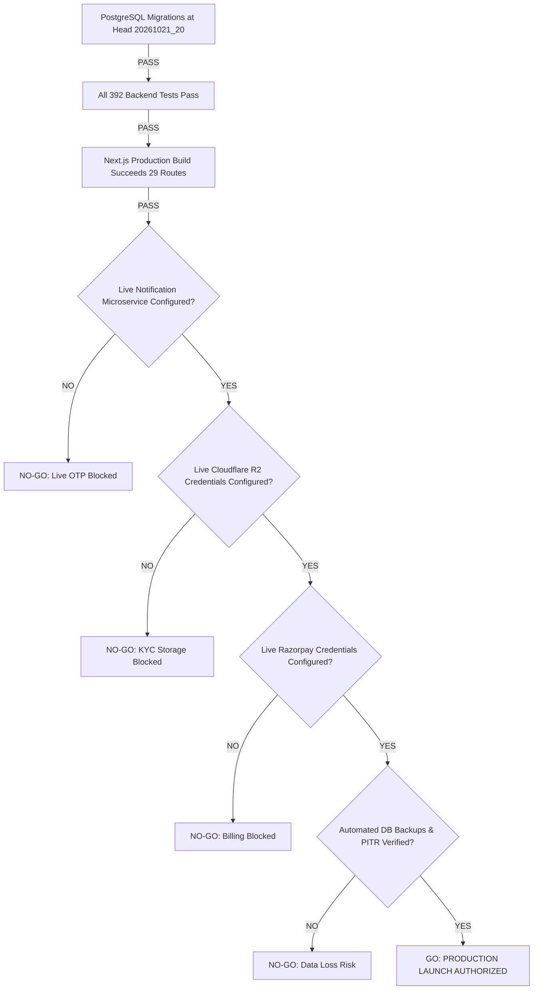

# Community OTT Agent Platform — Production Readiness Gap Analysis

**Workspace:** `D:\AVANFlix\OTT_Agent_App`  
**Date:** October 22, 2026  
**Auditor:** Automated System Audit & Security Verification Framework  
**Scope:** 12 Core Production Operational Areas, Security/Financial Risk Analysis, Release Blockers & Go/No-Go Decision Criteria  
**Status:** `AUDITED — LAUNCH GATED BY EXTERNAL PREREQUISITES`  

---

## 1. Executive Summary

This document performs an exhaustive gap analysis across all twelve critical operational dimensions required for production deployment of the **Community OTT Agent Platform**.

While the software development phases (Phases 1 through 4) have produced an enterprise-grade backend, an immutable double-entry financial ledger, and a protected Next.js proxy architecture with **392 passed backend tests** and **21 passed proxy tests**, live production launch is currently **gated** by specific external service configurations, infrastructure setup, operational playbooks, and legacy code decommissioning.

---

## 2. Detailed Audit Across 12 Production Readiness Areas

### 1. PostgreSQL Connectivity, Migrations & Backup / Recovery Arrangements
- **Current State:**
  - Database schema is fully managed via Alembic with a single linear head: `20261021_20 (head)`.
  - SQLAlchemy 2.0 connection pool is configured with `pool_pre_ping=True`, `pool_size=10`, `max_overflow=20`, and SSL connection support.
  - Zero MongoDB dependency on the backend.
- **Production Gaps:**
  - **No Automated Backup Configuration:** There are no automated `pg_dump` cron jobs, continuous archiving (WAL-G / pgBackRest), or point-in-time recovery (PITR) scripts in the repository.
  - **No Read Replica / High Availability Configuration:** Primary database connection string is single-node.
- **Risk Assessment:** High operational risk of data loss in disaster scenarios until automated daily snapshots and WAL streaming are established.

---

### 2. Cloudflare R2 Configuration & Storage Access Controls
- **Current State:**
  - S3-compatible adapter implemented in `backend/app/modules/registration_photos/storage.py` using `boto3`.
  - Mocked storage adapter (`MockedR2Storage`) fully tested and operational in automated test suites.
  - Authenticated streaming endpoint `/api/v1/storage/{object_id}/preview` prevents public exposure of KYC photos (Aadhaar, PAN, registration photos).
- **Production Gaps:**
  - **Missing Live Bucket Credentials:** `R2_ACCOUNT_ID`, `R2_ACCESS_KEY_ID`, `R2_SECRET_ACCESS_KEY`, and `R2_BUCKET_NAME` are unpopulated in `.env.example`.
  - **Lifecycle Rules:** Bucket lifecycle policies (e.g., auto-archiving unconfirmed temporary uploads after 24 hours) are not codified in infrastructure-as-code.
- **Risk Assessment:** High release blocker. Image KYC and document uploads will fail closed in production until real R2 bucket credentials are supplied.

---

### 3. Production Environment Variables & Secret Management
- **Current State:**
  - Pydantic Settings (`backend/app/core/config.py`) securely handles environment variables with `SecretStr` masking for all passwords, encryption keys, and tokens.
  - PII encryption uses authenticated AES-256-GCM (`IDENTITY_ENCRYPTION_KEY`).
  - Zero hardcoded secrets detected in source files.
- **Production Gaps:**
  - **Secret Rotation & Vault Integration:** Secrets are currently sourced directly from a local `.env` file on disk rather than an external secrets manager (e.g., AWS Secrets Manager, HashiCorp Vault, Doppler).
  - **Key Generation Playbook:** No documented procedure for initial generation of `IDENTITY_ENCRYPTION_KEY` (32 bytes urlsafe base64) and `PLATFORM_OIDC_TRANSACTION_ENCRYPTION_KEY`.
- **Risk Assessment:** Medium operational risk. A formal secret generation and rotation guide is required prior to launch.

---

### 4. HTTPS, Domain Configuration & Reverse Proxy / Ingress
- **Current State:**
  - Multi-tenant domain resolution (`hostname.py`) supports wildcard subdomains (e.g., `community-a.avanflix.com`) and custom domains with database TXT challenge verification.
  - Next.js custom server (`frontend/server.cjs`) handles hostname forwarding and scrubs OIDC callback queries.
- **Production Gaps:**
  - **Production Ingress Configuration Missing:** No Nginx, Traefik, Caddy, or Cloudflare Tunnel configuration file exists in the repository.
  - **TLS Termination:** Backend requires `FRONTEND_ORIGINS=https://...` in production. A production reverse proxy must terminate TLS and provide trusted proxy headers (`X-Forwarded-For`, `X-Forwarded-Proto`) while configuring `TRUSTED_PROXY_CIDRS`.
- **Risk Assessment:** Medium release blocker. Ingress reverse proxy configuration is required before exposing services to the internet.

---

### 5. OTP, Email, WhatsApp & Notification Service Dependencies
- **Current State:**
  - Backend integration client authored in `backend/app/modules/messaging/notification_service.py`.
  - Sliding-window rate limiting (anti-abuse) and anti-enumeration protections (HTTP 202) fully tested.
  - Graceful fallback to `development_dummy` mode (`123456`) in development.
- **Production Gaps:**
  - **External Service Blocker:** The configured external Notification Microservice (`http://handorg.duckdns.org/notifications`) fails with HTTP 403 on `/notifications/api/v1/messages` and `400 TENANT_NOT_FOUND` on `/api/v1/messages`.
  - **Production SMS / WhatsApp Gateway Provisioning:** Live SMS or WhatsApp delivery requires valid tenant provisioning and API credentials in the Notification Microservice.
- **Risk Assessment:** **Critical P0 Release Blocker**. Without live OTP delivery, real users cannot log in or register unless dummy OTP is left enabled (which is strictly prohibited in production).

---

### 6. Razorpay Production Configuration & Webhook Security
- **Current State:**
  - Server-side order creation converting rupees to exact integer paise.
  - Cryptographic signature verification via HMAC-SHA256 (`order_id|payment_id`).
  - Webhook event deduplication via database idempotency keys.
  - 14/14 tests passing in `test_razorpay_payments_and_settlement.py`.
- **Production Gaps:**
  - **Production Credentials:** `RAZORPAY_KEY_ID`, `RAZORPAY_KEY_SECRET`, and `RAZORPAY_WEBHOOK_SECRET` are unconfigured.
  - **Webhook URL Registration:** Production webhook URL (`https://<domain>/backend-api/api/v1/payments/webhook`) must be registered in the Razorpay merchant dashboard with enabled events: `order.paid`, `payment.captured`, `payment.failed`.
- **Risk Assessment:** **Critical P0 Release Blocker**. Real payments cannot be processed without live merchant credentials.

---

### 7. Financial Ledger Reconciliation & Payout Operational Controls
- **Current State:**
  - Immutable append-only double-entry ledger (`commission_accounts`, `commission_journals`, `commission_ledger_entries`).
  - Strict mathematical reconciliation: $\sum \text{Debits} == \sum \text{Credits}$ across all journals.
  - Anti-self-approval enforcement (`SELF_APPROVAL_PROHIBITED`).
  - Compensating reversals for rejected, failed, or cancelled payouts.
  - Platform Super Admin disbursement with mandatory UTR tracking.
- **Production Gaps:**
  - **Automated Nightly Reconciliation Job:** While the reconciliation logic exists in test suites (`test_phase4_end_to_end_integration.py`), no scheduled cron job or operational health check runs nightly to verify total system balance across all accounts.
  - **Live Banking Rail Integration:** Bank disbursement is confirmed manually via UTR entry. Automated disbursement via bank APIs (e.g. RazorpayX) is not implemented.
- **Risk Assessment:** Low financial risk; operational controls are strong. An automated nightly ledger integrity audit script should be scheduled.

---

### 8. Authentication, Session Security, CSRF, RBAC & Tenant Isolation
- **Current State:**
  - `HttpOnly`, `SameSite=Lax`, `Secure` cookies partitioned between tenant (`community_session`) and platform operator (`community_platform_session`).
  - CSRF validation enforced on all state-mutating requests (`X-CSRF-Token`).
  - RBAC catalog with 34 granular permissions.
  - Strict multi-tenant logical partitioning via composite foreign keys and SQL filtering.
  - SEC-07 remediation prevents legacy agent status bypass.
- **Production Gaps:**
  - **Production Platform OIDC IdP:** Enterprise OIDC IdP (Okta, Google Workspace, Azure AD) credentials for Platform Super Admins must be provisioned.
- **Risk Assessment:** Low security risk. The security baseline is thoroughly audited and compliant with SEC-01 through SEC-07.

---

### 9. Structured Logging, Audit Trails & Monitoring
- **Current State:**
  - JSON-formatted structured logging via `app.core.logging`.
  - Request IDs generated and propagated across frontend proxy and backend (`request_id_context`).
  - Sensitive fields (Aadhaar, PAN, passwords, OIDC callback query tokens) redacted from logs.
  - Mandatory audit events recorded in PostgreSQL `audit_events` table.
- **Production Gaps:**
  - **Centralized Log Aggregator:** Logs currently output to standard output (`stdout`). No shipped configuration for Loki, ELK, Datadog, or CloudWatch.
  - **APM & Alerting:** No Prometheus metrics endpoint (`/metrics`) or Sentry error tracking integration.
- **Risk Assessment:** Medium operational risk. A centralized log shipper and error alert channel should be provisioned for production monitoring.

---

### 10. Frontend Production Build & Legacy Code Decommissioning
- **Current State:**
  - Next.js 15 production build succeeds cleanly (`npm run build`, Exit code 0, 29 routes).
  - TypeScript strict typecheck clean (0 errors).
  - ESLint clean (0 errors / 0 warnings).
  - Proxy integration tests pass (21 / 21).
- **Production Gaps:**
  - **Legacy MongoDB Surface Remains:** `frontend/src/app/api/` contains 10 legacy Next.js API routes importing `@/lib/repo` and `@/lib/mongodb`. `Overview.tsx` contains legacy fetches.
  - While `mongodb-initialization.test.mjs` verifies safe fail-closed behavior when `MONGODB_URI` is unconfigured, these legacy files and the `mongodb` npm dependency should be completely excised before release.
- **Risk Assessment:** Low security risk, but creates operational confusion. Excising legacy MongoDB files will achieve 100% architectural cleanliness.

---

### 11. CI/CD Pipeline, Automated Release Gates & Rollback Playbooks
- **Current State:**
  - Local virtual environments and test scripts function seamlessly.
  - Single linear Alembic migration chain supports deterministic upgrades and downgrades.
- **Production Gaps:**
  - **No CI/CD Pipeline:** No `.github/workflows/` or GitLab CI configuration exists to automatically run pytest, frontend typecheck, lint, and build on pull requests.
  - **No Automated Deployment Scripts:** No Dockerfiles, Docker Compose, Kubernetes manifests, or Helm charts in the repository.
  - **No Written Rollback Playbook:** No step-by-step operational runbook for executing database migration downgrades or blue-green traffic switching.
- **Risk Assessment:** High operational risk for deployment consistency. A standardized GitHub Actions workflow and Docker containerization are needed.

---

### 12. End-to-End Workflows & User Acceptance Testing (UAT)
- **Current State:**
  - Backend integration test suite covers 14-step financial workflow and all edge cases.
  - Proxy integration test suite covers all proxy routes and security headers.
- **Production Gaps:**
  - **Staging User Acceptance Testing:** End-to-end browser walkthrough in a staging environment with real human actors (Super Admin, Community Admin, Agent, Subscriber) has not been formally conducted.
- **Risk Assessment:** Medium risk. Human UAT on a staging environment is required before commercial customer onboarding.

---

## 3. Comprehensive Risk & Blocker Matrix

| Blocker ID | Severity | Category | Description | Mitigation / Prerequisite |
| :--- | :---: | :--- | :--- | :--- |
| **BLK-01** | **P0 (Critical)** | External Service | Live Notification Microservice unreachable; live SMS/WhatsApp OTP delivery fails. | Provision tenant and route on Notification Microservice; obtain production API key. |
| **BLK-02** | **P0 (Critical)** | External Service | Cloudflare R2 credentials unconfigured; live KYC photo/document uploads fail. | Provision Cloudflare R2 bucket and supply `R2_ACCESS_KEY_ID`, `R2_SECRET_ACCESS_KEY`, etc. |
| **BLK-03** | **P0 (Critical)** | External Service | Razorpay live merchant credentials unconfigured; real subscription checkout cannot execute. | Provision live Razorpay account; configure `RAZORPAY_KEY_ID`, `RAZORPAY_KEY_SECRET`, and webhook secret. |
| **BLK-04** | **P1 (High)** | Operations | Database backup and PITR disaster recovery arrangement absent. | Implement automated daily `pg_dump` cron jobs and WAL streaming to offsite storage. |
| **BLK-05** | **P1 (High)** | DevOps | CI/CD pipeline automation and containerization (Docker/Nginx) missing. | Author GitHub Actions workflow for automated test gates and Dockerfile for deployment. |
| **BLK-06** | **P2 (Medium)** | Architecture | Legacy MongoDB API routes and `@/lib/repo` remain embedded in frontend. | Completely delete unused legacy `/api/` routes and remove `mongodb` npm dependency. |
| **BLK-07** | **P2 (Medium)** | Operations | Centralized logging aggregator and error alerting unconfigured. | Connect standard JSON logs to centralized APM (e.g., Datadog, CloudWatch, or Grafana Loki). |

---

## 4. Go / No-Go Launch Decision Criteria

The Community OTT Agent Platform must not be deployed to commercial production until all **P0 Critical Blockers** are resolved and verified against the following criteria:

### Mandatory Launch Criteria Checklist:
- [x] Backend automated test suite passing 100% (392 passed, 2 skipped).
- [x] Financial ledger double-entry reconciliation verified 100% ($\sum \text{Debits} == \sum \text{Credits}$).
- [x] Frontend Next.js production build cleanly compiled (29 routes).
- [x] Security controls SEC-01 through SEC-07 active and verified.
- [ ] **[NO-GO BLOCKER]** Live Notification Microservice connected and verified for live OTP.
- [ ] **[NO-GO BLOCKER]** Live Cloudflare R2 bucket provisioned and authenticated.
- [ ] **[NO-GO BLOCKER]** Live Razorpay merchant account keys and webhook secret configured.
- [ ] **[NO-GO BLOCKER]** Automated PostgreSQL backup scripts and recovery testing completed.
- [ ] **[NO-GO BLOCKER]** Production TLS reverse proxy (Nginx/Cloudflare) configured with trusted proxy CIDRs.
- [ ] **[OPERATIONAL CLEANUP]** Legacy MongoDB routes and npm dependency removed from frontend.

**Current Overall Launch Verdict:** `NO-GO (PENDING EXTERNAL SERVICE PROVISIONING)`

