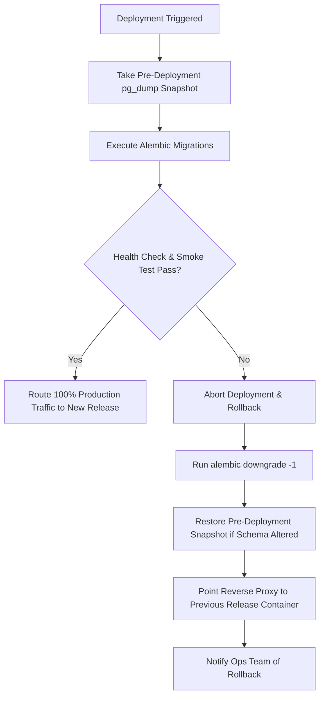

# Community OTT Agent Platform — Stage 5.0 Deployment Hardening Plan

**Workspace:** `D:\AVANFlix\OTT_Agent_App`  
**Date:** October 22, 2026  
**Auditor:** Automated System Audit & Architecture Verification Framework  
**Scope:** Actionable Implementation Plan for Production Blockers, Infrastructure Hardening & Deployment Automation  
**Status:** `PLANNING PROPOSED — STRICT READ-ONLY MODE (AWAITING OWNER AUTHORIZATION)`  

---

## 1. Executive Summary

This deployment hardening plan defines the concrete technical steps, responsible parties, exact configuration requirements, verification commands, and realistic effort ranges needed to resolve the production blockers identified in `STAGE_5_0_PRODUCTION_BLOCKER_AUDIT.md`.

All activities are structured into four prioritized tracks:
1. **Track 1 (P0): External Services & Production Credentials**
2. **Track 2 (P1): Operational Infrastructure & Legacy Code Cleanup**
3. **Track 3 (P2): Staging Verification & Deep Concurrency Testing**
4. **Track 4 (P3): Continuous Monitoring & Financial Integrity Operations**

> [!NOTE]
> All effort ranges provided in this document are engineering estimates for planning purposes. External vendor approval timelines (e.g., Razorpay KYC or Cloudflare account activation) are outside direct engineering control. Total engineering effort is estimated at **3 to 6 business days**.

---

## 2. Prioritized Implementation Tracks

### Track 1: External Services & Production Credentials (P0 — Critical Blockers)

#### 1.1 Notification Microservice Tenant Provisioning & Verification
- **Objective:** Establish live mobile SMS/WhatsApp OTP delivery so real users can authenticate without development dummy codes.
- **Responsible Party:** Platform Operations / External Microservice Administrator.
- **Required Owner Decisions:**
  - Confirm production messaging provider URL and acquire API access key.
  - Approve tenant ID assignment for Community OTT Platform in external routing service.
- **Implementation Steps:**
  1. Obtain provisioned tenant identifier and API key from external microservice administrator.
  2. Configure environment variables in production vault:
     ```env
     NOTIFICATION_SERVICE_BASE_URL="https://messaging.avanflix.com"
     NOTIFICATION_SERVICE_API_KEY="<production_secret_key>"
     OTP_DELIVERY_MODE="notification_service"
     DEVELOPMENT_STATIC_OTP_ENABLED="false"
     ```
  3. Ensure `development_dummy` mode fails closed if attempted in production or staging.
- **Proposed Future Verification Commands:**
  ```powershell
  # Test live OTP request against staging endpoint
  curl.exe -X POST "https://staging.avanflix.com/backend-api/api/v1/auth/otp/request" `
    -H "Content-Type: application/json" `
    -d '{"mobile_e164": "+919876543210"}'
  # Verify delivery receipt, expiration timestamp, and rate limiting
  ```
- **Estimated Effort:** 4 – 8 hours.

---

#### 1.2 Cloudflare R2 Live Bucket Provisioning & Configuration
- **Objective:** Enable durable, encrypted private cloud object storage for agent KYC photos, Aadhaar/PAN identity documents, and support attachments.
- **Responsible Party:** Cloud Infrastructure Engineer / DevOps.
- **Required Owner Decisions:**
  - Create Cloudflare R2 bucket named `avanflix-community-ott-prod`.
  - Issue S3-compatible API token with Object Read & Write permissions.
- **Implementation Steps:**
  1. Provision private R2 bucket in Cloudflare dashboard (block public access).
  2. Populate environment variables in production vault:
     ```env
     R2_ACCOUNT_ID="<cloudflare_account_id>"
     R2_ACCESS_KEY_ID="<r2_access_key_id>"
     R2_SECRET_ACCESS_KEY="<r2_secret_access_key>"
     R2_BUCKET_NAME="avanflix-community-ott-prod"
     R2_ENDPOINT_URL="https://<cloudflare_account_id>.r2.cloudflarestorage.com"
     R2_REGION="auto"
     ```
  3. Verify `CloudflareR2Storage` initializes and interacts via `boto3` SigV4.
- **Proposed Future Verification Commands:**
  ```powershell
  # Execute R2 integration test suite against live test bucket
  python -m pytest backend/tests/test_registration_photos.py -k "test_r2_live_upload" -v
  ```
- **Estimated Effort:** 2 – 4 hours.

---

#### 1.3 Razorpay Production Merchant Account & Webhook Activation
- **Objective:** Enable real-world Indian digital payment collection (UPI, Cards, Netbanking) for subscription billing and package purchases.
- **Responsible Party:** Finance / Merchant Account Administrator & Backend Lead.
- **Required Owner Decisions:**
  - Complete business KYC on Razorpay Dashboard to activate live merchant status.
  - Generate live Key ID and Key Secret.
  - Configure production webhook URL and generate Webhook Secret.
- **Implementation Steps:**
  1. Set production environment credentials:
     ```env
     RAZORPAY_KEY_ID="rzp_live_<key_id>"
     RAZORPAY_KEY_SECRET="<live_key_secret>"
     RAZORPAY_WEBHOOK_SECRET="<live_webhook_secret>"
     RAZORPAY_MODE="live"
     ```
  2. Register webhook URL in Razorpay Dashboard:
     - URL: `https://<domain>/backend-api/api/v1/payments/webhook`
     - Subscribed Events: `payment.captured`, `payment.failed`, `order.paid`
  3. Validate HMAC-SHA256 signature verification in `RazorpayClientAdapter`.
- **Proposed Future Verification Commands:**
  ```powershell
  # Run payment regression suite in test mode, then verify live test transaction
  python -m pytest backend/tests/test_razorpay_payments_and_settlement.py -v
  ```
- **Estimated Effort:** 3 – 6 hours.

---

### Track 2: Operational Infrastructure & Legacy Code Cleanup (P1 — Pre-Launch Required)

#### 2.1 Complete Decommissioning of Legacy MongoDB & Frontend Route Excision
- **Objective:** Eliminate dead legacy code, remove unneeded npm dependencies, and ensure 100% of frontend traffic flows through PostgreSQL-backed `/backend-api/` routes.
- **Responsible Party:** Frontend Engineer.
- **Implementation Steps:**
  1. Refactor remaining callers to use `/backend-api/`:
     - Update `frontend/src/components/Overview.tsx` to call `/backend-api/api/v1/platform/` or admin routes.
     - Update `frontend/src/components/ExistingUsersTab.tsx` to call `/backend-api/api/v1/agents/subscribers`.
     - Update `frontend/src/app/pay/[token]/page.tsx` to use `/backend-api/api/v1/subscriptions/pay`.
  2. Remove legacy routes in `frontend/src/app/api/`:
     - Delete `activity/`, `auth/admin-login/`, `auth/employee-otp/`, `auth/logout/`, `employee-profile/`, `employees/`, `packages/`, `pay-complete/`, `pay-lookup/`, `support/`, `users/`, and `me/`.
  3. Delete `frontend/src/lib/repo.ts` and `frontend/src/lib/mongodb.ts`.
  4. Uninstall `mongodb` package:
     ```powershell
     cd frontend
     npm uninstall mongodb
     npm prune
     ```
  5. Remove `mongodb-initialization.test.mjs` or adapt to verify absence of MongoDB.
- **Proposed Future Verification Commands:**
  ```powershell
  cd frontend
  npm run build
  npm run test:proxy
  # Verify zero occurrences of "mongodb" or "@/lib/repo" in src/
  grep -rn "mongodb" src/
  ```
- **Estimated Effort:** 4 – 6 hours.

---

#### 2.2 PostgreSQL Automated Backups, Point-in-Time Recovery & DR Playbook
- **Objective:** Guarantee database durability, daily automated backups, offsite encrypted replication, and verified recovery procedures.
- **Responsible Party:** DevOps / Database Administrator.
- **Implementation Steps:**
  1. Create automated backup script `scripts/backup_postgres.sh`:
     - Performs `pg_dump -Fc` (custom format with compression).
     - Computes SHA-256 checksum of the backup archive.
     - Encrypts archive using GPG or symmetric AES-256 before upload.
     - Synchronizes archive to private Cloudflare R2 backup bucket (`avanflix-db-backups`).
     - Enforces 30-day retention policy (prunes older archives).
  2. Configure automated cron job / Windows Scheduled Task:
     - Full daily backup at 02:00 UTC.
     - WAL archiving enabled for 15-minute RPO Point-in-Time Recovery.
  3. Author formal Disaster Recovery Playbook:
     - Document in `docs/operations/DISASTER_RECOVERY_PLAYBOOK.md`.
     - Provide step-by-step restoration commands and verification checks.
- **Proposed Future Verification Commands:**
  ```powershell
  # Execute test backup and verify checksum
  ./scripts/backup_postgres.sh --test
  # Test restoration into staging database
  ./scripts/restore_postgres.sh --backup <test_archive> --target-db avanflix_staging
  ```
- **Estimated Effort:** 6 – 10 hours.

---

#### 2.3 Production Reverse Proxy, TLS Ingress & Wildcard Subdomain Routing
- **Objective:** Provide secure TLS termination, HTTP/2 performance, wildcard community subdomain routing (`*.avanflix.com`), and security header enforcement.
- **Responsible Party:** DevOps / Network Security Engineer.
- **Implementation Steps:**
  1. Author production Nginx configuration template (`deploy/nginx/community_ott.conf`):
     - Listen on 443 with TLS 1.3 and modern cipher suites.
     - Enforce HSTS (`max-age=63072000; includeSubDomains; preload`).
     - Configure Let's Encrypt automated certificate renewal (DNS-01 challenge for wildcard `*.avanflix.com`).
     - Proxy requests for `/backend-api/` to Next.js custom server (or backend directly if isolated).
     - Pass real client IP and headers (`X-Forwarded-For`, `X-Forwarded-Proto`, `Host`).
  2. Author backend trusted proxy middleware:
     - Configure FastAPI to trust specific upstream proxy CIDRs.
- **Proposed Future Verification Commands:**
  ```powershell
  # Validate Nginx syntax
  nginx -t -c deploy/nginx/community_ott.conf
  # Test TLS handshake and cipher grade
  curl.exe -Iv https://staging.avanflix.com
  ```
- **Estimated Effort:** 4 – 8 hours.

---

#### 2.4 CI/CD Pipeline Automation (.github/workflows)
- **Objective:** Establish continuous integration gatekeeping so every commit and PR is automatically verified before deployment.
- **Responsible Party:** DevOps / Backend Lead.
- **Implementation Steps:**
  1. Author `.github/workflows/ci.yml`:
     - Stage 1: Backend Lint & Typecheck (ruff, mypy).
     - Stage 2: Backend Pytest Suite (392 tests with SQLite/Postgres in CI matrix).
     - Stage 3: Alembic Migration Linear Head Verification (`alembic check`).
     - Stage 4: Frontend Lint, Typecheck, and Production Compilation (`npm run build`).
     - Stage 5: Frontend Proxy Integration Test Suite (`npm run test:proxy`).
  2. Author `.github/workflows/deploy_staging.yml`:
     - Automated deployment to staging upon merge to `main`.
  3. Provide standardized `Dockerfile` and `docker-compose.yml` for containerized runtime.
- **Proposed Future Verification Commands:**
  ```powershell
  # Simulate CI locally using act or direct runners
  gh workflow run ci.yml
  ```
- **Estimated Effort:** 4 – 8 hours.

---

### Track 3: Staging Verification & Concurrency Testing (P2 — Pre-Release Gates)

#### 3.1 Live Staging User Acceptance Testing Walkthrough
- **Objective:** Perform manual human verification across all 12 core platform user journeys in a production-identical staging environment.
- **Responsible Party:** QA Lead, Product Owner, Community Admin representative.
- **Implementation Steps:**
  - Execute all 12 test scenarios defined in `STAGE_5_0_STAGING_UAT_AND_RELEASE_CHECKLIST.md`.
  - Capture transaction IDs, UTR numbers, R2 object keys, and audit log entries as evidence.
- **Estimated Effort:** 8 – 16 hours.

---

#### 3.2 Multi-Threaded PostgreSQL Concurrency Run
- **Objective:** Verify database transaction isolation, optimistic/pessimistic locking, and race-condition immunity under concurrent member activations and payout requests.
- **Responsible Party:** Backend Engineer.
- **Implementation Steps:**
  - Execute `test_activation_postgres.py` with multi-threaded workers on a live PostgreSQL staging database.
  - Verify that concurrent attempts to activate the same tenant or disburse the same payout fail closed with clean conflict exceptions (`HTTP 409 Conflict`).
- **Estimated Effort:** 2 – 4 hours.

---

### Track 4: Operational Resilience & Continuous Auditing (P3 — Post-Launch)

#### 4.1 Automated Nightly Ledger Integrity Reconciliation Cron
- **Objective:** Run an automated nightly balance reconciliation to guarantee that total debits equal total credits across all accounts in every tenant ($\sum \text{Debits} == \sum \text{Credits}$).
- **Responsible Party:** Backend Engineer.
- **Implementation Steps:**
  1. Author scheduled CLI command `backend/app/commands/reconcile_ledger.py`.
  2. Query all `commission_journals` and verify zero-sum invariant.
  3. If any discrepancy is detected, dispatch high-priority alert to Sentry and security operations team.
- **Estimated Effort:** 2 – 4 hours.

---

#### 4.2 Centralized Telemetry, Sentry APM & Health Alerting
- **Objective:** Provide instant exception alerting, latency tracking, and proactive outage detection.
- **Responsible Party:** DevOps / Full Stack Lead.
- **Implementation Steps:**
  1. Integrate Sentry SDK in FastAPI (`sentry-sdk[fastapi]`) and Next.js (`@sentry/nextjs`).
  2. Configure uptime probe polling `/backend-api/api/v1/health` every 60 seconds with PagerDuty / Slack webhooks.
- **Estimated Effort:** 2 – 4 hours.

---

## 3. Rollback, Backup & Recovery Strategy



### Rollback Protocol:
1. **Database Pre-Migration Snapshot:** Prior to running any migration in production, an automated snapshot `pre_deploy_<timestamp>.dump` must be generated.
2. **Atomic Container Swapping:** Production deployments must use blue/green or rolling container replacement so old containers remain healthy until the new container passes `/backend-api/api/v1/health`.
3. **Emergency Downgrade Command:**
   ```powershell
   alembic downgrade -1
   ```
4. **Configuration Secrets Rollback:** Secret changes in environment vaults must retain previous version history for instant 1-click reversal.

---

## 4. Resource Allocation & Timeline Summary

| Track | Focus Area | Priority | Estimated Hours | Target Timeline |
| :--- | :--- | :---: | :---: | :---: |
| **Track 1** | External Services (Notifications, R2, Razorpay) | **P0** | 9 – 18 hrs | Day 1 – Day 2 |
| **Track 2** | DevOps, Backups, TLS & Legacy Mongo Excision | **P1** | 18 – 32 hrs | Day 2 – Day 4 |
| **Track 3** | Staging UAT & Concurrency Verification | **P2** | 10 – 20 hrs | Day 4 – Day 5 |
| **Track 4** | Monitoring, Nightly Reconciliation & Alerts | **P3** | 4 – 8 hrs | Day 5 – Day 6 |
| **Total** | **Full Production Hardening & Release** | — | **41 – 78 hrs** | **~5 Business Days** |

