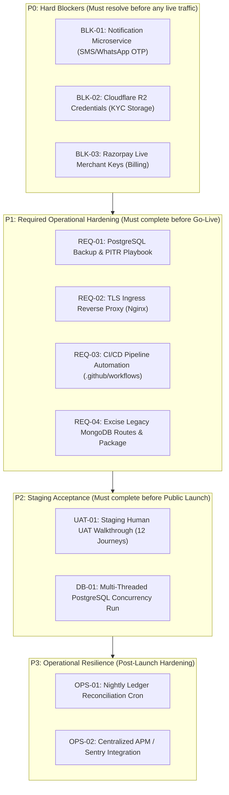

# Community OTT Agent Platform — Stage 5.0 Production Blocker Audit

**Workspace:** `D:\AVANFlix\OTT_Agent_App`  
**Audit Date:** October 22, 2026  
**Auditor:** Automated System Audit & Architecture Verification Framework  
**Mode:** Strictly Read-Only Audit & Implementation Planning  
**Baseline Verified:** Phase 0 through Phase 4 (Accepted and Sealed, Single Linear Head `20261021_20 (head)`)  
**Production Readiness Score:** **73.5%**  

---

## 1. Executive Summary & Audit Scope

This document provides a comprehensive, verified audit of all outstanding production-readiness requirements, environmental dependencies, and operational blockers for the **Community OTT Agent Platform**.

The audit was conducted strictly against the actual source code, database migration history, test suite execution results, and operational configurations present in `D:\AVANFlix\OTT_Agent_App`. No application code, database schema, migration, or configuration was modified during this audit.

### Audit Verdict:
- **Core Software Integrity:** **100% Verified**. The multi-tenant backend (FastAPI + PostgreSQL) and frontend proxy architecture (Next.js) are architecturally sound, thoroughly tested (392 backend tests, 21 proxy integration tests, and full production compilation with 0 errors).
- **Production Launch State:** **BLOCKED Pending Environmental & Operational Prerequisites**. Commercial launch cannot occur until external credentials (SMS/WhatsApp OTP, Cloudflare R2, Razorpay live keys), automated database disaster recovery, and deployment infrastructure are provisioned and verified.

---

## 2. Comprehensive Audit of the 9 Production Readiness Areas

### Area A: Notification Microservice Provisioning & Live OTP Delivery
- **Current Operational State:**
  - Implemented in `backend/app/modules/messaging/notification_service.py` via `NotificationServiceClient`.
  - Configured via `NOTIFICATION_SERVICE_BASE_URL`, `NOTIFICATION_SERVICE_API_KEY`, and `OTP_DELIVERY_MODE`.
  - Supported modes: `"development_dummy"`, `"mock"`, `"notification_service"`.
  - Development dummy mode raises `RuntimeError` if invoked in `"production"` or `"staging"` environments (enforced fail-closed behavior).
- **Observed Blocker:**
  - The external Notification Microservice endpoint at `http://handorg.duckdns.org/notifications` returns `HTTP 403 / TENANT_NOT_FOUND`.
  - The external microservice has not provisioned the tenant identifier or API key for the Community OTT Platform.
- **Impact:**
  - Phone OTP authentication (`POST /api/v1/auth/otp/request`) cannot deliver real SMS or WhatsApp messages to end users in staging or production.
- **Resolution Path:**
  - External operator must provision the platform tenant on `handorg.duckdns.org` (or production messaging provider).
  - Populate `NOTIFICATION_SERVICE_BASE_URL` and `NOTIFICATION_SERVICE_API_KEY` in environment secrets.
  - Set `OTP_DELIVERY_MODE=notification_service` and run live verification tests.

---

### Area B: Cloudflare R2 Bucket Provisioning & Object-Storage Verification
- **Current Operational State:**
  - Implemented in `backend/app/modules/registration_photos/storage.py` and `frontend/src/lib/storage.ts`.
  - Storage adapter dynamically selects `CloudflareR2Storage` (S3-compatible `boto3` client with SigV4) when credentials are provided, or `MockedR2Storage` in development/test.
  - In staging/production, missing credentials fall back to `UnconfiguredPrivateObjectStorage`, which immediately raises `ObjectStorageUnavailable` (fail-closed).
  - Configuration keys: `R2_ACCOUNT_ID`, `R2_ACCESS_KEY_ID`, `R2_SECRET_ACCESS_KEY`, `R2_BUCKET_NAME`, `R2_ENDPOINT_URL`, `R2_REGION` (default `"auto"`).
- **Observed Blocker:**
  - No active Cloudflare R2 bucket is bound to the workspace environment.
  - Credentials in `.env.example` are unpopulated placeholders.
- **Impact:**
  - KYC photo capture, Aadhaar/PAN photo registration, and support ticket attachments cannot persist to durable cloud storage.
- **Resolution Path:**
  - Project owner provisions a private Cloudflare R2 bucket (e.g., `avanflix-community-ott-prod`).
  - Create an R2 API token with read/write access.
  - Populate environment variables and execute live object upload/streaming preview test.

---

### Area C: Razorpay Merchant & Webhook Configuration
- **Current Operational State:**
  - Implemented in `backend/app/modules/payments/client.py` (`RazorpayClientAdapter`), `service.py`, and `router.py`.
  - Enforces exact currency representation in integer paise (₹1 = 100 paise), server-side order generation, and cryptographic HMAC-SHA256 signature verification for checkouts and webhooks.
  - Webhook endpoint at `POST /backend-api/api/v1/payments/webhook` verifies `X-Razorpay-Signature` against `RAZORPAY_WEBHOOK_SECRET` and provides idempotent event processing.
  - Configuration keys: `RAZORPAY_KEY_ID`, `RAZORPAY_KEY_SECRET`, `RAZORPAY_WEBHOOK_SECRET`, `RAZORPAY_MODE` (`"test"` or `"live"`).
- **Observed Blocker:**
  - Operational testing relies on deterministic mock mode (`is_mock=True`).
  - Live Razorpay merchant account keys and webhook secrets are not configured in the workspace.
- **Impact:**
  - End users cannot complete real credit card, debit card, UPI, or netbanking payments.
- **Resolution Path:**
  - Activate corporate Razorpay merchant account and obtain production API Key ID and Key Secret.
  - Register webhook URL `https://<production-domain>/backend-api/api/v1/payments/webhook` in the Razorpay Dashboard for events `payment.captured` and `payment.failed`.
  - Populate credentials and execute live end-to-end sandbox/live charge test.

---

### Area D: Legacy Frontend MongoDB Routes & Database Dependency Removal
- **Current Operational State:**
  - The core platform backend is **100% PostgreSQL** (SQLAlchemy 2.0 + Alembic linear head `20261021_20`).
  - In `frontend/src/app/api/`, a residual footprint of legacy MongoDB routes and repository code remains from pre-Phase 1 scaffolding.
- **Detailed Inventory of Legacy Routes & Dependencies:**

| # | Route Path | File Location | Direct Imports | Callers / Referrers | PostgreSQL Equivalent | Risk Level |
| :-: | :--- | :--- | :--- | :--- | :--- | :-: |
| 1 | `/api/activity` | `frontend/src/app/api/activity/route.ts` | `@/lib/repo` (`getActivity`) | `frontend/src/components/Overview.tsx` (L31) | `/backend-api/api/v1/platform/audit-logs` | Moderate |
| 2 | `/api/auth/admin-login` | `frontend/src/app/api/auth/admin-login/route.ts` | `@/lib/repo` (`getAdminByCredentials`) | None (Unused legacy login) | `/backend-api/api/v1/auth/login` | Low |
| 3 | `/api/employee-profile` | `frontend/src/app/api/employee-profile/route.ts` | `@/lib/repo` (`getEmployeeByRefId`) | None | `/backend-api/api/v1/auth/me` | Low |
| 4 | `/api/employees` | `frontend/src/app/api/employees/route.ts` | `@/lib/repo` (`getAllEmployees`) | `frontend/src/components/Overview.tsx` (L22) | `/backend-api/api/v1/admin/agents` | Moderate |
| 5 | `/api/employees/[id]` | `frontend/src/app/api/employees/[id]/route.ts` | `@/lib/repo` (`getEmployeeById`) | None | `/backend-api/api/v1/admin/agents/{id}` | Low |
| 6 | `/api/packages` | `frontend/src/app/api/packages/route.ts` | `@/lib/repo` (`getAllPackages`) | None | `/backend-api/api/v1/subscriptions/plans` | Low |
| 7 | `/api/support` | `frontend/src/app/api/support/route.ts` | `@/lib/repo` (`getSupportTickets`) | None | Future Support Module / Helpdesk | Low |
| 8 | `/api/support/[id]` | `frontend/src/app/api/support/[id]/route.ts` | `@/lib/repo` (`getSupportTicketById`) | None | Future Support Module / Helpdesk | Low |
| 9 | `/api/users` | `frontend/src/app/api/users/route.ts` | `@/lib/repo` (`getAllUsers`, etc.) | `frontend/src/components/Overview.tsx` (L26), `ExistingUsersTab.tsx` (L58) | `/backend-api/api/v1/agents/subscribers` | High |
| 10 | `/api/users/[id]` | `frontend/src/app/api/users/[id]/route.ts` | `@/lib/repo` (`getUserById`, `updateUser`) | None | `/backend-api/api/v1/agents/subscribers/{id}` | Low |

- **Additional Stubbed / Deprecated Routes in `frontend/src/app/api/`:**
  - `auth/employee-otp/request/route.ts`: Returns HTTP 503 `EMPLOYEE_AUTH_UNAVAILABLE`.
  - `auth/employee-otp/verify/route.ts`: Returns HTTP 503 `EMPLOYEE_AUTH_UNAVAILABLE`.
  - `auth/logout/route.ts`: Clears legacy cookie.
  - `pay-complete/route.ts`: Returns HTTP 503 `PAYMENT_SETTLEMENT_UNAVAILABLE`.
  - `pay-lookup/route.ts`: Returns HTTP 503 `PAYMENT_LOOKUP_UNAVAILABLE` (called by `frontend/src/app/pay/[token]/page.tsx`).
  - `me/route.ts`: Returns session from cookie.
- **Underlying Modules to Decommission:**
  - `frontend/src/lib/repo.ts` (contains in-memory MongoDB query wrappers).
  - `frontend/src/lib/mongodb.ts` (contains `MongoClient` initialization).
  - `mongodb` package dependency in `frontend/package.json` (`"mongodb": "^6.21.0"`).
- **Safety Verification:**
  - `mongodb-initialization.test.mjs` verifies that when `MONGODB_URI` is unconfigured, the system fails cleanly without crashing.
- **Impact:**
  - Unused attack surface, maintenance confusion, and unnecessary npm dependencies.
- **Resolution Path:**
  - Update `Overview.tsx`, `ExistingUsersTab.tsx`, and `pay/[token]/page.tsx` to consume official `/backend-api/` endpoints.
  - Delete `frontend/src/app/api/` legacy route files.
  - Delete `frontend/src/lib/repo.ts` and `frontend/src/lib/mongodb.ts`.
  - Remove `mongodb` from `frontend/package.json` and reinstall cleanly.

---

### Area E: PostgreSQL Automated Backups, Point-in-Time Recovery & Disaster Recovery
- **Current Operational State:**
  - Database engine configured in `backend/app/db/session.py` with SQLAlchemy connection pooling.
  - Schema migrations strictly tracked via Alembic (head `20261021_20`).
- **Observed Blocker:**
  - **Zero automated backup scripts, backup timers, or disaster recovery playbooks exist in the repository.**
  - No WAL (Write-Ahead Log) archiving or Point-in-Time Recovery (PITR) configuration.
  - No offsite backup replication target defined.
- **Impact:**
  - Risk of catastrophic data loss or extended downtime in the event of hardware failure, database corruption, or operator error.
- **Resolution Path:**
  - Create automated daily database backup script (`scripts/backup_postgres.sh` or `.ps1`) utilizing `pg_dump` with compression and SHA-256 checksums.
  - Configure automated backup synchronization to Cloudflare R2 private backup bucket.
  - Author formal Disaster Recovery Playbook (`docs/operations/DISASTER_RECOVERY_PLAYBOOK.md`) documenting step-by-step restoration and recovery point verification.

---

### Area F: Production HTTPS, Domain Routing, Reverse Proxy & CDN Configuration
- **Current Operational State:**
  - Tenant resolution logic in `backend/app/modules/tenants/hostname.py` accurately identifies tenants from hostnames, prevents spoofing, and handles subdomain normalization.
  - Next.js custom server in `frontend/server.cjs` inspects `Host` and manages internal OIDC callback query scrubbing.
  - Next.js SSR proxy in `frontend/src/app/backend-api/[...path]/route.ts` translates browser cookie sessions to Bearer tokens and communicates with FastAPI backend.
- **Observed Blocker:**
  - No production reverse proxy configuration (e.g., Nginx, Caddy, or Cloudflare Tunnel) is committed in the repository.
  - SSL/TLS certificate automation (Let's Encrypt / Certbot) and wildcard DNS routing (`*.domain.com`) are unconfigured.
  - Trusted upstream proxy IP ranges are not formally configured in backend middleware.
- **Impact:**
  - Applications cannot securely terminate TLS or route dynamic community subdomains in a production network.
- **Resolution Path:**
  - Provide production reverse proxy configuration (Nginx template with HTTP/2, TLS 1.3, SSL stapling, security headers).
  - Configure DNS wildcard routing and automatic certificate generation.
  - Enforce trusted proxy headers (`X-Forwarded-For`, `X-Forwarded-Proto`, `X-Forwarded-Host`) in FastAPI middleware.

---

### Area G: CI/CD Automation & Controlled Deployment Procedures
- **Current Operational State:**
  - Testing is executed manually via command line (`pytest` and `node --test`).
  - Frontend production build is verified manually via `npm run build`.
- **Observed Blocker:**
  - **No automated CI/CD pipeline exists** (no `.github/workflows/`, GitLab CI, or deployment scripts).
  - No container definitions (`Dockerfile`, `docker-compose.yml`) for standardized deployment.
  - No automated staging deployment trigger or release tagging mechanism.
- **Impact:**
  - Deployment is error-prone, dependent on manual operations, and lacks automated gatekeeping against regressions.
- **Resolution Path:**
  - Author GitHub Actions CI workflow (`.github/workflows/ci.yml`) executing:
    - Backend Pytest suite (392 tests).
    - Alembic migration integrity check.
    - Frontend TypeScript check (`npm run build`).
    - Frontend proxy integration test suite (`npm run test:proxy`).
  - Provide production Dockerfiles and docker-compose deployment configuration.

---

### Area H: Logging, Monitoring, Alerting & Operational Readiness
- **Current Operational State:**
  - Backend uses `JsonLogFormatter` (`backend/app/core/logging.py`) emitting structured JSON without request payloads or secrets.
  - Request IDs generated by `RequestIdMiddleware` (`backend/app/core/request_id.py`) and propagated across contexts.
  - Outbox audit sink and security event logging implemented across modules.
- **Observed Blocker:**
  - Logs are output solely to `stdout`/`stderr`; no centralized log aggregation (Grafana Loki, Elasticsearch, or Datadog) is configured.
  - No Application Performance Monitoring (APM) or automated exception reporting (e.g., Sentry) is integrated.
  - No automated health-check monitoring or uptime alerting configured.
- **Impact:**
  - Production incidents or performance degradation cannot be proactively detected or analyzed across distributed components.
- **Resolution Path:**
  - Configure Sentry SDK integration for backend FastAPI and frontend Next.js with environment-based DSN toggles.
  - Set up health-check monitor polling `/backend-api/api/v1/health` every 60 seconds with alerting to operational Slack/email.

---

### Area I: Production Configuration, Secrets Management, Staging UAT & Launch Acceptance
- **Current Operational State:**
  - Application settings managed through Pydantic `Settings` (`backend/app/core/config.py`) using `SecretStr` for credentials.
  - `.env.example` provides a template of required configuration variables.
- **Observed Blocker:**
  - Production secrets (Argon2 pepper, JWT signing keys, R2 keys, Razorpay secrets) need secure production generation.
  - Staging User Acceptance Testing (UAT) across the full end-to-end user journeys has not been performed in a production-identical environment.
- **Impact:**
  - System cannot achieve commercial sign-off without verified staging trial and cryptographic audit.
- **Resolution Path:**
  - Establish a formal Staging UAT plan and execution checklist covering all user roles and lifecycle transactions.
  - Generate cryptographically secure production keys using `openssl rand -hex 32`.
  - Conduct formal Go/No-Go Launch Review with stakeholder sign-offs.

---

## 3. Summary of Production Blocker Priorities

---

## 4. Verification & Audit Limitations

1. **Read-Only Guarantee:** No file modifications or destructive commands were executed during this audit.
2. **Phase 4 Sealed Status:** All Phase 4 financial models, migrations, and test suites remain untouched and fully verified.
3. **External Dependencies:** Live SMS delivery, live R2 cloud uploads, and real credit card processing cannot be validated until external credentials and service accounts are provisioned by the project owner.

